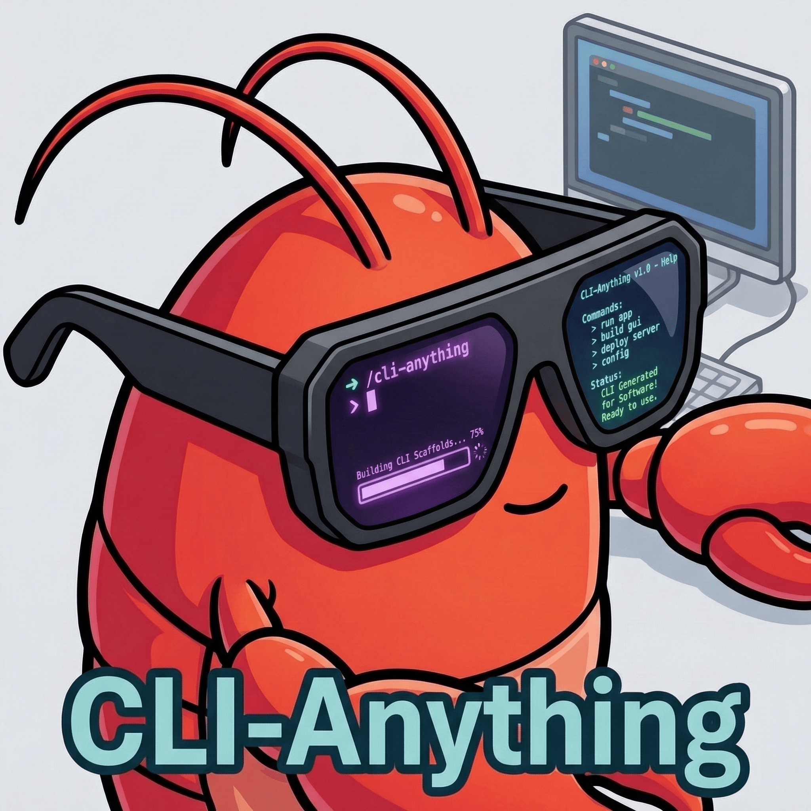
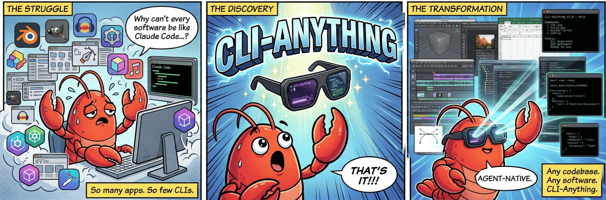
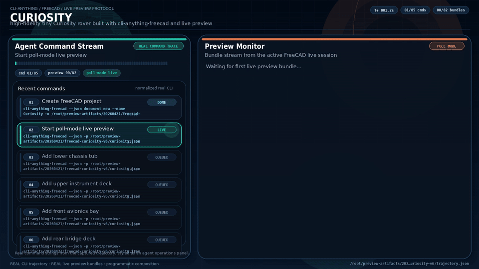
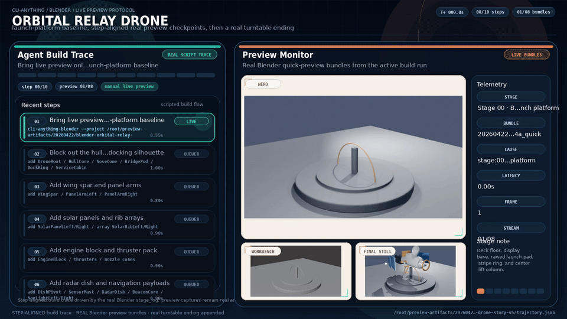
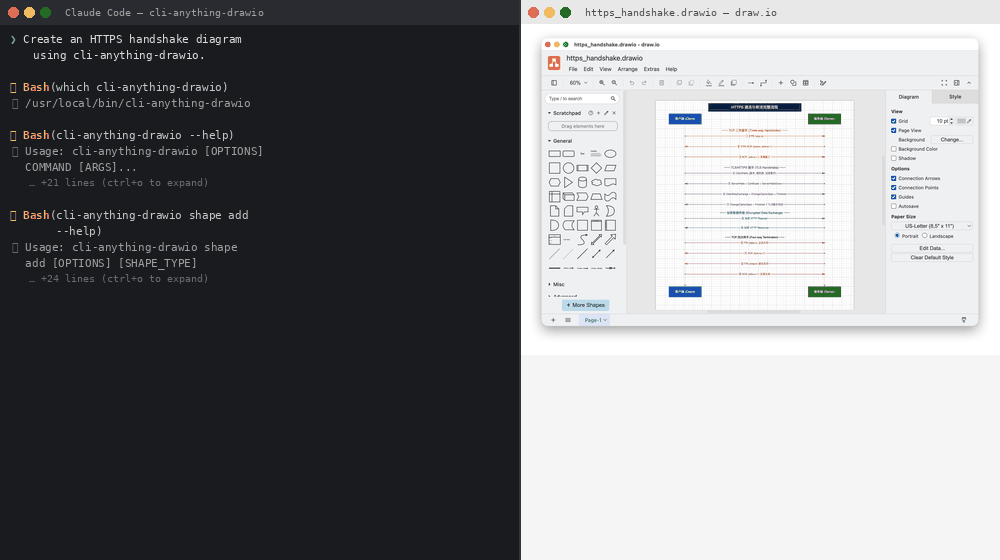
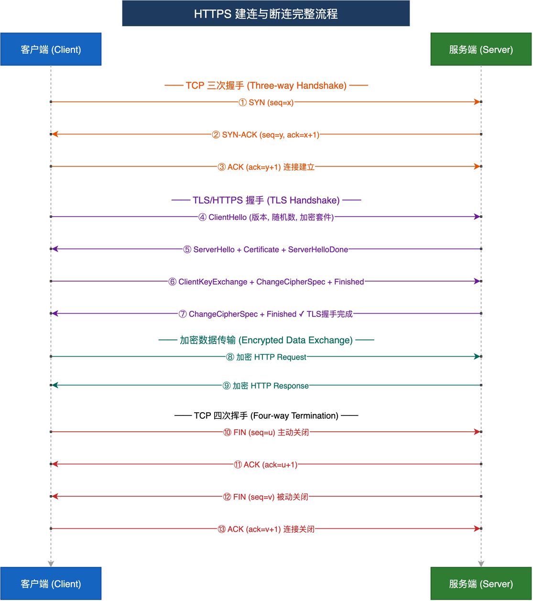
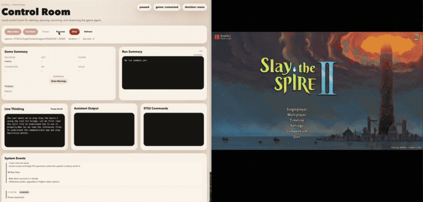
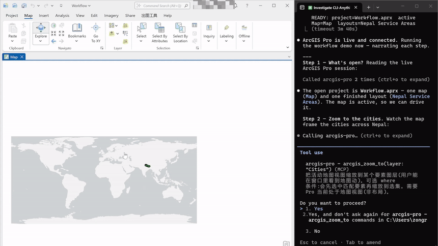
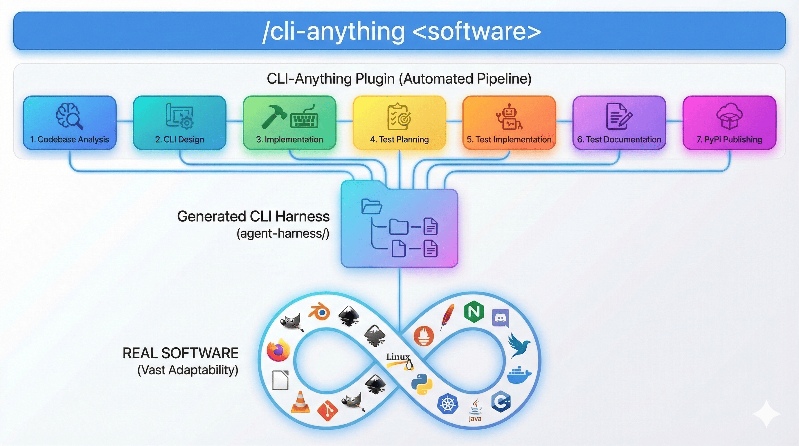

<h1 align="center">&nbsp; CLI-Anything: すべてのソフトウェアをエージェントネイティブに</h1>

<div align="center">
<a href="https://www.star-history.com/hkuds/cli-anything"><picture><source media="(prefers-color-scheme: dark)" srcset="https://api.star-history.com/badge?repo=HKUDS/CLI-Anything&amp;type=trending&amp;theme=dark"><source media="(prefers-color-scheme: light)" srcset="https://api.star-history.com/badge?repo=HKUDS/CLI-Anything&amp;type=trending"></picture></a>&#32;<a href="https://trendshift.io/repositories/22991" target="_blank"></a>&#32;<a href="https://www.star-history.com/hkuds/cli-anything"><picture><source media="(prefers-color-scheme: dark)" srcset="https://api.star-history.com/badge?repo=HKUDS/CLI-Anything&amp;type=rank&amp;theme=dark"><source media="(prefers-color-scheme: light)" srcset="https://api.star-history.com/badge?repo=HKUDS/CLI-Anything&amp;type=rank"></picture></a>
</div>

<p align="center">
  <strong>今日のソフトウェアは人間👨‍💻のためのもの。明日のユーザーはエージェント🤖。<br>
CLI-Anything: AIエージェントと世界のソフトウェアの架け橋</strong><br>
</p>

**🌐 [CLI-Hub](https://hkuds.github.io/CLI-Anything/)**: `pip install cli-anything-hub` のあと `cli-hub install <name>` — コミュニティが構築したすべてのCLIを探索、インストール、管理できます。自分のCLIを追加したいですか？[PRを送信](https://github.com/HKUDS/CLI-Anything/blob/main/CONTRIBUTING.md)してください — Hubは即座に更新されます。

**🎬 [デモを見る](#-実世界のデモ)**: AIエージェントが生成されたCLIに加え、プレビュー、ライブプレビュー、軌跡ループを使って、CADビルド、3Dシーン、図表、ゲームプレイ、字幕など、実際の成果物を生み出す様子をご覧ください。

**🙋 [コントリビューターになる、またはCLIをリクエストする]**: [参加する](https://github.com/HKUDS/CLI-Anything/issues/new?template=contributor-signup.yml)！新しいCLIハーネスの構築に登録してください — レビューとマージが完了すれば、コミュニティコントリビューターの一人としてアクセス権が得られます！CLI-Anythingに特定のソフトウェアやサービスへの対応を希望しますか？[ウィッシュリストリクエスト](https://github.com/HKUDS/CLI-Anything/issues/new?template=cli-wishlist.yml)を送信してください！

<p align="center">
  <a href="#-クイックスタート"></a>
  <a href="https://hkuds.github.io/CLI-Anything/"></a>
  <a href="#-デモンストレーション"></a>
  <a href="#-テスト結果"></a>
  <a href="https://arxiv.org/abs/2606.03854"></a>
  <a href="LICENSE"></a>
</p>

<p align="center">
  
  
  
  
  
  <a href="https://github.com/HKUDS/.github/blob/main/profile/README.md"></a>
<a href="https://github.com/HKUDS/.github/blob/main/profile/README.md"></a>
</p>

**ワンコマンド**: あらゆるソフトウェアをPi、OpenClaw、nanobot、Cursor、Claude Codeなどのエージェント対応に。&nbsp;&nbsp;[**English**](README.md) | [**中文文档**](README_CN.md) | [**Deutsch**](README_DE.md)

<p align="center">
  
</p>

<p align="center">
  
</p>

---

## 📰 ニュース

> コミュニティの皆様の貴重なご尽力に感謝します！さらなるアップデートが毎日続々と進行中です。

- **2026-05-30** 🧭 **Hermes skill** が提案されました（#320）。インストーラースクリプトとHARNESSフォールバックガイダンスを備えたCLI-Anythingオーケストレーションスキルを追加するものです。🗺️ **ArcGIS Pro** が公開レジストリ向けに提案されました（#318）。地図作成、地理処理、フィーチャ編集、ライブPro MCPワークフローに対応するWindows/ArcPy CLIです。

- **2026-05-27** 🔧 **CLI-Hub** のレジストリ日付更新が `python -m pip` インストールコマンドに対応しました（#312）。レジストリ自動化におけるパッケージ日付の検出が改善されました。

- **2026-05-23** 📝 **Obsidian Agent CLI** が公開レジストリ向けに提案されました（#307）。PyPIからインストールできるObsidian自動化CLIで、永続的なエージェントメモリワークフローと固定されたスキルリンクを備えています。

- **2026-05-21** 🔒 **Sketch CLI** のトークンファイル処理が、パストラバーサルやシンボリックリンクによる脱出に対して強化されました（#304）。

- **2026-05-20** 📓 **Joplin CLI** が提案されました（#300）。ノートブック、ノート、ToDo、タグ、添付ファイル、検索/同期、インポート/エクスポート、サーバー/E2EEヘルパー、完全なドキュメント、同梱のスキルドキュメントを備え、134件のテストによる検証ベースラインを備えています。

- **2026-05-20** 🎛️ **Rekordbox CLI** がマージされました（#252）。ガード付きのSQLCipher書き込みパス、バックアップ必須の強制書き込み、スモークカバレッジ、ルートスキル同期を備えています。📚 **Calibre CLI** がマージされました（#223）。ライブラリ/検索/メタデータ/変換/エクスポートのワークフロー、41件のユニットテスト、実際のCalibreによるE2Eの証跡、ルートスキル検証を備えています。🧊 **3MF CLI** がマージされました（#209）。メッシュ検査、穴のサイズ変更、修復、比較、三角形属性の保持に対応しています。🎙️ **MiniMax CLI** がマージされました（#189）。チャット/TTSワークフロー、JSONセーフなモデル/音声一覧、REPLの引用符処理、スモーク/E2Eカバレッジを備えています。🎮 **UEAtelier** がレジストリに加わりました（#297）。Python CLIプロキシを備えたUnreal Editor MCP自己拡張ワークベンチです。

- **2026-05-19** 🛠️ 既存のハーネスに品質/セキュリティ面の見直しが行われました — **Zoom** は直接URLからレコーディングをダウンロードできるようになり（#294）、**Obsidian** の検索はLocal REST APIのベンダーコンテンツタイプを使うようになり（#289）、**LibreOffice** のヘッドレス変換はmacOSでより堅牢になり（#290）、XML/SVG/ODF/MLT/MusicXML/CSLの解析は信頼できない入力を `defusedxml` 経由で処理するようになりました（#296）。

- **2026-05-18** 📈 READMEの見せ方を刷新し、Trendshiftバッジと中央揃えのプロジェクトヘッダーの磨き上げを行いました（#285、#286）。ランディングセクションは発見とプロジェクトの勢いに焦点を当てたままです。

- **2026-05-17** 🌐 **CLI-Hub** のレジストリ処理が強化されました（#281） — レジストリエントリは `_source` タグ付けの前にコピーされるようになり、キャッシュされた、あるいはモックされたレジストリデータがその場で変更されるのを防ぎます。

- **2026-05-16** 🔧 **n8n** に、後にmainへマージされたREPLバナーのクラッシュ修正が入りました（#280）。サブコマンドなしの対話的起動パスが回帰カバレッジ付きで復旧しました。

<details>
<summary>過去のニュース（4月10日〜18日）</summary>

- **2026-04-18** 🧩 **すべてのSKILL.mdファイルが、最上位の `skills/` ディレクトリ配下に統一されつつあります** — すべてのCLIスキルを `npx skills add HKUDS/CLI-Anything --skill <skill-name> -g -y` で単一の正規ソースからインストールできます。ルートスキル検証CIも追加し、コントリビューション/PRドキュメントとREPLのスキルパスヒントを新しいレイアウトに同期させ、**CLI-Hub** のインストール優先フロントエンドを新しい `npx skills` フローに合わせて刷新しました。

- **2026-04-17** 🌐 **CLI-Hub** にさらなるインストールUXの見直しが入りました — 公開レジストリのメタデータとスキルカバレッジが引き締められ、訪問カウントが修正され、Web Hubがさらに洗練されました。🧪 **Shotcut** のレンダリング出力の長さが修正されました（#92）。📝 **SKILL** のコントリビューションパスが新しいドキュメントフローに合わせて修正され（#224）、スキルジェネレーターは空のイントロを安全に処理できるようになりました（#203）。

- **2026-04-16** 🗺️ **QGIS CLI** がマージされました（#207） — 本格的なGIS/地図オーサリングハーネスが登場しました。🧬 **UniMol Tools CLI** が分子モデリングワークフロー向けにマージされました（#219）。🌐 **CLI-Hub** にも **py4csr** を含む公開CLIがさらに追加され、生成されるメタスキルが刷新され、SKILLコントリビューションドキュメントが修正され、スキル生成における `apt-get` パッケージ抽出が修正されました（#204）。

- **2026-04-16** 📈 **Unreal Insights CLI** が拡張されました — バックグラウンドキャプチャセッション制御（`capture start/status/snapshot/stop`）、エンジンルートに一致する `UnrealInsights.exe` の解決/ビルドフローが追加され、新しいオーケストレーションワークフローに合わせてドキュメント/テストが刷新されました。

- **2026-04-15** 🌐 **CLI-Hub** が **v0.2.0** にアップデートされました — PyPIパッケージが複数のインストールソース（`pip`、`npm`、`brew`、同梱/システムツール）からの公開CLIに対応し、新しい `public_registry.json` を基盤としています。Hubフロントエンドは **CLI-Anything CLIs** と **Public CLIs** の別々のデッキで再設計され、ライブのエンドツーエンドチェックでpipパッケージとnpmパッケージの両方にわたる実際のインストール、アップデート、アンインストールフローがカバーされるようになりました。

- **2026-04-14** 🧭 **Safari CLI** がマージされ、Hubレジストリに追加されました（#212） — `safari-mcp` によるブラウザ自動化です。🎬 **Kdenlive** にもGen 5プロジェクト出力と不正なプロジェクト生成に対する互換性修正が入りました。

- **2026-04-13** 📓 **Obsidian CLI** がマージされました（#211） — Local REST APIによる知識管理ハーネスで、48件のユニットテストと7件のE2Eテストを備えています。⛓️ **Eth2-Quickstart CLI** がマージされました（#195） — Ethereumステーキングノード管理ハーネスです。📚 **Zotero CLI** がv0.4.1にアップデートされました（#201） — スタンドアロンリポジトリから配布されるようになり、CLI-Hubはリモートの `skill_md` URLに対応しました。

- **2026-04-11** 🔗 **n8n CLI** がマージされました（#188） — セルフホスト自動化フロー向けのワークフロー自動化ハーネスです。🔧 **Exa CLI** の修正（#205）で、使用状況追跡のための `x-exa-integration` ヘッダーが追加されました。📦 **CLI-Hub** にはPyPI自動公開ワークフローとパッケージ更新パイプラインも加わりました。

- **2026-04-10** 📦 **CLI-Hubパッケージマネージャー** がローンチしました — `pip install cli-anything-hub` で、1つのコマンドからCLI-Anythingハーネスを探索、検索、インストール、アップデート、アンインストールできます。Web Hubにもインストールに焦点を当てた初のフロントエンド刷新と「Empower yourself」ツールキットカードが登場しました。

</details>

<details>
<summary>過去のニュース（4月1日〜9日）</summary>

- **2026-04-09** 🧹 クリーンアップとドキュメントの見直し（#200） — Openscreenのテスト小計を修正し、Openscreenを中国語READMEとプロジェクト構成に追加し、ドキュメント内の `/cli-anything` コマンド構文を明確にしました。

- **2026-04-08** 🎬 **Openscreen CLI** がマージされました（#183） — 101件のテストを備えた画面録画エディタハーネスです。☁️ **CloudAnalyzer CLI** がマージされました（#181） — 27コマンドを備えたクラウドコスト分析ハーネスです。🌊 **SeaClip / PM2 / ChromaDB** ハーネスがマージされました（#129）。

- **2026-04-07** 🔄 **Dify Workflow CLI** がマージされました（#191） — ワークフロー自動化ラッパーです。🔧 **Inkscape** の自動保存修正（#193、#182を修正）。🛡️ **DomShellのセキュリティ強化**（#156） — ブラウザCLI向けのURL検証とDOMサニタイズです。🥧 **Pi Coding Agent拡張機能** がマージされました（#178）。

- **2026-04-06** 🔍 **Exa CLI** がマージされました（#172） — AIによるWeb検索と回答のハーネスです。🎮 **Godot CLI** がマージされました（#140） — デモゲーム全体のE2Eパイプラインを備えたゲームエンジンハーネスです。☁️ **CloudAnalyzer** のレビュー修正とフロントエンド改善も入りました。

- **2026-04-03** 🧪 **WireMock CLI** がマージされました（#170） — APIテスト向けのHTTPモックサーバーハーネスです。🥧 **Pi Coding Agent** の拡張機能対応も入り、CLIデモ録画がドキュメントに追加されました。

- **2026-04-01** ⚔️ **Slay the Spire II CLI** がマージされました（#148） — デッキ構築型ローグライクハーネスです。🎥 **VideoCaptioner CLI** がマージされました（#166） — AIによる動画キャプション生成ハーネスです。🛰️ **IntelWatch** がB2B OSINTワークフロー向けにレジストリに追加されました。

</details>

<details>
<summary>過去のニュース（3月23日〜30日）</summary>

- **2026-03-30** 🏗️ **CLI-Anything v0.2.0** — HARNESS.mdのプログレッシブディスクロージャー再設計。詳細ガイドはオンデマンド読み込み用に `guides/` へ抽出されました。フェーズ1〜7は連続した構成になりました。Key PrinciplesとRulesは単一の権威あるセクションに統合されました。

- **2026-03-29** 📐 Blenderのスキルドキュメントが更新されました — 絶対レンダーパスの使用と正しい前提条件を徹底します。

- **2026-03-28** 🌐 **CLIBrowser** が、エージェントがアクセスできるブラウザ自動化向けにCLI-Hubレジストリに追加されました。

- **2026-03-27** 📚 ZoteroのSKILL.mdがエージェント向けの制約で強化されました。REPL設定と実行ファイル解決の修正も入りました。

- **2026-03-26** 📖 **Zotero CLI** ハーネスがZoteroデスクトップ向けに登場しました（ライブラリ管理、コレクション、引用）。Draw.ioのカスタムIDバグ修正（#132）とregistry.jsonの構文修正も入りました。

- **2026-03-25** 🎮 **RenderDoc CLI** がGPUフレームキャプチャ分析向けにマージされました。FreeCADはv1.1向けに更新されました。BlenderのEEVEEエンジン名が修正されました。Zoomのトークン権限が強化されました。

- **2026-03-24** 🏭 **FreeCAD CLI** が17グループ・258コマンドで追加されました。**iTerm2** と **Teltonika RMS** のハーネスがレジストリに追加されました。

- **2026-03-23** 🤖 **CLI-Hubメタスキル** をローンチしました — エージェントが自律的にCLIを発見し、インストールできるようになりました。**Krita CLI** ハーネスがデジタルペインティング向けにマージされました。

</details>

<details>
<summary>過去のニュース（3月11日〜22日）</summary>

- **2026-03-22** 🎵 **MuseScore CLI** が、移調、エクスポート、楽器管理の機能とともにマージされました。

- **2026-03-21** 🔧 インフラ改善 — 複数のCLIにわたってテストハーネスとドキュメントを洗練しました。いくつかのバックエンドでWindows互換性が強化されました。

- **2026-03-20** 🌐 **Novita AI** CLIがOpenAI互換APIアクセス向けに追加されました。Hubでの発見性を高めるため、レジストリメタデータが改善されました。

- **2026-03-19** 📦 ハーネス全体でパッケージ構成が洗練されました。コマンドドキュメントを改善し、SKILL.md生成が向上しました。

- **2026-03-18** 🧪 テストカバレッジの拡大 — 複数のCLIにわたってE2Eシナリオとエッジケース検証が追加されました。

- **2026-03-17** 🌐 **[CLI-Hub](https://hkuds.github.io/CLI-Anything/)** をローンチしました — 単一の `pip` コマンドで任意のCLIを探索、検索、インストールできる中央レジストリです。

- **2026-03-16** 🤖 **SKILL.md生成**（フェーズ6.5）が追加されました — 生成されるすべてのCLIに、AIが発見できるスキル定義が同梱されるようになりました。

- **2026-03-15** 🐾 コミュニティから **OpenClaw** への対応が届きました！クロスプラットフォーム対応のため、Windowsの `cygpath` ガードがマージされました。

- **2026-03-14** 🔒 GIMP Script-Fuのパグインジェクション脆弱性が修正され、**日本語README** の翻訳が追加されました。

- **2026-03-13** 🔌 **Qodercli** プラグインが、専用のセットアップスクリプトを備えたコミュニティコントリビューションとして正式にマージされました。

- **2026-03-12** 📦 **Codex skill** の統合が入り、CLI-Anythingがまた1つのAIコーディングプラットフォームに対応しました。

- **2026-03-11** 📞 **Zoom** のビデオ会議ハーネスが、対応アプリケーションの11番目として追加されました。

</details>

---

## 🤔 なぜCLIなのか？

CLIは人間とAIエージェント両方にとって普遍的なインターフェースです：

• **構造化 & 組み合わせ可能** - テキストコマンドはLLMのフォーマットに適合し、複雑なワークフローのために連鎖可能

• **軽量 & 汎用的** - 最小限のオーバーヘッドで、依存関係なくすべてのシステムで動作

• **自己記述的** - --helpフラグがエージェントが発見できる自動ドキュメントを提供

• **実証済みの成功** - Claude Codeは毎日何千もの実際のワークフローをCLIを通じて実行

• **エージェントファースト設計** - 構造化されたJSON出力がパース処理の複雑さを排除

• **決定論的 & 信頼性** - 一貫した結果が予測可能なエージェントの動作を実現

## 🚀 クイックスタート

CLI-Anythingには、同じく有用な2つの出発点があります：

| 目的 | ここから開始 |
|------|------------|
| **既存のCLIエコシステムを今すぐ使う** | `cli-anything-hub`をインストールし、レジストリを参照して、すぐに使えるCLIをインストールします。 |
| **新しいエージェントネイティブCLIを構築する** | お使いのエージェント向けのCLI-Anythingプラグイン／スキルをインストールし、7フェーズのハーネスジェネレーターを実行します。 |

<details open>
<summary><strong>フェーズ1: 自分自身を強化する — あなたのCLIツールキット</strong></summary>

まずCLI-Hubパッケージマネージャーをインストールします。これにより、1つのコマンドからCLI-Anythingのハーネスや公開されているサードパーティ製CLIを参照、検索、検査、インストール、更新、アンインストール、起動できます。

**PIP**

```bash
pip install cli-anything-hub
```

| コマンド | 動作 |
|---------|--------------|
| `cli-hub list` | レジストリを参照します |
| `cli-hub search <query>` | キーワードで検索します |
| `cli-hub info <name>` | 1つのCLIを検査します |
| `cli-hub install <name>` | CLI-Hubからインストールします |
| `cli-hub update <name>` | インストール済みのものを更新します |
| `cli-hub uninstall <name>` | インストール済みのものを削除します |
| `cli-hub launch <name> [args...]` | インストール済みのCLIを実行します |

```bash
# 利用可能なものを確認
cli-hub list
cli-hub search image

# CLIをインストールしてすぐに試す
cli-hub install gimp
cli-hub info gimp
cli-hub launch gimp
```

> 一部のCLIは実際のデスクトップソフトウェアやバックエンドソフトウェアをラップしています。選択したCLIにGIMP、Blender、LibreOfficeなどの上流ツールが必要な場合は、その上流アプリケーションもインストールしてください。

</details>

<details open>
<summary><strong>フェーズ1.5: エージェントを強化する — 1つのコマンドでインストール</strong></summary>

SKILL互換エージェントにCLI-Hubメタスキルを与えると、タスクに適したCLIを発見してインストールできるようになります。

**こちらでも利用可能です：** [ClawHub](https://clawhub.ai/yuh-yang/cli-anything-hub), [SkillHub](https://www.skillhub.club/web/skills/itsyuhao-cli-anything-hub), [SkillHub.cn](https://skillhub.cn/skills/cli-hub-meta-skill)

**NPX SKILLS**

```bash
npx skills add HKUDS/CLI-Anything --skill cli-hub-meta-skill -g -y
```

**対応：** OpenClaw、Nanobot、Claude Code、Codex、Reasonix、Antigravity、その他のSKILL互換エージェント。

次にプロンプトを入力します：

```text
Find appropriate CLI software in CLI-Hub and complete the task: ...
```

</details>

<details open>
<summary><strong>フェーズ3: レジストリにまだない場合は新しいCLIを構築する</strong></summary>

CLI-Hubでまだ利用できないソフトウェア、コードベース、社内ツール向けの新しいハーネスが必要な場合は、CLI-Anythingジェネレーターを使用します。

**前提条件**

- **Python 3.10+**
- 対象ソフトウェアまたはソースリポジトリがローカルまたはオンラインで利用可能であること
- サポートされているAIコーディングエージェント: [Claude Code](#-claude-code) | [Cursor](#-cursor) | [Pi](#-pi-coding-agent) | [OpenClaw](#-openclaw) | [OpenCode](#-opencode) | [Codex](#-codex) | [Hermes](#-hermes) | [Reasonix](#-reasonix) | [Qodercli](#-qodercli) | [GitHub Copilot CLI](#-github-copilot-cli) | [More Platforms](#-more-platforms-coming-soon)

### プラットフォームを選択

<details open>
<summary><h4 id="-claude-code">⚡ Claude Code</h4></summary>

**ステップ1: マーケットプレイスの追加**

CLI-AnythingはGitHub上でホストされるClaude Codeプラグインマーケットプレイスとして配布されています。

```bash
# CLI-Anythingマーケットプレイスを追加
/plugin marketplace add HKUDS/CLI-Anything
```

**ステップ2: プラグインのインストール**

```bash
# マーケットプレイスからcli-anythingプラグインをインストール
/plugin install cli-anything
```

これで完了です。プラグインがClaude Codeセッションで利用可能になります。

> **Windowsユーザー向けの注意：** Claude Codeは `bash` 経由でシェルコマンドを実行します。Windowsでは、Git for Windows（`bash` と `cygpath` を含みます）をインストールするか、WSLを使用してください。そうしないと、`cygpath: command not found` というエラーでコマンドが失敗する場合があります。

**ステップ3: ワンコマンドでCLIを構築**

```bash
# /cli-anything <ソフトウェアのパスまたはリポジトリ>
# GIMPの完全なCLIを生成（全7フェーズ）
/cli-anything ./gimp
```

Claude Codeのバージョン間でのコマンド互換性：
- 主要なエントリーポイントとして `/cli-anything` を使用してください。
- `/cli-anything` が認識されない古いビルドでは、**プラグインがインストールされ読み込まれていることを確認したうえで**、レガシーな入力形式 `/cli-anything:cli-anything` を試してください。
- 補助コマンドは `:subcommand` 形式のままです（例： `/cli-anything:refine`）。

`Unknown skill: cli-anything` と表示される場合は、まずプラグインのインストール／読み込みに集中してください（どちらの入力形式も同じスキルを参照するため、形式を切り替えても解決しません）：
1. プラグインコマンドをリロードします： `/reload-plugins`
2. プラグインが読み込まれていることを確認します： `/help cli-anything`（CLI-Anythingのヘルプ／コマンドが表示されるはずです）
3. 必要に応じてマーケットプレイスから再インストールします：
   - `/plugin marketplace add HKUDS/CLI-Anything`
   - `/plugin install cli-anything`
4. プラグインが利用可能であることを確認したら、エントリコマンドを再試行します：
   - 推奨： `/cli-anything ./gimp`
   - 古いビルドのみ： `/cli-anything:cli-anything ./gimp`

これにより完全なパイプラインが実行されます：
1. 🔍 **分析** — ソースコードをスキャンし、GUIアクションをAPIにマッピング
2. 📐 **設計** — コマンドグループ、状態モデル、出力フォーマットを設計
3. 🔨 **実装** — REPL、JSON出力、アンドゥ/リドゥ機能を備えたClick CLIを構築
4. 📋 **テスト計画** — ユニットテスト + E2Eテスト計画のTEST.mdを作成
5. 🧪 **テスト作成** — 包括的なテストスイートを実装
6. 📝 **ドキュメント** — TEST.mdを結果で更新
7. 📦 **公開** — `setup.py`を作成し、PATHにインストール

**ステップ4（オプション）: CLIの改善と拡張**

初回ビルド後、CLIを反復的に改善してカバレッジを拡大し、不足している機能を追加できます：

```bash
# 広範な改善 — エージェントがすべての機能のギャップを分析
/cli-anything:refine ./gimp

# 集中的な改善 — 特定の機能領域をターゲット
/cli-anything:refine ./gimp "画像のバッチ処理とフィルタのCLIを追加したい"
```

refineコマンドは、ソフトウェアの全機能と現在のCLIカバレッジの間のギャップ分析を行い、特定されたギャップに対して新しいコマンド、テスト、ドキュメントを実装します。複数回実行してカバレッジを着実に拡大できます — 各実行はインクリメンタルで非破壊的です。

<details>
<summary><strong>代替方法: 手動インストール</strong></summary>

マーケットプレイスを使用しない場合：

```bash
# リポジトリをクローン
git clone https://github.com/HKUDS/CLI-Anything.git

# プラグインをClaude Codeのプラグインディレクトリにコピー
cp -r CLI-Anything/cli-anything-plugin ~/.claude/plugins/cli-anything

# プラグインをリロード
/reload-plugins
```

</details>

</details>

<details>
<summary><h4 id="-pi-coding-agent">⚡ Pi Coding Agent</h4></summary>

**ステップ1: 拡張機能のインストール**

拡張機能はこのリポジトリの `.pi-extension/cli-anything/` にあります。グローバルにインストールすると、**すべて**のPiプロジェクトで `/cli-anything` コマンドが利用可能になります：

```bash
# リポジトリをクローン
git clone https://github.com/HKUDS/CLI-Anything.git
cd CLI-Anything

# Piの拡張機能ディレクトリにグローバルインストール
bash .pi-extension/cli-anything/install.sh
```

アンインストールするには：

```bash
bash .pi-extension/cli-anything/install.sh --uninstall
```

> **仕組み：** `install.sh` は拡張機能ファイル（`cli-anything-plugin/` のHARNESS.md、コマンド、ガイド、スクリプト、テンプレートを含みます）を `~/.pi/agent/extensions/cli-anything/` にコピーします。Piは起動時にこれを自動検出します。Piで `/reload` を実行するか、Piを再起動して有効化してください。

**ステップ2: ワンコマンドでCLIを構築**

拡張機能が読み込まれると、以下のコマンドが利用可能になります：

```bash
# GIMPの完全なCLIを生成（全7フェーズ）
/cli-anything ./gimp

# GitHubリポジトリからビルド
/cli-anything https://github.com/blender/blender
```

**ステップ3（オプション）: CLIの改善と拡張**

```bash
# 広範な改善 — エージェントがすべての機能のギャップを分析
/cli-anything:refine ./gimp

# 集中的な改善 — 特定の機能領域をターゲット
/cli-anything:refine ./gimp "batch processing and filters"
```

**利用可能なコマンド**

| コマンド | 説明 |
|---------|-------------|
| `/cli-anything <path-or-repo>` | 完全なCLIハーネスを構築します |
| `/cli-anything:refine <path> [focus]` | 既存のCLIハーネスを改善します |
| `/cli-anything:test <path-or-repo>` | CLIハーネスのテストを実行します |
| `/cli-anything:validate <path-or-repo>` | CLIハーネスを検証します |
| `/cli-anything:list [options]` | すべてのCLI-Anythingツールを一覧表示します |

</details>

<details>
<summary><h4 id="-opencode">⚡ OpenCode（実験的）</h4></summary>

**ステップ1: コマンドのインストール**

> **注:** OpenCodeを最新版にアップグレードしてください。古いバージョンでは異なるコマンドパスを使用する場合があります。

CLI-Anythingのコマンド**と** `HARNESS.md` をOpenCodeのコマンドディレクトリにコピーします：

```bash
# リポジトリをクローン
git clone https://github.com/HKUDS/CLI-Anything.git

# グローバルインストール（すべてのプロジェクトで利用可能）
cp CLI-Anything/opencode-commands/*.md ~/.config/opencode/commands/
cp CLI-Anything/cli-anything-plugin/HARNESS.md ~/.config/opencode/commands/

# またはプロジェクトレベルのインストール
cp CLI-Anything/opencode-commands/*.md .opencode/commands/
cp CLI-Anything/cli-anything-plugin/HARNESS.md .opencode/commands/
```

> **注:** OpenCodeを最新版にアップグレードしてください。古いバージョンでは `commands/` ではなく `command/`（単数形）を使用します。`commands/` が存在しない場合は、グローバルインストールとプロジェクトレベルインストールの両方で `command/` を使用してください。

> **注:** `HARNESS.md`はすべてのコマンドが参照する方法論の仕様書です。コマンドと同じディレクトリに配置する必要があります。

これにより5つのスラッシュコマンドが追加されます: `/cli-anything`、`/cli-anything-refine`、`/cli-anything-test`、`/cli-anything-validate`、`/cli-anything-list`。

**ステップ2: ワンコマンドでCLIを構築**

```bash
# GIMPの完全なCLIを生成（全7フェーズ）
/cli-anything ./gimp

# GitHubリポジトリからビルド
/cli-anything https://github.com/blender/blender
```

コマンドはサブタスクとして実行され、Claude Codeと同じ7フェーズの方法論に従います。

**ステップ3（オプション）: CLIの改善と拡張**

```bash
# 広範な改善 — エージェントがすべての機能のギャップを分析
/cli-anything-refine ./gimp

# 集中的な改善 — 特定の機能領域をターゲット
/cli-anything-refine ./gimp "バッチ処理とフィルタ"
```

</details>

<details>
<summary><h4 id="-goose">⚡ Goose（Desktop / CLI） <sup><code>Experimental</code></sup> <sup><code>Community</code></sup></h4></summary>

**ステップ1: Gooseのインストール**

お使いのOS向けのGoose公式手順を使用して、Goose（DesktopまたはCLI）をインストールします。

**ステップ2: CLIプロバイダーの設定**

Claude CodeなどのCLIプロバイダーを使用するようGooseを設定し、そのCLIがインストールされ認証済みであることを確認します。

**ステップ3: GooseセッションでCLI-Anythingを使用**

Gooseの設定が完了したら、セッションを開始し、上記のClaude Code向けに説明したものと同じCLI-Anythingコマンドを使用します。例えば：

```bash
/cli-anything ./gimp
/cli-anything:refine ./gimp "batch processing and filters"
```

> 注: GooseがCLIプロバイダーを経由して実行される場合、そのプロバイダーの機能とコマンド形式を使用します。
</details>

<details>

<summary><h4 id="-qodercli">⚡ Qodercli <sup><code>Community</code></sup></h4></summary>

**ステップ1: プラグインの登録**

```bash
git clone https://github.com/HKUDS/CLI-Anything.git
bash CLI-Anything/qoder-plugin/setup-qodercli.sh
```

これにより`~/.qoder.json`にcli-anythingプラグインが登録されます。登録後、新しいQodercliセッションを開始してください。

**ステップ2: QodercliからCLI-Anythingを使用**

```bash
/cli-anything ./gimp
/cli-anything:refine ./gimp "batch processing and filters"
/cli-anything:validate ./gimp
```
</details>

<details>

<summary><h4 id="-openclaw">⚡ OpenClaw <sup><code>Community</code></sup></h4></summary>

**ステップ1: スキルのインストール**

CLI-AnythingはネイティブのOpenClaw `SKILL.md` ファイルを提供します。これをOpenClawのスキルディレクトリにコピーしてください：

```bash
# リポジトリをクローン
git clone https://github.com/HKUDS/CLI-Anything.git

# グローバルスキルフォルダにインストール
mkdir -p ~/.openclaw/skills/cli-anything
cp CLI-Anything/openclaw-skill/SKILL.md ~/.openclaw/skills/cli-anything/SKILL.md
```

**ステップ2: CLIの構築**

これで、OpenClaw内でスキルを呼び出せます：

`@cli-anything build a CLI for ./gimp`

このスキルはClaude CodeやOpenCodeと同じ7段階の方法論に従っています。

</details>

<details>

<summary><h4 id="-cursor">⚡ Cursor</h4></summary>

Cursorでは**両方**のトラックを利用できます：

| トラック | 目的 | インストール |
|-------|---------|---------|
| **Generator** | `/cli-anything`で新しいハーネスを構築します（refine/test/validate/listも含みます） | `cursor-plugin/`のCursorプラグイン |
| **Consumer** | CLI-Hubから公開済みのCLIを検索/インストール/使用します | `npx skills` + `cli-hub`（変更なし） |

**Generator — Cursorプラグインをインストール**

```bash
git clone https://github.com/HKUDS/CLI-Anything.git
bash CLI-Anything/cursor-plugin/scripts/install.sh
```

Windows PowerShell：

```powershell
.\CLI-Anything\cursor-plugin\scripts\install.ps1
```

アップグレードには`--force` / `-Force`を使用します。デフォルトのインストールパスは
`~/.cursor/plugins/local/cli-anything`です（`plugins`という名前のディレクトリを指す
`CURSOR_PLUGINS_HOME`で上書きできます）。インストーラーは`cli-anything-plugin/`の方法論
リソースを同梱し、`PLUGIN_ROOT.txt`と`~/.cursor/cli-anything-generator.root`を書き込むため、
Cursorエージェントが方法論への絶対パスを解決できます。

Cursorウィンドウを再読み込み（**Developer: Reload Window**）してから、以下を実行します：

```text
/cli-anything ./gimp
/cli-anything-refine ./shotcut "picture-in-picture workflows"
/cli-anything-test ./libreoffice
/cli-anything-validate ./libreoffice
/cli-anything-list
```

**Consumer — Hub / skills（Generatorプラグインとは別です）**

```bash
npx skills add HKUDS/CLI-Anything --skill cli-hub-meta-skill -g -y
# またはアプリごとのスキル（例：cli-anything-blender）
pip install cli-anything-hub
```

プラグインインストーラーをローカルで検証します：

```bash
bash CLI-Anything/cursor-plugin/tests/test_install.sh
```

ローカルプラグインの読み込みに関するトラブルシューティングについては、[`cursor-plugin/README.md`](cursor-plugin/README.md)をご覧ください。
</details>

<details>

<summary><h4 id="-codex">⚡ Codex <sup><code>実験的</code></sup> <sup><code>コミュニティ</code></sup></h4></summary>

**ステップ1: スキルのインストール**

同梱のインストーラーを実行します：

```bash
# リポジトリをクローン
git clone https://github.com/HKUDS/CLI-Anything.git

# スキルをインストール
bash CLI-Anything/codex-skill/scripts/install.sh
```

Windows PowerShellの場合：

```powershell
.\CLI-Anything\codex-skill\scripts\install.ps1
```

これにより`$CODEX_HOME/skills/cli-anything`（`CODEX_HOME`が未設定の場合は`~/.codex/skills/cli-anything`）にスキルがインストールされます。
インストーラーは、正規の`HARNESS.md`、コマンド仕様、オンデマンドガイド、再利用可能なヘルパースクリプト、スキルテンプレート、プレビュープロトコルも、インストールされたスキルの`references/`および`scripts/`ディレクトリに同梱します。
これにより、Codexスキルは`cli-anything-plugin/`を信頼できる情報源としつつ、自己完結した状態を保ちます。

インストール後、検出されるようにCodexを再起動してください。

**ステップ2: CodexからCLI-Anythingを使用**

自然言語でタスクを説明します。例：

```text
CLI-Anythingを使って./gimpのハーネスを構築して
CLI-Anythingを使って./shotcutのピクチャーインピクチャーワークフローを改善して
CLI-Anythingを使って./libreofficeを検証して
CLI-Anythingを使って現在のディレクトリ配下で生成されたハーネスを一覧表示して
```

CodexスキルはClaude CodeプラグインおよびOpenCodeコマンドと同じ方法論を適用しつつ、生成されるPythonハーネスのフォーマットは変更されません。

自己完結したCodexインストールをローカルで検証するには：

```bash
bash CLI-Anything/codex-skill/tests/test_install.sh
```
</details>

<details>

<summary><h4 id="-hermes">⚡ Hermes <sup><code>実験的</code></sup> <sup><code>コミュニティ</code></sup></h4></summary>

**ステップ1: スキルのインストール**

同梱のインストーラーを実行します：

```bash
# リポジトリをクローン
git clone https://github.com/HKUDS/CLI-Anything.git

# スキルをインストール
bash CLI-Anything/hermes-skill/scripts/install.sh
```

Windows PowerShellの場合：

```powershell
.\CLI-Anything\hermes-skill\scripts\install.ps1
```

これにより`$HERMES_HOME/skills/cli-anything-hermes`（`HERMES_HOME`が未設定の場合は`~/.hermes/skills/cli-anything-hermes`）にスキルがインストールされます。

インストール後、検出されるように[Hermes Agent](https://github.com/NousResearch/hermes-agent)を再起動してください。

**ステップ2: HermesからCLI-Anythingを使用**

自然言語でタスクを説明します。例：

```text
CLI-Anythingを使って./gimpのハーネスを構築して
CLI-Anythingを使って./shotcutのピクチャーインピクチャーワークフローを改善して
CLI-Anythingを使って./libreofficeを検証して
```

HermesスキルはClaude CodeプラグインおよびCodexスキルと同じ方法論を適用し、Hermesの`terminal`、`execute_code`、`delegate_task`、および`read_file` / `write_file` / `patch`ツールを7段階のハーネスワークフローに結び付けつつ、生成されるPythonハーネスのフォーマットは変更されません。
</details>

<details>

<summary><h4 id="-reasonix">⚡ Reasonix <sup><code>実験的</code></sup> <sup><code>コミュニティ</code></sup></h4></summary>

**ステップ1: スキルのインストール**

同梱のインストーラーを実行します：

```bash
# リポジトリをクローン
git clone https://github.com/HKUDS/CLI-Anything.git

# スキルをインストール
bash CLI-Anything/reasonix-skill/scripts/install.sh
```

Windows PowerShellの場合：

```powershell
.\CLI-Anything\reasonix-skill\scripts\install.ps1
```

これにより、Reasonixのグローバルスキルディレクトリである`~/.reasonix/skills/cli-anything`にスキルがインストールされます。

インストール後、検出されるようにReasonixを再起動してください。

**ステップ2: ReasonixからCLI-Anythingを使用**

自然言語でタスクを説明します。例：

```text
CLI-Anythingを使って./gimpのハーネスを構築して
CLI-Anythingを使って./shotcutのピクチャーインピクチャーワークフローを改善して
CLI-Anythingを使って./libreofficeを検証して
```

ReasonixスキルはClaude CodeプラグインおよびCodex/Hermesスキルと同じ方法論を適用し、Reasonixの`bash`、`write_file`、`edit_file`、`multi_edit`、`grep`、`glob`、および任意の`mcp__codegraph__search` / `mcp__codegraph__context`ツールを7段階のハーネスワークフローに結び付けつつ、生成されるPythonハーネスのフォーマットは変更されません。
</details>

<details>

<summary><h4 id="-github-copilot-cli">⚡ GitHub Copilot CLI <sup><code>コミュニティ</code></sup></h4></summary>

**ステップ1: プラグインのインストール**

```bash
git clone https://github.com/HKUDS/CLI-Anything.git
cd CLI-Anything
copilot plugin install ./cli-anything-plugin
```

これにより、CLI-AnythingプラグインがGitHub Copilot CLIにインストールされます。これでプラグインがGitHub Copilot CLIセッションで利用できるはずです。

**ステップ2: GitHub Copilot CLIからCLI-Anythingを使用**

```bash
/cli-anything ./gimp
/cli-anything:refine ./gimp "batch processing and filters"
/cli-anything:validate ./gimp
```

</details>

<details>
<summary><h4 id="-more-platforms-coming-soon">🔮 その他のプラットフォーム（近日公開）</h4></summary>

CLI-Anythingはプラットフォーム非依存で設計されています。より多くのAIコーディングエージェントのサポートを予定しています：

- **Cursor** — `cursor-plugin/`のCursorプラグイン（Generator）とHub/skills（Consumer）で利用可能
- **Codex** — `codex-skill/`内の同梱スキルで利用可能
- **Windsurf** — 近日公開
- **お好みのツール** — コントリビューション歓迎！リファレンス実装については`opencode-commands/`ディレクトリをご覧ください。

</details>

### 生成されたCLIの使用

どのプラットフォームでビルドしても、生成されたCLIは同じ方法で動作します：

```bash
# PATHにインストール
cd gimp/agent-harness && pip install -e .

# どこからでも使用可能
cli-anything-gimp --help
cli-anything-gimp project new --width 1920 --height 1080 -o poster.json
cli-anything-gimp --json layer add -n "Background" --type solid --color "#1a1a2e"

# インタラクティブREPLに入る
cli-anything-gimp
```

各リポジトリ内ハーネスには現在、`skills/cli-anything-<software>/SKILL.md`に正規の[`SKILL.md`](#-skillmdの生成)があり、モノレポを`npx skills add HKUDS/CLI-Anything --list`で直接検出できるようになっています。インストールされたハーネスパッケージには、互換性のためのコピーが`cli_anything/<software>/skills/SKILL.md`に引き続き同梱され、REPLバナーはリポジトリルートの正規ファイルが存在する場合はそちらを優先し、存在しない場合はパッケージ内のコピーにフォールバックします。

</details>

---

## 🤖 CLI-Hubでエージェントを強化

CLI-Hubにより、エージェントは必要なCLIを自律的に発見、インストール、使用できます。

```bash
npx skills add HKUDS/CLI-Anything --skill cli-hub-meta-skill -g -y
```

**以下でも提供されています:** [ClawHub](https://clawhub.ai/yuh-yang/cli-anything-hub), [SkillHub](https://www.skillhub.club/web/skills/itsyuhao-cli-anything-hub), [SkillHub.cn](https://skillhub.cn/skills/cli-hub-meta-skill)

次に、次のようにプロンプトを入力します:

```text
Find appropriate CLI software in CLI-Hub and complete the task: ...
```

メタスキルはエージェントをライブのCLI-Hubカタログへ案内し、そこでエージェントはCLIを選択し、インストールし、タスク固有の使用法についてそのCLI自身の `SKILL.md` を読むことができます。

---

## 💡 CLI-Anythingのビジョン: エージェントネイティブソフトウェアの構築

• 🌐 **ユニバーサルアクセス** - すべてのソフトウェアが構造化されたCLIを通じて即座にエージェント制御可能に。

• 🔗 **シームレスな統合** - エージェントがAPI、GUI、再構築、複雑なラッパーなしにあらゆるアプリケーションを制御。

• 🚀 **未来志向のエコシステム** - ワンコマンドで人間向けに設計されたソフトウェアをエージェントネイティブツールに変換。

---

## 🔧 CLI-Anythingの活用シーン

| カテゴリ | エージェントネイティブにする方法 | 代表例 |
|----------|----------------------|----------|
| **📂 GitHubリポジトリ** | あらゆるオープンソースプロジェクトを自動CLI生成でエージェント制御可能なツールに変換 | VSCodium, WordPress, Calibre, Zotero, Joplin, Logseq, Penpot, Super Productivity |
| **🤖 AI/MLプラットフォーム** | 構造化されたコマンドでモデルの訓練、推論パイプライン、ハイパーパラメータチューニングを自動化 | Stable Diffusion WebUI, ComfyUI, Ollama, InvokeAI, Text-generation-webui, Open WebUI, Fooocus, Kohya_ss, AnythingLLM, SillyTavern |
| **📊 データ & アナリティクス** | プログラマティックなデータ処理、可視化、統計分析ワークフローを実現 | JupyterLab, Apache Superset, Metabase, Redash, DBeaver, KNIME, Orange, OpenSearch Dashboards, Lightdash |
| **💻 開発ツール** | コマンドインターフェースでコード編集、ビルド、テスト、デプロイプロセスを効率化 | Jenkins, Gitea, Hoppscotch, Portainer, pgAdmin, SonarQube, ArgoCD, OpenLens, Insomnia, Beekeeper Studio, **[iTerm2](https://iterm2.com)** |
| **🎨 クリエイティブ & メディア** | コンテンツ作成、編集、レンダリングワークフローをプログラムで制御 | Blender, GIMP, OBS Studio, Audacity, WaveTone, Krita, Kdenlive, Shotcut, Inkscape, Darktable, LMMS, Ardour |
| **🎮 ゲーム開発** | ヘッドレスエンジンインターフェースを通じてゲームプロジェクト、シーン、エクスポート、スクリプティングを管理 | **[Godot Engine](https://godotengine.org)**, **[s&box](https://sbox.game)** |
| **🔬 科学計算** | 研究ワークフロー、シミュレーション、複雑な計算を自動化 | ImageJ, FreeCAD, QGIS, ParaView, Gephi, LibreCAD, Stellarium, KiCad, JASP, Jamovi |
| **🏢 エンタープライズ & オフィス** | ビジネスアプリケーションと生産性ツールをエージェントがアクセス可能なシステムに変換 | NextCloud, GitLab, Grafana, Mattermost, LibreOffice, AppFlowy, NocoDB, Odoo (Community), Plane, ERPNext |
| **📞 コミュニケーション & コラボレーション** | 構造化されたCLIで会議のスケジュール、参加者管理、録画取得、レポートを自動化 | Zoom, Jitsi Meet, BigBlueButton, Mattermost |
| **📐 ダイアグラム & ビジュアライゼーション** | ダイアグラム、フローチャート、アーキテクチャ図、ビジュアルドキュメントをプログラムで作成・操作 | Draw.io (diagrams.net), Mermaid, PlantUML, Excalidraw, yEd |
| **🌐 ネットワーク & インフラストラクチャ** | 構造化されたCLIコマンドでネットワークサービス、DNS、広告ブロック、インフラストラクチャを管理 | AdGuardHome |
| **🧪 テスト & モッキング** | HTTPモックサーバーを制御し、テストスタブを管理し、統合テストのためにAPIトラフィックを記録・再生 | **[WireMock](https://wiremock.org)** |
| **🔬 グラフィックス & GPUデバッグ** | GPUフレームキャプチャを分析し、パイプライン状態を検査し、シェーダーをエクスポートし、レンダリング状態を比較 | RenderDoc |
| **⚙️ 製造 & 機械制御** | 設計ファイルから実物の出力まで実ハードウェアを駆動 — ソフトウェアの実際のバックエンド上の機械プロファイルによる、安全ゲート付きの検出、プリフライト、ジョグ、フレーミングコマンド | MeerK40t (laser), Ink/Stitch (embroidery) |
| **🎬 動画 & 字幕** | 音声を文字起こしし、字幕を翻訳し、スタイル付きキャプションを動画に焼き付け — フルキャプションパイプライン | VideoCaptioner |
| **🔍 AIネイティブ検索** | 埋め込みベースのAPIを通じた構造化コンテンツ取得によるニューラル検索とディープWeb検索 | [Exa](https://exa.ai) |
| **✨ AIコンテンツ生成** | AI搭載のクラウドAPIを通じてプロフェッショナルな成果物（スライド、ドキュメント、ダイアグラム、ウェブサイト、調査レポート）を生成 | [AnyGen](https://www.anygen.io), Gamma, Beautiful.ai, Tome |

---

## CLI-Anythingの主な特徴

### エージェントとソフトウェアのギャップ
AIエージェントは推論には優れていますが、実際のプロフェッショナルソフトウェアの操作は苦手です。現在のソリューションは脆弱なUI自動化、限定的なAPI、または機能の90%を失う簡素化された再実装です。

**CLI-Anythingの解決策**: あらゆるプロフェッショナルソフトウェアを機能を損なうことなくエージェントネイティブツールに変換。

| **現在の課題** | **CLI-Anythingの解決策** |
|----------|----------------------|
| 🤖 「AIは実際のツールを使えない」 | 実際のソフトウェアバックエンド（Blender、LibreOffice、FFmpeg）との直接統合 — フルプロフェッショナル機能、妥協ゼロ |
| 💸 「UI自動化はすぐ壊れる」 | スクリーンショットなし、クリックなし、RPA的な脆弱性なし。構造化インターフェースによる純粋なコマンドラインの信頼性 |
| 📊 「エージェントには構造化データが必要」 | シームレスなエージェント利用のための組み込みJSON出力 + デバッグ用の人間が読める形式 |
| 🔧 「カスタム統合はコストが高い」 | 1つのClaudeプラグインが実証済みの7フェーズパイプラインで任意のコードベースのCLIを自動生成 |
| ⚡ 「プロトタイプと本番のギャップ」 | 2,280以上のテストと実際のソフトウェアでの検証。18の主要アプリケーションで実戦検証済み |

---

## 🎯 CLI-Anythingで何ができる？

<table>
<tr>
<td width="33%">

### 🛠️ エージェントにワークフローを任せる

プロフェッショナルでも日常でも — コードベースを`/cli-anything`に渡すだけ。クリエイティブ作業にはGIMP、Blender、Shotcut。日常タスクにはLibreOffice、OBS Studio。ソースがない？オープンソースの代替を見つけてそれを渡しましょう。エージェントが使える完全なCLIが即座に手に入ります。

</td>
<td width="33%">

### 🔗 散在するAPIを1つのCLIに統合

断片化されたWebサービスAPIの管理にうんざりしていませんか？ドキュメントやSDKの原稿を`/cli-anything`に渡せば、エージェントが個々のエンドポイントを一貫したコマンドグループにまとめた**強力でステートフルなCLI**を手に入れます。数十のAPIコール代わりに1つのツール — トークンを節約しながらより強力な機能を。

</td>
<td width="33%">

### 🚀 GUIエージェントの置き換えまたは強化

CLI-Anythingは**GUIベースのエージェントアプローチを完全に置き換え**可能 — スクリーンショットも脆弱なピクセルクリックも不要。さらに面白いのは：ソフトウェアを`/cli-anything`すれば、コードとターミナルだけで**エージェントタスク、評価器、ベンチマークを合成**できます — 完全自動化、反復改善可能、圧倒的に効率的。

</td>
</tr>
</table>

---

## ✨ ⚙️ CLI-Anythingの仕組み

<table>
<tr>
<td width="50%">

### 🏗️ 完全自動化された7フェーズパイプライン
コードベース分析からPyPI公開まで — プラグインがアーキテクチャ設計、実装、テスト計画、テスト作成、ドキュメンテーションを完全に自動で処理します。

</td>
<td width="50%">

### 🎯 本物のソフトウェア統合
実際のレンダリングのための実アプリケーションへの直接呼び出し。LibreOfficeがPDFを生成し、Blenderが3Dシーンをレンダリングし、Audacityがsoxを通じてオーディオを処理します。**妥協ゼロ**、**おもちゃの実装ゼロ**。

</td>
</tr>
<tr>
<td width="50%">

### 🔁 スマートセッション管理
アンドゥ/リドゥ機能を備えた永続的なプロジェクト状態と、すべてのCLIで一貫したインタラクティブ体験を提供する統合REPLインターフェース（ReplSkin）。

</td>
<td width="50%">

### 📦 設定不要のインストール
シンプルな pip install -e . で cli-anything-<software> がPATHに直接追加されます。エージェントは標準的なwhichコマンドでツールを発見します。セットアップ不要、ラッパー不要。

</td>
</tr>
<tr>
<td width="50%">

### 🧪 プロダクショングレードのテスト
多層的な検証: 合成データによるユニットテスト、実際のファイルとソフトウェアによるエンドツーエンドテスト、さらにインストール済みコマンドのCLIサブプロセス検証。

</td>
<td width="50%">

### 🐍 クリーンなパッケージアーキテクチャ
すべてのCLIがcli_anything.*名前空間で整理 — 競合なし、pip installable、一貫した命名規則: cli-anything-gimp、cli-anything-blenderなど。

</td>
</tr>
</table>

### 🤖 SKILL.mdの生成

生成される各CLIには、現在 `skills/cli-anything-<software>/SKILL.md` に正規の `SKILL.md` があります。これにより、現在のモノレポを `npx skills` で直接利用できるようになり、`cli_anything/<software>/skills/SKILL.md` にあるパッケージ化された互換コピーが、インストール済みハーネスの動作を維持します。

**SKILL.mdが提供するもの:**
- エージェントのスキル発見のための、名前と説明を含む **YAMLフロントマター**
- 利用可能なすべてのサブコマンドを文書化した **コマンドグループ**
- 一般的なワークフローの **使用例**
- JSON出力、エラーハンドリング、プログラムによる使用に関する **エージェント固有のガイダンス**

SKILL.mdファイルは、パイプラインのフェーズ6.5で `skill_generator.py` を使って自動生成されます。このジェネレーターは、CLIのClickデコレーター、setup.py、READMEからメタデータを直接抽出します。ジェネレーターは現在、正規のリポジトリルートのスキルファイルを書き込み、インストール済みハーネスが使用するパッケージローカルの互換コピーを更新します。このリポジトリ内では、REPLバナーはエージェントを正規のルートスキルパスへ案内します。`pip install` 後は、パッケージ化されたコピーにフォールバックします。

---

## 🎬 実世界のデモ

AIエージェントが生成されたCLIを使って、完全で有用な成果物を生み出します — GUIは不要です。

### FreeCAD &mdash; プレビュー、ライブプレビュー、トラジェクトリによるCuriosityローバー

> **Harness:** `cli-anything-freecad` | **Preview Stack:** `preview` + `preview live` + `trajectory.json` | **成果物:** エージェントが構築したCuriosity風ローバー

エージェントが、実際のFreeCADプレビューバンドルを公開し、ライブプレビューセッションを更新し、後の再生のためにコマンドからプレビューまでの履歴を記録しながら、Curiosityに着想を得たローバーを段階的に組み立てます。完成したデモでは、最終ショーケースの前に成果物が一歩ずつ進化していく様子が示されます。

<p align="center">
  
</p>

<p align="center">
  <sub>README用GIFは、ローカルの完全なデモ動画から、速度調整済みの高品質なffmpegパレットワークフローで生成されました。</sub>
</p>

### Blender &mdash; プレビュー、ライブプレビュー、トラジェクトリによる軌道リレードローン

> **Harness:** `cli-anything-blender` | **Preview Stack:** `preview` + `preview live` + `trajectory.json` | **成果物:** エージェントが構築した軌道リレードローン

エージェントがBlenderハーネスを使い、実際のプレビューループのもとでハードサーフェスの軌道リレードローンを成長させます。各ステージでレンダリングに基づく新しいバンドルが送られ、ライブセッションが現在の先端を追跡し、トラジェクトリがすべてのコマンドを対応する視覚状態に結びつけます。デモは、洗練されたターンテーブルに向けた完成シーンで締めくくられます。

<p align="center">
  
</p>

<p align="center">
  <sub>README用GIFは、ローカルの完全なデモ動画から、速度調整済みの高品質なffmpegパレットワークフローで生成されました。</sub>
</p>

### Draw.io &mdash; HTTPSハンドシェイク図

> **Harness:** `cli-anything-drawio` | **所要時間:** 約4分 | **成果物:** `.drawio` + `.png`

エージェントが、TCPの3ウェイハンドシェイク、TLSネゴシエーション、暗号化データ交換、TCPの4ウェイ終了まで、HTTPS接続のライフサイクル全体の図を、すべてCLIコマンドだけでゼロから作成します。

<p align="center">
  
</p>

<details>
<summary>最終成果物</summary>
<p align="center">
  
</p>
</details>

*貢献者 [@zhangxilong-43](https://github.com/zhangxilong-43)*

### Slay the Spire II &mdash; ゲーム自動化

> **Harness:** `cli-anything-slay-the-spire-ii` | **成果物:** 自動化されたゲームプレイセッション

エージェントがCLIハーネスを使ってSlay the Spire IIのランをプレイします — ゲーム状態を読み取り、カードを選択し、パスを選び、リアルタイムで戦略的な判断を行います。

<p align="center">
  
</p>

*貢献者 [@TianyuFan0504](https://github.com/TianyuFan0504)*

### VideoCaptioner &mdash; 自動生成字幕

> **Harness:** `cli-anything-videocaptioner` | **成果物:** 字幕付き動画フレーム

エージェントがVideoCaptioner CLIを使って、スタイル付き字幕を自動生成し、動画コンテンツに重ねます。バイリンガルテキストのレンダリングとカスタマイズ可能な書式に対応します。

<table align="center">
<tr>
<td align="center"><strong>Sub A</strong></td>
<td align="center"><strong>Sub B</strong></td>
</tr>
<tr>
<td></td>
<td></td>
</tr>
</table>

*貢献者 [@WEIFENG2333](https://github.com/WEIFENG2333)*

### ArcGIS Pro &mdash; MCPブリッジによるライブエージェント地図作成

> **Harness:** [`arcgis-pro`](https://github.com/Jasper0122/CLI-Anything-Arcgis-Pro) （[`public_registry.json`](public_registry.json) に登録） | **モード:** ライブPro MCPブリッジ | **成果物:** 実行中のArcGIS Proセッションでエージェントが駆動するマップナビゲーション

エージェントがMCPブリッジを通じて、**ライブで開いているArcGIS Proセッション**を駆動します — プロジェクトを読み取り、フィーチャレイヤーへマップをズームし、ジオプロセシングを実行し、レイアウトをエクスポートします。各ステップは、見ているその場でProの中で実行されます。ArcGIS ProはEsriの商用GISデスクトップ（Windows専用、ライセンス必須）であるため、これはソースから生成されたものではなく、その公式 **ArcPy / ArcGIS Pro SDK** をラップしたもので、QGISハーネスに対するArcGIS Pro版にあたります。

<p align="center">
  
</p>

<p align="center">
  <sub>README用GIFは、ローカルの完全なデモ動画から、高品質なffmpegパレットワークフローで生成されました。</sub>
</p>

*貢献者 [@Jasper0122](https://github.com/Jasper0122)*

*さらに多くのCLIデモが近日公開予定です。*

---

## 🎬 デモンストレーション

### 🎯 汎用
CLI-Anythingはコードベースを持つあらゆるソフトウェアで動作します — ドメインの制限やアーキテクチャの制約はありません。

### 🏭 プロフェッショナルグレードのテスト
クリエイティブ、生産性、コミュニケーション、ダイアグラム、AI画像生成、AIコンテンツ生成、ネットワーク広告ブロック、ローカルLLM推論、ネイティブデバッグ、グラフィックスプロファイリングなど、以前はAIエージェントがアクセスできなかったドメインにわたる、18の多様で複雑なアプリケーションでテスト済みです。

### 🎨 多様なドメインカバレッジ
クリエイティブワークフロー（画像編集、3Dモデリング、ベクターグラフィックス）からプロダクションツール（オーディオ、オフィス、ライブストリーミング、動画編集）まで。

### ✅ 完全なCLI生成
各アプリケーションに対して完全な本番対応のCLIインターフェースを生成 — デモではなく、全機能へのアクセスを保持した包括的なツールアクセス。

<table>
<tr>
<th align="center">ソフトウェア</th>
<th align="center">ドメイン</th>
<th align="center">CLIコマンド</th>
<th align="center">バックエンド</th>
<th align="center">テスト</th>
</tr>
<tr>
<td align="center"><strong>🎨 GIMP</strong></td>
<td>画像編集</td>
<td><code>cli-anything-gimp</code></td>
<td>Pillow + GEGL/Script-Fu</td>
<td align="center">✅ 107</td>
</tr>
<tr>
<td align="center"><strong>🧊 Blender</strong></td>
<td>3Dモデリング & レンダリング</td>
<td><code>cli-anything-blender</code></td>
<td>bpy (Pythonスクリプティング)</td>
<td align="center">✅ 208</td>
</tr>
<tr>
<td align="center"><strong>✏️ Inkscape</strong></td>
<td>ベクターグラフィックス</td>
<td><code>cli-anything-inkscape</code></td>
<td>直接SVG/XML操作</td>
<td align="center">✅ 202</td>
</tr>
<tr>
<td align="center"><strong>🎵 Audacity</strong></td>
<td>オーディオ制作</td>
<td><code>cli-anything-audacity</code></td>
<td>Python wave + sox</td>
<td align="center">✅ 161</td>
</tr>
<tr>
<td align="center"><strong>WaveTone</strong></td>
<td>オーディオ文字起こし</td>
<td><code>cli-anything-wavetone</code></td>
<td>JSONマニフェスト + 実際のWaveTone起動</td>
<td align="center"><a href="wavetone/agent-harness/">New</a></td>
</tr>
<tr>
<td align="center"><strong>🌐 Browser</strong></td>
<td>ブラウザ自動化</td>
<td><code>cli-anything-browser</code></td>
<td>DOMShell MCP + アクセシビリティツリー</td>
<td align="center">✅ <a href="browser/agent-harness/">New</a></td>
</tr>
<tr>
<td align="center"><strong><a href="web-yu-pri/agent-harness/">Web Yu-pri</a></strong></td>
<td>日本郵便の配送ラベル</td>
<td><code>cli-anything-web-yu-pri</code></td>
<td>Playwright + Web Yu-priフォーム</td>
<td align="center">✅ <a href="web-yu-pri/agent-harness/">New</a></td>
</tr>
<tr>
<td align="center"><strong>📄 LibreOffice</strong></td>
<td>オフィススイート (Writer, Calc, Impress)</td>
<td><code>cli-anything-libreoffice</code></td>
<td>ODF生成 + ヘッドレスLO</td>
<td align="center">✅ 158</td>
</tr>
<tr>
<td align="center"><strong><a href="openrefine/agent-harness/">OpenRefine</a></strong></td>
<td>データクリーニング</td>
<td><code>cli-anything-openrefine</code></td>
<td>OpenRefineローカルHTTP API</td>
<td align="center">✅ 76</td>
</tr>
<tr>
<td align="center"><strong>⚡ <a href="n8n/agent-harness/">n8n</a></strong></td>
<td>ワークフロー自動化</td>
<td><code>cli-anything-n8n</code></td>
<td>n8n REST API v1.1.1</td>
<td align="center">✅ <a href="n8n/agent-harness/">55+ cmds</a></td>
</tr>
<tr>
<td align="center"><strong>📧 <a href="mailchimp/agent-harness/">Mailchimp</a></strong></td>
<td>メールマーケティング &amp; 自動化</td>
<td><code>cli-anything-mailchimp</code></td>
<td>Mailchimp Marketing API v3.0</td>
<td align="center">✅ <a href="mailchimp/agent-harness/">303 cmds</a></td>
</tr>
<tr>
<td align="center"><strong>📚 <a href="zotero/agent-harness/">Zotero</a></strong></td>
<td>文献管理</td>
<td><code>cli-anything-zotero</code></td>
<td>ローカルSQLite + コネクタ + ローカルAPI</td>
<td align="center">✅ <a href="zotero/agent-harness/">New</a></td>
</tr>
<tr>
<td align="center"><strong>📖 <a href="calibre/agent-harness/">Calibre</a></strong></td>
<td>電子書籍ライブラリ管理</td>
<td><code>cli-anything-calibre</code></td>
<td>calibredb + ebook-convert + ebook-meta</td>
<td align="center">✅ <a href="calibre/agent-harness/">58</a></td>
</tr>
<tr>
<td align="center"><strong>📓 <a href="joplin/agent-harness/">Joplin</a></strong></td>
<td>ノートとToDo管理</td>
<td><code>cli-anything-joplin</code></td>
<td>JoplinターミナルCLIサブプロセス</td>
<td align="center">✅ 134</td>
</tr>
<tr>
<td align="center"><strong>📝 <a href="mubu/agent-harness/">Mubu</a></strong></td>
<td>ナレッジ管理 &amp; アウトライニング</td>
<td><code>cli-anything-mubu</code></td>
<td>ローカルMubuデータ + 同期ログ</td>
<td align="center">✅ 96</td>
</tr>
<tr>
<td align="center"><strong>📹 OBS Studio</strong></td>
<td>ライブストリーミング & 録画</td>
<td><code>cli-anything-obs-studio</code></td>
<td>JSONシーン + obs-websocket</td>
<td align="center">✅ 153</td>
</tr>
<tr>
<td align="center"><strong>📱 <a href="nslogger/agent-harness/">NSLogger</a></strong></td>
<td>iOS/macOSログキャプチャ</td>
<td><code>cli-anything-nslogger</code></td>
<td>NSLoggerワイヤプロトコル + ネイティブmacOS Bonjour</td>
<td align="center">✅ 139</td>
</tr>
<tr>
<td align="center"><strong>🎞️ Kdenlive</strong></td>
<td>動画編集</td>
<td><code>cli-anything-kdenlive</code></td>
<td>MLT XML + meltレンダラー</td>
<td align="center">✅ 155</td>
</tr>
<tr>
<td align="center"><strong>🎬 Shotcut</strong></td>
<td>動画編集</td>
<td><code>cli-anything-shotcut</code></td>
<td>直接MLT XML + melt</td>
<td align="center">✅ 154</td>
</tr>
<tr>
<td align="center"><strong>🎬 <a href="openscreen/agent-harness/">Openscreen</a></strong></td>
<td>画面録画エディター</td>
<td><code>cli-anything-openscreen</code></td>
<td>ffmpegバックエンド</td>
<td align="center">✅ 101</td>
</tr>
<tr>
<td align="center"><strong>📞 Zoom</strong></td>
<td>ビデオ会議</td>
<td><code>cli-anything-zoom</code></td>
<td>Zoom REST API (OAuth2)</td>
<td align="center">✅ 22</td>
</tr>
<tr>
<td align="center"><strong>🎵 MuseScore</strong></td>
<td>楽譜作成</td>
<td><code>cli-anything-musescore</code></td>
<td>mscore CLI (MSCX/MusicXML)</td>
<td align="center">✅ 56</td>
</tr>
<tr>
<td align="center"><strong>📐 Draw.io</strong></td>
<td>ダイアグラム</td>
<td><code>cli-anything-drawio</code></td>
<td>mxGraph XML + draw.io CLI</td>
<td align="center">✅ 138</td>
</tr>
<tr>
<td align="center"><strong><a href="eez-studio/agent-harness/">EEZ Studio</a></strong></td>
<td>組み込みUI / 計測器自動化</td>
<td><code>cli-anything-eez-studio</code></td>
<td>.eez-project JSON + EEZ Studio Nodeバックエンド</td>
<td align="center">✅ <a href="eez-studio/agent-harness/">New</a></td>
</tr>
<tr>
<td align="center"><strong>⛓️ ETH2 QuickStart</strong></td>
<td>DevOps / Ethereum</td>
<td><code>cli-anything-eth2-quickstart</code></td>
<td>eth2-quickstartシェル自動化 + JSONヘルスチェック</td>
<td align="center">✅ 18</td>
</tr>
<tr>
<td align="center"><strong>🧜 Mermaid Live Editor</strong></td>
<td>ダイアグラム</td>
<td><code>cli-anything-mermaid</code></td>
<td>Mermaidステート + mermaid.inkレンダラー</td>
<td align="center">✅ 10</td>
</tr>
<tr>
<td align="center"><strong>✨ AnyGen</strong></td>
<td>AIコンテンツ生成</td>
<td><code>cli-anything-anygen</code></td>
<td>AnyGen REST API (anygen.io)</td>
<td align="center">✅ 50</td>
</tr>
<tr>
<td align="center"><strong>🧠 NotebookLM</strong></td>
<td>AIリサーチアシスタント</td>
<td><code>cli-anything-notebooklm</code></td>
<td>NotebookLM CLIラッパー（実験的）</td>
<td align="center">✅ 21</td>
</tr>
<tr>
<td align="center"><strong>🧩 <a href="dify-workflow/agent-harness/">Dify Workflow</a></strong></td>
<td>Dify DSL編集</td>
<td><code>cli-anything-dify-workflow</code></td>
<td>オープンソースのdify-workflow CLIのラッパー</td>
<td align="center">✅ 11</td>
</tr>
<tr>
<td align="center"><strong>🖼️ ComfyUI</strong></td>
<td>AI画像生成</td>
<td><code>cli-anything-comfyui</code></td>
<td>ComfyUI REST API</td>
<td align="center">✅ 70</td>
</tr>
<tr>
<td align="center"><strong>🛡️ AdGuard Home</strong></td>
<td>ネットワーク全体の広告ブロック</td>
<td><code>cli-anything-adguardhome</code></td>
<td>AdGuard Home REST API</td>
<td align="center">✅ 36</td>
</tr>
<tr>
<td align="center"><strong>🦙 Ollama</strong></td>
<td>ローカルLLM推論</td>
<td><code>cli-anything-ollama</code></td>
<td>Ollama REST API</td>
<td align="center">✅ 98</td>
</tr>
<tr>
<td align="center"><strong>🧬 <a href="unimol_tools/agent-harness/">Uni-Mol Tools</a></strong></td>
<td>分子特性予測 (AI4S)</td>
<td><code>cli-anything-unimol-tools</code></td>
<td>Uni-Mol分子MLバックエンド</td>
<td align="center">✅ 67</td>
</tr>
<tr>
<td align="center"><strong>🎬 <a href="videocaptioner/agent-harness/">VideoCaptioner</a></strong></td>
<td>AI動画キャプション生成</td>
<td><code>cli-anything-videocaptioner</code></td>
<td>videocaptioner CLI (PyPI)</td>
<td align="center">✅ 26</td>
</tr>
<tr>
<td align="center"><strong>🎨 Sketch</strong></td>
<td>UIデザイン</td>
<td><code>sketch-cli</code></td>
<td>sketch-constructor (Node.js)</td>
<td align="center">✅ 19</td>
</tr>
<tr>
<td align="center"><strong>🎮 Godot Engine</strong></td>
<td>ゲーム開発</td>
<td><code>cli-anything-godot</code></td>
<td>Godot 4.xヘッドレスサブプロセス</td>
<td align="center">✅ 24</td>
</tr>
<tr>
<td align="center"><strong>📦 <a href="sbox/agent-harness/">s&amp;box</a></strong></td>
<td>ゲーム開発</td>
<td><code>cli-anything-sbox</code></td>
<td>Source 2ゲームエンジン - .scene/.prefab/.vmat/.vsnd JSONへの直接ファイルI/O</td>
<td align="center">✅ 244</td>
</tr>
<tr>
<td align="center"><strong>🐞 <a href="lldb/agent-harness/">LLDB</a></strong></td>
<td>ネイティブデバッグ</td>
<td><code>cli-anything-lldb</code></td>
<td>LLDB Python API</td>
<td align="center">✅ 27</td>
</tr>
<tr>
<td align="center"><strong>🟩 <a href="nsight-graphics/agent-harness/">Nsight Graphics CLI</a></strong></td>
<td>GPUデバッグ &amp; プロファイリング</td>
<td><code>cli-anything-nsight-graphics</code></td>
<td>公式 ngfx / ngfx-capture オーケストレーション + GPU Trace サマリー + リプレイ分析</td>
<td align="center">✅ 51</td>
</tr>
<tr>
<td align="center"><strong>🔍 <a href="exa/agent-harness/">Exa</a></strong></td>
<td>AIネイティブWeb検索</td>
<td><code>cli-anything-exa</code></td>
<td>exa-py SDK</td>
<td align="center">✅ 40</td>
</tr>
<tr>
<td align="center"><strong>📈 <a href="unrealinsights/agent-harness/">Unreal Insights</a></strong></td>
<td>パフォーマンスプロファイリング</td>
<td><code>cli-anything-unrealinsights</code></td>
<td>バックグラウンドトレースセッション + エンジンに適合したUnrealInsightsビルド + ヘッドレスエクスポート</td>
<td align="center">✅ 50</td>
</tr>
<tr>
<td align="center"><strong>☁️ <a href="cloudanalyzer/agent-harness/">CloudAnalyzer</a></strong></td>
<td>点群 / 軌跡QA</td>
<td><code>cli-anything-cloudanalyzer</code></td>
<td>CloudAnalyzer (Python API)</td>
<td align="center">✅ 14</td>
</tr>
<tr>
<td align="center"><strong>🗺️ <a href="QGIS/agent-harness/">QGIS</a></strong></td>
<td>地理空間分析 &amp; マッピング</td>
<td><code>cli-anything-qgis</code></td>
<td>PyQGIS + qgis_process</td>
<td align="center">✅ 22</td>
</tr>
<tr>
<td align="center"><strong>🔩 <a href="3MF/agent-harness/">3MF</a></strong></td>
<td>3Dプリント用メッシュジオメトリエディター</td>
<td><code>cli-anything-3mf</code></td>
<td>numpy, scipy, trimesh</td>
<td align="center">✅ 50</td>
</tr>
<tr>
<td align="center"><strong>🗄️ <a href="tigris/agent-harness/">Tigris</a></strong></td>
<td>オブジェクトストレージ (S3互換、グローバル、イーグレスなし) — バケット、オブジェクト、スナップショット、IAM、アクセスキー</td>
<td><code>cli-anything-tigris</code></td>
<td>公式 <code>tigris</code> CLIをラップするサブプロセス</td>
<td align="center">✅ <a href="tigris/agent-harness/">New</a></td>
</tr>
<tr>
<td align="center" colspan="4"><strong>合計</strong></td>
<td align="center"><strong>✅ 2,461</strong></td>
</tr>
</table>

> **全2,461テストで100%パス** — 1,732ユニットテスト + 579エンドツーエンドテスト + 19 Node.jsテスト。

---

## 📊 テスト結果

各CLIハーネスは本番環境の信頼性を確保するために厳格な多層テストを実施しています：

| レイヤー | テスト内容 | 例 |
|-------|---------------|---------|
| **ユニットテスト** | 合成データによるすべてのコア関数の分離テスト | `test_core.py` — プロジェクト作成、レイヤー操作、フィルタパラメータ |
| **E2Eテスト（ネイティブ）** | プロジェクトファイル生成パイプライン | 有効なODF ZIP構造、正しいMLT XML、SVGの整形式性 |
| **E2Eテスト（実バックエンド）** | 実際のソフトウェア呼び出し + 出力検証 | LibreOffice → `%PDF-`マジックバイトを持つPDF、Blender → レンダリングされたPNG |
| **CLIサブプロセステスト** | `subprocess.run`によるインストール済みコマンド | `cli-anything-gimp --json project new` → 有効なJSON出力 |

```
================================ テストサマリー ================================
gimp          107 passed  ✅   (64 unit + 43 e2e)
blender       208 passed  ✅   (150 unit + 58 e2e)
inkscape      202 passed  ✅   (148 unit + 54 e2e)
audacity      161 passed  ✅   (107 unit + 54 e2e)
wavetone       30 passed  ✅   (24 unit + 6 default e2e, 2 backend-gated e2e skipped; 32 passed opt-in)
libreoffice   158 passed  ✅   (89 unit + 69 e2e)
mubu           96 passed  ✅   (85 unit + 11 e2e)
obs-studio    153 passed  ✅   (116 unit + 37 e2e)
nslogger      139 passed  ✅   (97 unit + 42 e2e)
kdenlive      155 passed  ✅   (111 unit + 44 e2e)
shotcut       154 passed  ✅   (110 unit + 44 e2e)
zoom           22 passed  ✅   (22 unit + 0 e2e)
drawio        138 passed  ✅   (116 unit + 22 e2e)
eth2-quickstart 18 passed ✅   (18 unit + 3 e2e skipped)
mermaid        10 passed  ✅   (5 unit + 5 e2e)
anygen         50 passed  ✅   (40 unit + 10 e2e)
notebooklm     21 passed  ✅   (21 unit + 0 e2e)
comfyui        73 passed  ✅   (63 unit + 10 e2e)
adguardhome    36 passed  ✅   (24 unit + 12 e2e)
ollama         98 passed  ✅   (87 unit + 11 e2e)
sketch         19 passed  ✅   (19 jest, Node.js)
renderdoc      59 passed  ✅   (45 unit + 14 e2e)
cloudcompare   88 passed  ✅   (49 unit + 39 e2e)
openscreen    101 passed  ✅   (78 unit + 23 e2e)
lldb           27 passed  ✅   (23 unit + 4 e2e)
nsight-graphics 51 passed ✅   (46 unit/CLI + 5 local e2e)
unrealinsights 50 passed  ✅   (49 unit + 1 e2e, 9 backend-gated e2e skipped)
cloudanalyzer  14 passed  ✅   (7 unit + 7 e2e)
3mf            50 passed  ✅   (50 unit)
joplin        134 passed  ✅   (107 unit + 27 e2e, 1 skipped on Windows)
──────────────────────────────────────────────────────────────────────────────
TOTAL        2,464 passed  ✅   100% pass rate
```

---

## 🏗️ CLI-Anythingのアーキテクチャ

<p align="center">
  
</p>

### 🎯 コア設計原則

1. **本物のソフトウェア統合** — CLIは有効なプロジェクトファイル（ODF、MLT XML、SVG）を生成し、レンダリングを実際のアプリケーションに委譲します。**ソフトウェアの代替ではなく、ソフトウェアへの構造化インターフェースを構築します**。

2. **柔軟なインタラクションモデル** — すべてのCLIがデュアルモードで動作: インタラクティブなエージェントセッション用のステートフルREPL + スクリプティング/パイプライン用のサブコマンドインターフェース。**素のコマンドを実行 → REPLモードに入る**。

3. **一貫したユーザー体験** — すべての生成CLIがブランドバナー、スタイル付きプロンプト、コマンド履歴、進捗表示、標準化されたフォーマットを持つ統合REPLインターフェース（repl_skin.py）を共有。

4. **エージェントネイティブ設計** — すべてのコマンドに組み込みの--jsonフラグがマシン向けの構造化データを提供し、人間が読めるテーブルがインタラクティブ用途に対応。**エージェントは標準の--helpとwhichコマンドで機能を発見**。

5. **妥協なしの依存関係** — 実際のソフトウェアは必須要件です — フォールバックなし、グレースフルデグラデーションなし。**バックエンドが見つからない場合、テストはスキップではなく失敗し、本物の機能を保証します**。

---

## 📂 プロジェクト構造

```
cli-anything/
├── 📄 README.md                          # 現在のファイル
├── 📁 assets/                            # 画像とメディア
│   ├── icon.png                          # プロジェクトアイコン
│   └── teaser.png                        # ティーザー画像
│
├── 🔌 cli-anything-plugin/               # Claude Codeプラグイン
│   ├── HARNESS.md                        # 方法論SOP（信頼できる唯一の情報源）
│   ├── README.md                         # プラグインドキュメント
│   ├── QUICKSTART.md                     # 5分で始めるガイド
│   ├── PUBLISHING.md                     # 配布ガイド
│   ├── repl_skin.py                      # 統合REPLインターフェース
│   ├── commands/                         # プラグインコマンド定義
│   │   ├── cli-anything.md               # メインビルドコマンド
│   │   ├── refine.md                     # 既存ハーネスカバレッジの拡張
│   │   ├── test.md                       # テストランナー
│   │   └── validate.md                   # 標準検証
│   └── scripts/
│       └── setup-cli-anything.sh         # セットアップスクリプト
│
├── 🖱️ cursor-plugin/                     # Cursor Desktopジェネレータープラグイン
│   ├── .cursor-plugin/plugin.json        # Cursorプラグインマニフェスト
│   ├── commands/                         # /cli-anythingスラッシュコマンド
│   ├── skills/                           # 支援ジェネレータースキル
│   ├── rules/                            # フェーズゲートガイダンス
│   ├── scripts/                          # Bash/PowerShellインストーラー + 同梱ヘルパー
│   └── tests/                            # インストーラーリソース同期の回帰テスト
├── 🤖 codex-skill/                      # 自己完結型Codexスキルインストーラー
│   ├── SKILL.md                         # Codexワークフローエントリーポイント
│   ├── agents/                          # Codex UIメタデータ
│   ├── scripts/                         # BashおよびPowerShellインストーラー
│   └── tests/                           # インストーラーリソース同期の回帰テスト
├── 🧭 hermes-skill/                     # Hermes Agentスキルエントリーポイント
├── 🧠 reasonix-skill/                   # Reasonixスキルエントリーポイント
├── 🎨 gimp/agent-harness/               # GIMP CLI (107テスト)
├── 🧊 blender/agent-harness/            # Blender CLI (208テスト)
├── ✏️ inkscape/agent-harness/            # Inkscape CLI (202テスト)
├── 🎵 audacity/agent-harness/           # Audacity CLI (161テスト)
├── wavetone/agent-harness/              # WaveTone CLI (32テスト: デフォルト30 + バックエンドゲート付きe2e 2)
├── 🌐 browser/agent-harness/            # Browser CLI (DOMShell MCP、新規)
├── 🌐 web-yu-pri/agent-harness/         # 日本郵便 Webゆうプリ CLI (新規)
├── 📄 libreoffice/agent-harness/        # LibreOffice CLI (158テスト)
├── 🧹 openrefine/agent-harness/         # OpenRefine CLI (76テスト: 64 unit + 12 実バックエンドe2e)
├── 📧 mailchimp/agent-harness/          # Mailchimp Marketing API CLI (303コマンド、36 unitテスト)
├── 📚 zotero/agent-harness/             # Zotero CLI (新規、書き込みインポート対応)
├── 📖 calibre/agent-harness/            # Calibre CLI (58テスト: 38 unit + 20 E2E)
├── 📓 joplin/agent-harness/             # Joplin CLI (134テスト: 107 unit + 27 e2e)
├── 📝 mubu/agent-harness/               # Mubu CLI (96テスト)
├── 📹 obs-studio/agent-harness/         # OBS Studio CLI (153テスト)
├── 📱 nslogger/agent-harness/           # NSLogger CLI (139テスト)
├── 🎞️ kdenlive/agent-harness/           # Kdenlive CLI (155テスト)
├── 🎬 shotcut/agent-harness/            # Shotcut CLI (154テスト)
├── 📞 zoom/agent-harness/               # Zoom CLI (22テスト)
├── 🎵 musescore/agent-harness/          # MuseScore CLI (56テスト)
├── 📐 drawio/agent-harness/             # Draw.io CLI (138テスト)
├── 🧪 eez-studio/agent-harness/         # EEZ Studio CLI (プロジェクト、LVGL、SCPI自動化)
├── ⛓️ eth2-quickstart/agent-harness/    # ETH2 QuickStart CLI (18 unit、3 e2eスキップ)
├── 🧜 mermaid/agent-harness/            # Mermaid Live Editor CLI (10テスト)
├── ✨ anygen/agent-harness/             # AnyGen CLI (50テスト)
├── 🖼️ comfyui/agent-harness/            # ComfyUI CLI (73テスト)
├── 🧠 notebooklm/agent-harness/         # NotebookLM CLI (実験的、21テスト)
├── 🧩 dify-workflow/agent-harness/      # Dify Workflow CLIラッパー (11テスト)
├── 🛡️ adguardhome/agent-harness/       # AdGuard Home CLI (36テスト)
├── 🦙 ollama/agent-harness/             # Ollama CLI (98テスト)
├── 🎮 godot/agent-harness/              # Godot Engine CLI (24テスト)
├── 📦 sbox/agent-harness/               # s&box CLI (244テスト: 157 unit + 17 オーケストレーター + 50 e2e + 20 終了コード)
├── 🎨 sketch/agent-harness/             # Sketch CLI (19テスト、Node.js)
├── 🔬 renderdoc/agent-harness/          # RenderDoc CLI (59テスト)
├── 🟩 nsight-graphics/agent-harness/    # Nsight Graphics CLI (51テスト)
├── 🐞 lldb/agent-harness/               # LLDB CLI (27テスト)
├── 📈 unrealinsights/agent-harness/     # Unreal Insights CLI (50テスト)
├── 🎬 videocaptioner/agent-harness/     # VideoCaptioner CLI (26テスト)
├── 🎬 openscreen/agent-harness/         # Openscreen CLI — 画面録画エディター (101テスト)
├── ☁️ cloudcompare/agent-harness/       # CloudCompare CLI (88テスト)
├── 🔍 exa/agent-harness/               # Exa CLI (40テスト)
└── ⛅ cloudanalyzer/agent-harness/      # CloudAnalyzer CLI (14テスト)
└── 🔩 3MF/agent-harness/               # 3MF Mesh Editor CLI (50+テスト)
```

各`agent-harness/`にはClick CLI、コアモジュール、ユーティリティ（`repl_skin.py`とバックエンドラッパーを含む）、包括的なテストを備えた`cli_anything.<software>/`配下のインストール可能なPythonパッケージが含まれています。

---

## 🎯 プラグインコマンド

| コマンド | 説明 |
|---------|-------------|
| `/cli-anything <ソフトウェアパスまたはリポジトリ>` | 完全なCLIハーネスを構築 — 全7フェーズ |
| `/cli-anything:refine <ソフトウェアパス> [フォーカス]` | 既存のハーネスを改善 — ギャップ分析でカバレッジを拡大 |
| `/cli-anything:test <ソフトウェアパスまたはリポジトリ>` | テストを実行しTEST.mdを結果で更新 |
| `/cli-anything:validate <ソフトウェアパスまたはリポジトリ>` | HARNESS.md標準に対して検証 |

### 使用例

```bash
# ローカルソースからGIMPの完全なCLIを構築
/cli-anything /home/user/gimp

# GitHubリポジトリからビルド
/cli-anything https://github.com/blender/blender

# 既存のハーネスを改善 — 広範なギャップ分析
/cli-anything:refine /home/user/gimp

# 特定のフォーカスエリアで改善
/cli-anything:refine /home/user/shotcut "ビデオインビデオとピクチャーインピクチャーの合成"

# テストを実行しTEST.mdを更新
/cli-anything:test /home/user/inkscape

# HARNESS.md標準に対して検証
/cli-anything:validate /home/user/audacity
```

---

## 🎮 デモ: 生成されたCLIの使用

`cli-anything-libreoffice`でエージェントができることの例：

```bash
# 新しいWriterドキュメントを作成
$ cli-anything-libreoffice document new -o report.json --type writer
✓ Writerドキュメントを作成: report.json

# コンテンツを追加
$ cli-anything-libreoffice --project report.json writer add-heading -t "Q1レポート" --level 1
✓ 見出しを追加: "Q1レポート"

$ cli-anything-libreoffice --project report.json writer add-table --rows 4 --cols 3
✓ 4×3テーブルを追加

# LibreOfficeヘッドレスで実際のPDFにエクスポート
$ cli-anything-libreoffice --project report.json export render output.pdf -p pdf --overwrite
✓ エクスポート完了: output.pdf (42,831 bytes) via libreoffice-headless

# エージェント用のJSONモード
$ cli-anything-libreoffice --json document info --project report.json
{
  "name": "Q1 Report",
  "type": "writer",
  "pages": 1,
  "elements": 2,
  "modified": true
}
```

### REPLモード

```
$ cli-anything-blender
╔══════════════════════════════════════════╗
║       cli-anything-blender v1.0.0       ║
║     Blender CLI for AI Agents           ║
╚══════════════════════════════════════════╝

blender> scene new --name ProductShot
✓ シーンを作成: ProductShot

blender[ProductShot]> object add-mesh --type cube --location 0 0 1
✓ メッシュを追加: Cube at (0, 0, 1)

blender[ProductShot]*> render execute --output render.png --engine CYCLES
✓ レンダリング完了: render.png (1920×1080, 2.3 MB) via blender --background

blender[ProductShot]> exit
Goodbye! 👋
```

---

## 📖 標準プレイブック: HARNESS.md

HARNESS.mdは、自動CLI生成によってあらゆるソフトウェアをエージェントアクセス可能にするための決定版SOPです。

自動生成プロセスを通じて洗練された実証済みのパターンと方法論をエンコードしています。

このプレイブックは、18の多様な本番対応ハーネスの構築に成功した経験から得られた主要な知見を集約しています。

### 重要な教訓

| 教訓 | 説明 |
|--------|-------------|
| **実際のソフトウェアを使用する** | CLIはレンダリングのために実際のアプリケーションを呼び出す必要があります。GIMPの代わりにPillowを使ったり、Blenderのカスタムレンダラーを作ったりしないこと。有効なプロジェクトファイルを生成 → 実際のバックエンドを呼び出す。 |
| **レンダリングギャップ** | GUIアプリはレンダリング時にエフェクトを適用します。CLIがプロジェクトファイルを操作していても素朴なエクスポートツールを使うと、エフェクトが暗黙的にドロップされます。解決策: ネイティブレンダラー → フィルタ変換 → レンダースクリプト。 |
| **フィルタ変換** | フォーマット間でエフェクトをマッピング（MLT → ffmpeg）する際、重複フィルタのマージ、インターリーブされたストリーム順序、パラメータ空間の違い、マッピング不可能なエフェクトに注意。 |
| **タイムコード精度** | 非整数フレームレート（29.97fps）は累積的な丸め誤差を引き起こします。`int()`ではなく`round()`を使用し、表示には整数演算を使い、テストでは±1フレームの許容差を持たせること。 |
| **出力検証** | 終了コード0だからといってエクスポートが成功したと信頼しないこと。検証: マジックバイト、ZIP/OOXML構造、ピクセル分析、オーディオRMSレベル、長さチェック。 |

> 完全な方法論はこちら: [`cli-anything-plugin/HARNESS.md`](cli-anything-plugin/HARNESS.md)

---

## 📦 インストール & 使用方法

### CLI-Hubユーザー向け

```bash
# パッケージマネージャーをインストール
pip install cli-anything-hub

# CLIを閲覧、検索、確認、インストール
cli-hub list
cli-hub search <query>
cli-hub info <name>
cli-hub install <name>

# インストール済みCLIを管理
cli-hub update <name>
cli-hub uninstall <name>
cli-hub launch <name> [args...]
```

### プラグインユーザー向け（Claude Code）

```bash
# マーケットプレイスの追加とインストール（推奨）
/plugin marketplace add HKUDS/CLI-Anything
/plugin install cli-anything

# 任意のコードベースを持つソフトウェアのCLIを構築
/cli-anything <ソフトウェア名>
```

### 生成されたCLI向け

```bash
# 生成されたCLIをインストール
cd <software>/agent-harness
pip install -e .

# 確認
which cli-anything-<software>

# 使用
cli-anything-<software> --help
cli-anything-<software>                    # REPLに入る
cli-anything-<software> --json <command>   # エージェント用JSON出力
```

### テストの実行

```bash
# 特定のCLIのテストを実行
cd <software>/agent-harness
python3 -m pytest cli_anything/<software>/tests/ -v

# force-installedモード（検証に推奨）
CLI_ANYTHING_FORCE_INSTALLED=1 python3 -m pytest cli_anything/<software>/tests/ -v -s
```

---

## 🤝 コントリビューション

コントリビューションを歓迎します！CLI-Anythingは拡張可能に設計されています：

- **新しいソフトウェアターゲット** — プラグインを使用して任意のコードベースのCLIを生成し、[`cli-anything-plugin/PUBLISHING.md`](cli-anything-plugin/PUBLISHING.md)を通じてハーネスを提出してください。
- **方法論の改善** — 新しい教訓をエンコードした`HARNESS.md`へのPR
- **プラグインの強化** — 新しいコマンド、フェーズの改善、より良い検証
- **テストカバレッジ** — より多くのE2Eシナリオ、エッジケース、ワークフローテスト

### 制限事項

- **強力な基盤モデルが必要** — CLI-Anythingは信頼性のあるハーネス生成のためにフロンティアクラスのモデル（例：Claude Opus 4.6、Claude Sonnet 4.6、GPT-5.4）に依存しています。弱いまたは小さいモデルでは、大幅な手動修正が必要な不完全または不正確なCLIが生成される可能性があります。
- **利用可能なソースコードに依存** — 7フェーズパイプラインはソースコードから分析・生成します。対象ソフトウェアがデコンパイルが必要なコンパイル済みバイナリのみを提供する場合、ハーネスの品質とカバレッジは大幅に低下します。
- **反復的な改善が必要な場合がある** — 1回の`/cli-anything`実行ですべての機能を完全にカバーできないことがあります。CLIのパフォーマンスとカバレッジを本番品質にするためには、`/refine`を1回以上実行することがしばしば必要です。

### ロードマップ

- [ ] より多くのアプリケーションカテゴリのサポート（CAD、DAW、IDE、EDA、科学ツール）
- [ ] エージェントタスク完了率のベンチマークスイート
- [ ] 社内/カスタムソフトウェア向けコミュニティ提供CLIハーネス
- [ ] Claude Code以外の追加エージェントフレームワークとの統合
- [ ] クローズドソースソフトウェアとWebサービスのAPIをCLIにパッケージ化するサポート
- [x] エージェントスキルの発見とオーケストレーション用のSKILL.mdをCLIと共に生成

---

## 📖 ドキュメント

| ドキュメント | 説明 |
|----------|-------------|
| [`cli-anything-plugin/HARNESS.md`](cli-anything-plugin/HARNESS.md) | 方法論SOP — 信頼できる唯一の情報源 |
| [`cli-anything-plugin/README.md`](cli-anything-plugin/README.md) | プラグインドキュメント — コマンド、オプション、フェーズ |
| [`cli-anything-plugin/QUICKSTART.md`](cli-anything-plugin/QUICKSTART.md) | 5分で始めるガイド |
| [`cli-anything-plugin/PUBLISHING.md`](cli-anything-plugin/PUBLISHING.md) | 配布・公開ガイド |

各生成ハーネスにも以下が含まれます：
- `<SOFTWARE>.md` — そのアプリケーション固有のアーキテクチャSOP
- `tests/TEST.md` — テスト計画と結果のドキュメント

---

## ⭐ スター履歴

CLI-Anythingがあなたのソフトウェアをエージェントネイティブにするのに役立ったら、スターをお願いします！ ⭐

<div align="center">
  <a href="https://star-history.com/#HKUDS/CLI-Anything&Date">
    <picture>
      <source media="(prefers-color-scheme: dark)" srcset="https://api.star-history.com/svg?repos=HKUDS/CLI-Anything&type=Date&theme=dark" />
      <source media="(prefers-color-scheme: light)" srcset="https://api.star-history.com/svg?repos=HKUDS/CLI-Anything&type=Date" />
      
    </picture>
  </a>
</div>

---

## 📚 引用

CLI-Anythingが役立つ場合は、技術レポートを引用してください：

```bibtex
@misc{yang2026clianythingagentnativecomputeruse,
      title={CLI-Anything: Towards Agent-Native Computer Use}, 
      author={Yuhao Yang and Tianyu Fan and Chao Huang},
      year={2026},
      eprint={2606.03854},
      archivePrefix={arXiv},
      primaryClass={cs.HC},
      url={https://arxiv.org/abs/2606.03854}, 
}
```

---

## 📄 ライセンス

Apache License 2.0 — 自由に使用、変更、配布できます。

---

<div align="center">

**CLI-Anything** — *コードベースを持つあらゆるソフトウェアをエージェントネイティブに。*

<sub>AIエージェント時代のための方法論 | 18のプロフェッショナルソフトウェアデモ | 2,280のパステスト</sub>

<br>


</div>

<p align="center">
  <em> CLI-Anythingをご覧いただきありがとうございます ✨</em><br><br>
  
</p>
