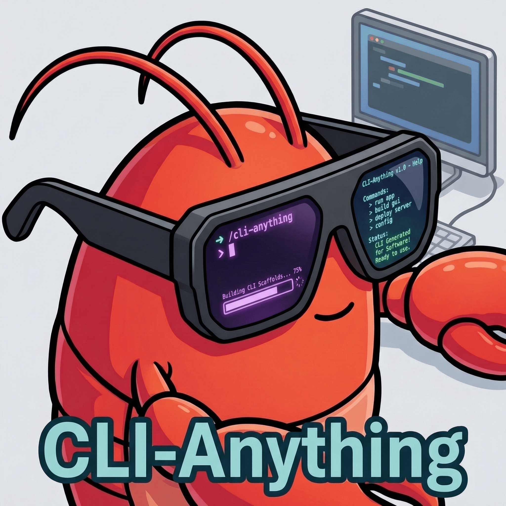
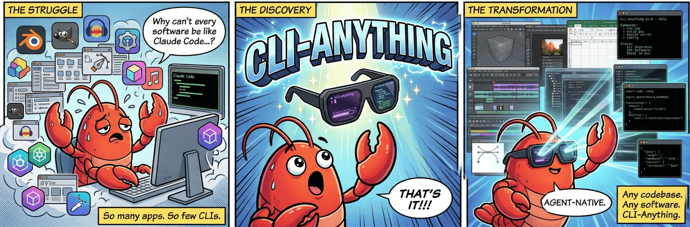
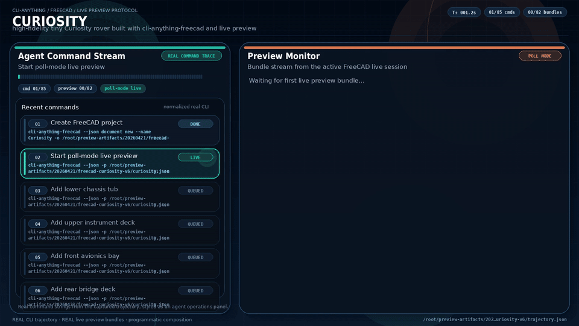
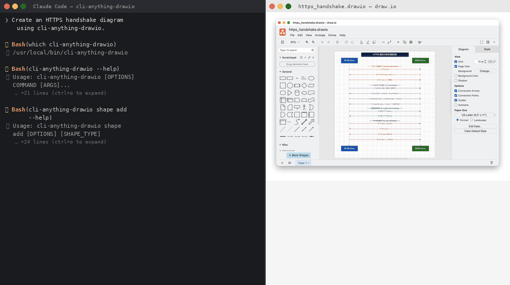
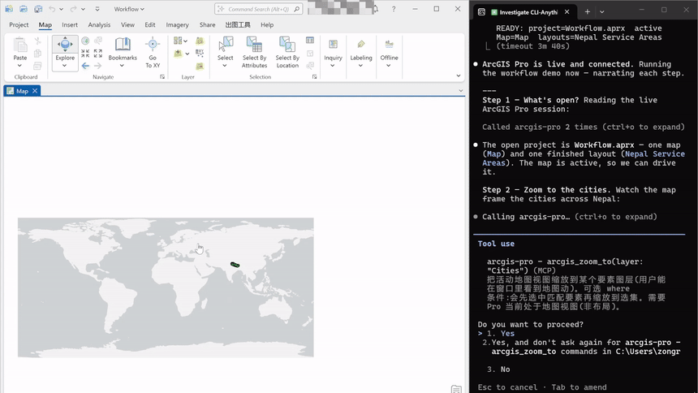
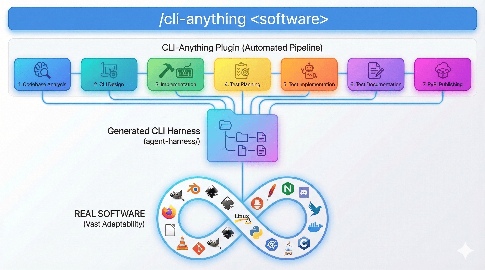

<h1 align="center">&nbsp; CLI-Anything: Biến MỌI Phần Mềm Thành Agent-Native</h1>

<div align="center">
<a href="https://www.star-history.com/hkuds/cli-anything"><picture><source media="(prefers-color-scheme: dark)" srcset="https://api.star-history.com/badge?repo=HKUDS/CLI-Anything&amp;type=trending&amp;theme=dark"><source media="(prefers-color-scheme: light)" srcset="https://api.star-history.com/badge?repo=HKUDS/CLI-Anything&amp;type=trending"></picture></a>&#32;<a href="https://trendshift.io/repositories/22991" target="_blank"></a>&#32;<a href="https://www.star-history.com/hkuds/cli-anything"><picture><source media="(prefers-color-scheme: dark)" srcset="https://api.star-history.com/badge?repo=HKUDS/CLI-Anything&amp;type=rank&amp;theme=dark"><source media="(prefers-color-scheme: light)" srcset="https://api.star-history.com/badge?repo=HKUDS/CLI-Anything&amp;type=rank"></picture></a>
</div>

<p align="center">
  <strong>Phần mềm ngày nay phục vụ Con người👨‍💻. Người dùng của ngày mai sẽ là các Agent🤖.<br>
CLI-Anything: Cầu nối giữa AI Agent và phần mềm của thế giới</strong><br>
</p>

**🌐 [CLI-Hub](https://hkuds.github.io/CLI-Anything/)**: `pip install cli-anything-hub` rồi `cli-hub install <name>` — duyệt, cài đặt và quản lý mọi CLI do cộng đồng xây dựng. Muốn thêm CLI của riêng bạn? [Mở một PR](https://github.com/HKUDS/CLI-Anything/blob/main/CONTRIBUTING.md) — hub cập nhật ngay lập tức.

**🎬 [Xem Demo](#-demo-thực-tế)**: Xem các AI agent dùng CLI được tạo ra cùng các vòng lặp preview, live preview và trajectory để tạo ra sản phẩm thật — bản dựng CAD, cảnh 3D, sơ đồ, gameplay, phụ đề và nhiều hơn nữa.

**🙋 [Trở thành Contributor, hoặc Yêu cầu một CLI]**: [Tham gia cùng chúng tôi](https://github.com/HKUDS/CLI-Anything/issues/new?template=contributor-signup.yml)! Đăng ký để xây dựng một CLI harness mới — sau khi được duyệt và merge, bạn sẽ có quyền truy cập với tư cách contributor của cộng đồng! Muốn CLI-Anything hỗ trợ một phần mềm hoặc dịch vụ cụ thể? Gửi [yêu cầu wishlist](https://github.com/HKUDS/CLI-Anything/issues/new?template=cli-wishlist.yml)!

<p align="center">
  <a href="#-bắt-đầu-nhanh"></a>
  <a href="https://hkuds.github.io/CLI-Anything/"></a>
  <a href="#-các-bản-demo"></a>
  <a href="#-kết-quả-kiểm-thử"></a>
  <a href="https://arxiv.org/abs/2606.03854"></a>
  <a href="LICENSE"></a>
</p>

<p align="center">
  
  
  
  
  
  <a href="https://github.com/HKUDS/.github/blob/main/profile/README.md"></a>
<a href="https://github.com/HKUDS/.github/blob/main/profile/README.md"></a>
</p>

**Một Dòng Lệnh Duy Nhất**: Biến bất kỳ phần mềm nào thành sẵn sàng cho agent trên Pi, OpenClaw, nanobot, Cursor, Claude Code, v.v.&nbsp;&nbsp;[**English**](README.md) | [**中文文档**](README_CN.md) | [**日本語ドキュメント**](README_JA.md) | [**Deutsch**](README_DE.md)

<p align="center">
  
</p>

<p align="center">
  
</p>

---

## 📰 Tin tức

> Cảm ơn mọi nỗ lực vô giá từ cộng đồng! Các cập nhật mới vẫn đang đến mỗi ngày..

- **2026-05-30** 🧭 **Hermes skill** được đề xuất (#320), bổ sung một skill điều phối CLI-Anything kèm script cài đặt và hướng dẫn dự phòng HARNESS. 🗺️ **ArcGIS Pro** được đề xuất vào registry công khai (#318) dưới dạng CLI Windows/ArcPy cho bản đồ học, xử lý địa lý, chỉnh sửa feature và các workflow MCP live-Pro.

- **2026-05-27** 🔧 Cập nhật ngày registry của **CLI-Hub** nay xử lý được lệnh cài đặt `python -m pip` (#312), cải thiện khả năng phát hiện ngày của gói cho tự động hóa registry.

- **2026-05-23** 📝 **Obsidian Agent CLI** được đề xuất vào registry công khai (#307), mang đến CLI tự động hóa Obsidian cài qua PyPI với workflow bộ nhớ agent bền vững và liên kết skill được ghim cố định.

- **2026-05-21** 🔒 Xử lý token-file của **Sketch CLI** được tăng cường chống path traversal và symlink escape (#304).

- **2026-05-20** 📓 **Joplin CLI** được đề xuất (#300) với notebook, ghi chú, to-do, tag, tệp đính kèm, tìm kiếm/đồng bộ, import/export, helper server/E2EE, tài liệu đầy đủ, tài liệu skill đóng gói và baseline kiểm chứng 134 test.

- **2026-05-20** 🎛️ **Rekordbox CLI** được merge (#252) với đường ghi SQLCipher có kiểm soát, ghi ép buộc yêu cầu backup, bao phủ smoke test và đồng bộ root skill. 📚 **Calibre CLI** được merge (#223) với các workflow thư viện/tìm kiếm/metadata/chuyển đổi/export, 41 unit test, bằng chứng E2E trên Calibre thật và kiểm chứng root skill. 🧊 **3MF CLI** được merge (#209) với kiểm tra mesh, thay đổi kích thước lỗ, sửa chữa, so sánh và thuộc tính tam giác được bảo toàn. 🎙️ **MiniMax CLI** được merge (#189) với workflow chat/TTS, liệt kê model/voice an toàn JSON, xử lý quote trong REPL và bao phủ smoke/E2E. 🎮 **UEAtelier** gia nhập registry (#297) với vai trò bàn làm việc tự mở rộng MCP cho Unreal Editor kèm CLI proxy bằng Python.

- **2026-05-19** 🛠️ Các harness hiện có được rà soát chất lượng/bảo mật — **Zoom** tải bản ghi từ URL trực tiếp (#294), tìm kiếm của **Obsidian** nay dùng content type của vendor Local REST API (#289), chuyển đổi headless của **LibreOffice** ổn định hơn trên macOS (#290), và việc parse XML/SVG/ODF/MLT/MusicXML/CSL nay chuyển input không tin cậy qua `defusedxml` (#296).

- **2026-05-18** 📈 Làm mới cách trình bày README với badge Trendshift và trau chuốt header dự án căn giữa (#285, #286), giữ phần mở đầu tập trung vào khám phá và động lực của dự án.

- **2026-05-17** 🌐 Xử lý registry của **CLI-Hub** được tăng cường (#281) — các mục registry nay được sao chép trước khi gắn thẻ `_source`, ngăn dữ liệu registry bị cache hoặc mock bị thay đổi tại chỗ.

- **2026-05-16** 🔧 **n8n** nhận bản sửa lỗi crash banner REPL mà sau đó được merge vào main (#280), khôi phục đường khởi động tương tác không subcommand kèm kiểm chứng hồi quy.

<details>
<summary>Tin tức trước đó (10–18 tháng 4)</summary>

- **2026-04-18** 🧩 **Mọi file SKILL.md nay đang được hợp nhất dưới thư mục `skills/` ở cấp cao nhất** — mọi skill CLI đều có thể cài từ một nguồn chuẩn duy nhất bằng `npx skills add HKUDS/CLI-Anything --skill <skill-name> -g -y`. Chúng tôi cũng bổ sung CI kiểm chứng root-skill, đồng bộ tài liệu đóng góp / PR và gợi ý đường dẫn skill trong REPL theo bố cục mới, đồng thời làm mới frontend ưu tiên cài đặt của **CLI-Hub** quanh flow `npx skills` mới.

- **2026-04-17** 🌐 **CLI-Hub** nhận thêm một đợt cải tiến UX cài đặt — metadata registry công khai và độ bao phủ skill được siết chặt, việc đếm lượt truy cập được sửa, và web hub được tinh chỉnh thêm. 🧪 Thời lượng output render của **Shotcut** được sửa (#92). 📝 Đường đóng góp **SKILL** được sửa cho flow tài liệu mới (#224), và bộ sinh skill nay xử lý an toàn phần intro trống (#203).

- **2026-04-16** 🗺️ **QGIS CLI** được merge (#207) — một harness GIS / soạn bản đồ đầy đủ đã ra mắt. 🧬 **UniMol Tools CLI** được merge (#219) cho các workflow mô hình hóa phân tử. 🌐 **CLI-Hub** cũng bổ sung thêm nhiều CLI công khai, bao gồm **py4csr**, làm mới meta-skill được sinh ra, sửa tài liệu đóng góp SKILL, và sửa việc trích xuất gói `apt-get` trong sinh skill (#204).

- **2026-04-16** 📈 **Unreal Insights CLI** được mở rộng — bổ sung điều khiển phiên capture nền (`capture start/status/snapshot/stop`), flow phân giải/build `UnrealInsights.exe` khớp engine-root, và tài liệu/test làm mới cho workflow điều phối mới.

- **2026-04-15** 🌐 **CLI-Hub** cập nhật lên **v0.2.0** — gói PyPI nay hỗ trợ CLI công khai từ nhiều nguồn cài đặt (`pip`, `npm`, `brew`, công cụ đóng gói/hệ thống), dựa trên `public_registry.json` mới. Frontend của Hub được thiết kế lại với hai bộ **CLI-Anything CLIs** và **Public CLIs** riêng biệt, và các kiểm tra end-to-end trực tiếp nay bao phủ flow cài đặt, cập nhật và gỡ cài đặt thật trên cả gói pip lẫn npm.

- **2026-04-14** 🧭 **Safari CLI** được merge (#212) và thêm vào registry của Hub — tự động hóa trình duyệt qua `safari-mcp`. 🎬 **Kdenlive** cũng nhận bản sửa tương thích cho output project Gen 5 và việc sinh project không hợp lệ.

- **2026-04-13** 📓 **Obsidian CLI** được merge (#211) — harness quản lý tri thức qua Local REST API, với 48 unit test và 7 E2E test. ⛓️ **Eth2-Quickstart CLI** được merge (#195) — harness quản lý node staking Ethereum. 📚 **Zotero CLI** cập nhật lên v0.4.1 (#201) — nay phát hành từ repo riêng của nó, và CLI-Hub có thêm hỗ trợ URL `skill_md` từ xa.

- **2026-04-11** 🔗 **n8n CLI** được merge (#188) — harness tự động hóa workflow cho các flow tự host. 🔧 Bản sửa **Exa CLI** (#205) bổ sung header `x-exa-integration` để theo dõi sử dụng. 📦 **CLI-Hub** cũng có thêm workflow tự xuất bản PyPI và pipeline làm mới gói.

- **2026-04-10** 📦 **Trình quản lý gói CLI-Hub** ra mắt — `pip install cli-anything-hub` để duyệt, tìm kiếm, cài đặt, cập nhật và gỡ cài đặt các harness CLI-Anything từ một lệnh. Web Hub cũng phát hành đợt làm mới frontend ưu tiên cài đặt đầu tiên và thẻ toolkit "Empower yourself".

</details>

<details>
<summary>Tin tức trước đó (1–9 tháng 4)</summary>

- **2026-04-09** 🧹 Đợt dọn dẹp và tài liệu (#200) — sửa tổng phụ test của Openscreen, thêm Openscreen vào README tiếng Trung và cấu trúc dự án, và làm rõ cú pháp lệnh `/cli-anything` trong tài liệu.

- **2026-04-08** 🎬 **Openscreen CLI** được merge (#183) — harness biên tập quay màn hình với 101 test. ☁️ **CloudAnalyzer CLI** được merge (#181) — harness phân tích chi phí cloud với 27 lệnh. 🌊 Các harness **SeaClip / PM2 / ChromaDB** được merge (#129).

- **2026-04-07** 🔄 **Dify Workflow CLI** được merge (#191) — wrapper tự động hóa workflow. 🔧 Sửa auto-save cho **Inkscape** (#193, sửa #182). 🛡️ **Tăng cường bảo mật DomShell** (#156) — kiểm tra URL và khử DOM cho CLI trình duyệt. 🥧 **Extension Pi Coding Agent** được merge (#178).

- **2026-04-06** 🔍 **Exa CLI** được merge (#172) — harness tìm kiếm web và trả lời bằng AI. 🎮 **Godot CLI** được merge (#140) — harness game engine với pipeline E2E game demo đầy đủ. ☁️ Các bản sửa review và cải tiến frontend của **CloudAnalyzer** cũng được đưa vào.

- **2026-04-03** 🧪 **WireMock CLI** được merge (#170) — harness mock server HTTP cho kiểm thử API. 🥧 Hỗ trợ extension **Pi Coding Agent** cũng được đưa vào, và các bản ghi demo CLI được thêm vào tài liệu.

- **2026-04-01** ⚔️ **Slay the Spire II CLI** được merge (#148) — harness roguelike xây bộ bài. 🎥 **VideoCaptioner CLI** được merge (#166) — harness tạo phụ đề video bằng AI. 🛰️ **IntelWatch** được thêm vào registry cho workflow OSINT B2B.

</details>

<details>
<summary>Tin tức trước đó (23–30 tháng 3)</summary>

- **2026-03-30** 🏗️ **CLI-Anything v0.2.0** — thiết kế lại HARNESS.md theo hướng progressive disclosure. Các hướng dẫn chi tiết được tách vào `guides/` để nạp theo nhu cầu. Các Phase 1–7 nay liên tục. Key Principles và Rules được gộp thành một mục có thẩm quyền duy nhất.

- **2026-03-29** 📐 Tài liệu skill Blender được cập nhật — bắt buộc đường dẫn render tuyệt đối và điều kiện tiên quyết chính xác.

- **2026-03-28** 🌐 **CLIBrowser** được thêm vào registry CLI-Hub cho tự động hóa trình duyệt mà agent truy cập được.

- **2026-03-27** 📚 SKILL.md của Zotero được tăng cường với các ràng buộc hướng tới agent; sửa cấu hình REPL và phân giải executable.

- **2026-03-26** 📖 Harness **Zotero CLI** ra mắt cho Zotero desktop (quản lý thư viện, collection, trích dẫn). Sửa lỗi custom ID của Draw.io (#132) và sửa cú pháp registry.json.

- **2026-03-25** 🎮 **RenderDoc CLI** được merge cho phân tích capture frame GPU. FreeCAD cập nhật cho v1.1. Tên engine EEVEE của Blender được sửa. Quyền token của Zoom được tăng cường.

- **2026-03-24** 🏭 **FreeCAD CLI** được thêm với 258 lệnh trong 17 nhóm. Các harness **iTerm2** và **Teltonika RMS** được thêm vào registry.

- **2026-03-23** 🤖 Ra mắt **meta-skill CLI-Hub** — agent nay có thể tự khám phá và cài đặt CLI một cách tự chủ. Harness **Krita CLI** được merge cho vẽ kỹ thuật số.

</details>

<details>
<summary>Tin tức trước đó (11–22 tháng 3)</summary>

- **2026-03-22** 🎵 **MuseScore CLI** được merge với transpose, export và quản lý nhạc cụ.

- **2026-03-21** 🔧 Cải tiến hạ tầng — tinh chỉnh test harness và tài liệu trên nhiều CLI. Tăng cường tương thích Windows cho nhiều backend.

- **2026-03-20** 🌐 **Novita AI** CLI được thêm cho truy cập API tương thích OpenAI. Cải tiến metadata registry để hub khám phá tốt hơn.

- **2026-03-19** 📦 Tinh chỉnh cấu trúc gói trên các harness. Cải thiện sinh SKILL.md với tài liệu lệnh tốt hơn.

- **2026-03-18** 🧪 Mở rộng độ bao phủ test — thêm kịch bản E2E và kiểm chứng trường hợp biên trên nhiều CLI.

- **2026-03-17** 🌐 Ra mắt **[CLI-Hub](https://hkuds.github.io/CLI-Anything/)** — một registry trung tâm nơi bạn có thể duyệt, tìm kiếm và cài đặt bất kỳ CLI nào bằng một lệnh `pip` duy nhất.

- **2026-03-16** 🤖 Bổ sung **sinh SKILL.md** (Phase 6.5) — mọi CLI được tạo ra nay đều đi kèm một định nghĩa skill mà AI khám phá được.

- **2026-03-15** 🐾 Hỗ trợ **OpenClaw** từ cộng đồng! Merge guard `cygpath` trên Windows cho hỗ trợ đa nền tảng.

- **2026-03-14** 🔒 Sửa lỗ hổng path injection trong GIMP Script-Fu và bổ sung bản dịch **README tiếng Nhật**.

- **2026-03-13** 🔌 Plugin **Qodercli** chính thức được merge như một đóng góp cộng đồng kèm script setup riêng.

- **2026-03-12** 📦 Tích hợp **Codex skill** ra mắt, mang CLI-Anything đến thêm một nền tảng AI coding nữa.

- **2026-03-11** 📞 Harness hội nghị truyền hình **Zoom** được thêm như ứng dụng hỗ trợ thứ 11.

</details>

---

## 🤔 Vì sao lại là CLI?

CLI là giao diện phổ quát cho cả con người lẫn AI agent:

• **Có cấu trúc & Kết hợp được** - Lệnh văn bản khớp với định dạng của LLM và có thể nối chuỗi cho các workflow phức tạp

• **Nhẹ & Phổ quát** - Chi phí phụ tối thiểu, chạy trên mọi hệ thống mà không cần phụ thuộc

• **Tự mô tả** - Cờ --help cung cấp tài liệu tự động mà agent có thể khám phá

• **Thành công đã được chứng minh** - Claude Code chạy hàng nghìn workflow thật qua CLI mỗi ngày

• **Thiết kế Agent-First** - Output JSON có cấu trúc loại bỏ độ phức tạp khi parse

• **Xác định & Đáng tin cậy** - Kết quả nhất quán giúp hành vi của agent có thể dự đoán được

## 🚀 Bắt đầu nhanh

CLI-Anything có hai điểm khởi đầu hữu ích như nhau:

| Mục tiêu | Bắt đầu tại đây |
|------|------------|
| **Dùng hệ sinh thái CLI có sẵn ngay** | Cài `cli-anything-hub`, duyệt registry và cài các CLI làm sẵn. |
| **Xây dựng một CLI agent-native mới** | Cài plugin/skill CLI-Anything cho agent của bạn, rồi chạy bộ sinh harness 7 phase. |

<details open>
<summary><strong>Phase 1: Trao quyền cho chính bạn — bộ công cụ CLI của bạn</strong></summary>

Hãy cài trình quản lý gói CLI-Hub trước. Nó cho phép bạn duyệt, tìm kiếm, kiểm tra, cài đặt, cập nhật, gỡ cài đặt và khởi chạy các harness CLI-Anything cùng các CLI công khai của bên thứ ba từ một lệnh duy nhất.

**PIP**

```bash
pip install cli-anything-hub
```

| Lệnh | Tác dụng |
|---------|--------------|
| `cli-hub list` | Duyệt registry |
| `cli-hub search <query>` | Tìm theo từ khóa |
| `cli-hub info <name>` | Kiểm tra một CLI |
| `cli-hub install <name>` | Cài đặt từ CLI-Hub |
| `cli-hub update <name>` | Cập nhật một bản cài đặt |
| `cli-hub uninstall <name>` | Gỡ bỏ một bản cài đặt |
| `cli-hub launch <name> [args...]` | Chạy một CLI đã cài |

```bash
# Duyệt những gì đang có
cli-hub list
cli-hub search image

# Cài đặt và thử ngay một CLI
cli-hub install gimp
cli-hub info gimp
cli-hub launch gimp
```

> Một số CLI bao bọc phần mềm desktop hoặc backend thật. Nếu CLI bạn chọn cần GIMP, Blender, LibreOffice hoặc một công cụ upstream khác, hãy cài cả ứng dụng upstream đó.

</details>

<details open>
<summary><strong>Phase 1.5: Trao quyền cho agent của bạn — cài đặt bằng một lệnh</strong></summary>

Cung cấp cho các agent tương thích SKILL meta-skill CLI-Hub để chúng tự khám phá và cài đặt đúng CLI cho một tác vụ.

**Cũng có trên:** [ClawHub](https://clawhub.ai/yuh-yang/cli-anything-hub), [SkillHub](https://www.skillhub.club/web/skills/itsyuhao-cli-anything-hub), [SkillHub.cn](https://skillhub.cn/skills/cli-hub-meta-skill)

**NPX SKILLS**

```bash
npx skills add HKUDS/CLI-Anything --skill cli-hub-meta-skill -g -y
```

**Hoạt động với:** OpenClaw, Nanobot, Claude Code, Codex, Reasonix, Antigravity và các agent tương thích SKILL khác.

Sau đó ra lệnh:

```text
Find appropriate CLI software in CLI-Hub and complete the task: ...
```

</details>

<details open>
<summary><strong>Phase 3: Xây dựng CLI mới khi registry chưa có</strong></summary>

Dùng bộ sinh CLI-Anything khi bạn cần một harness mới cho phần mềm, một codebase hoặc một công cụ nội bộ chưa có sẵn qua CLI-Hub.

**Điều kiện tiên quyết**

- **Python 3.10+**
- Phần mềm đích hoặc repo nguồn có sẵn tại máy hoặc trực tuyến
- Một AI coding agent được hỗ trợ: [Claude Code](#-claude-code) | [Cursor](#-cursor) | [Pi](#-pi-coding-agent) | [OpenClaw](#-openclaw) | [OpenCode](#-opencode) | [Codex](#-codex) | [Hermes](#-hermes) | [Reasonix](#-reasonix) | [Qodercli](#-qodercli) | [GitHub Copilot CLI](#-github-copilot-cli) | [Thêm nền tảng](#-more-platforms-coming-soon)

### Chọn nền tảng Agent của bạn

<details open>
<summary><h4 id="-claude-code">⚡ Claude Code</h4></summary>

**Bước 1: Thêm Marketplace**

CLI-Anything được phân phối dưới dạng marketplace plugin Claude Code lưu trữ trên GitHub.

```bash
# Thêm marketplace CLI-Anything
/plugin marketplace add HKUDS/CLI-Anything
```

**Bước 2: Cài đặt Plugin**

```bash
# Cài đặt plugin cli-anything từ marketplace
/plugin install cli-anything
```

Vậy là xong. Plugin nay đã sẵn sàng trong phiên Claude Code của bạn.

> **Lưu ý cho người dùng Windows:** Claude Code chạy lệnh shell qua `bash`. Trên Windows, hãy cài Git for Windows (bao gồm `bash` và
`cygpath`) hoặc dùng WSL; nếu không, lệnh có thể lỗi với `cygpath: command not found`.

**Bước 3: Xây dựng CLI bằng một lệnh**

```bash
# /cli-anything <software-path-or-repo>
# Tạo một CLI hoàn chỉnh cho GIMP (cả 7 phase)
/cli-anything ./gimp
```

Khả năng tương thích lệnh giữa các phiên bản Claude Code:
- Dùng `/cli-anything` làm điểm vào chính.
- Trên các bản cũ mà `/cli-anything` không được nhận diện **sau khi đã xác nhận plugin được cài và nạp**, hãy thử dạng entry cũ `/cli-anything:cli-anything`.
- Các lệnh phụ giữ dạng `:subcommand` (ví dụ `/cli-anything:refine`).

Nếu bạn thấy `Unknown skill: cli-anything`, hãy tập trung vào việc cài/nạp plugin trước (cả hai dạng entry đều tham chiếu cùng một skill, nên đổi dạng sẽ không giúp ích):
1. Nạp lại lệnh plugin: `/reload-plugins`
2. Kiểm chứng plugin đã được nạp: `/help cli-anything` (trợ giúp/lệnh của CLI-Anything sẽ xuất hiện)
3. Cài lại từ marketplace nếu cần:
   - `/plugin marketplace add HKUDS/CLI-Anything`
   - `/plugin install cli-anything`
4. Sau khi xác nhận plugin đã sẵn sàng, thử lại lệnh entry:
   - Ưu tiên: `/cli-anything ./gimp`
   - Chỉ bản cũ: `/cli-anything:cli-anything ./gimp`

Thao tác này chạy toàn bộ pipeline:
1. 🔍 **Phân tích** — Quét mã nguồn, ánh xạ hành động GUI sang API
2. 📐 **Thiết kế** — Kiến trúc nhóm lệnh, mô hình trạng thái, định dạng output
3. 🔨 **Triển khai** — Xây dựng Click CLI với REPL, output JSON, undo/redo
4. 📋 **Lập kế hoạch kiểm thử** — Tạo TEST.md với kế hoạch unit + E2E test
5. 🧪 **Viết kiểm thử** — Triển khai bộ test toàn diện
6. 📝 **Tài liệu** — Cập nhật TEST.md với kết quả
7. 📦 **Xuất bản** — Tạo `setup.py`, cài vào PATH

**Bước 4 (Tùy chọn): Tinh chỉnh và cải thiện CLI**

Sau lần build đầu tiên, bạn có thể tinh chỉnh CLI lặp đi lặp lại để mở rộng độ bao phủ và bổ sung tính năng còn thiếu:

```bash
# Tinh chỉnh diện rộng — agent phân tích khoảng trống trên mọi khả năng
/cli-anything:refine ./gimp

# Tinh chỉnh tập trung — nhắm vào một khu vực chức năng cụ thể
/cli-anything:refine ./gimp "I want more CLIs on image batch processing and filters"
```

Lệnh refine thực hiện phân tích khoảng trống giữa toàn bộ khả năng của phần mềm và độ bao phủ CLI hiện tại, rồi triển khai lệnh, test và tài liệu mới cho các khoảng trống đã xác định. Bạn có thể chạy nó nhiều lần để mở rộng độ bao phủ đều đặn — mỗi lần chạy đều tăng dần và không phá hủy.

<details>
<summary><strong>Thay thế: Cài đặt thủ công</strong></summary>

Nếu bạn không muốn dùng marketplace:

```bash
# Clone repo
git clone https://github.com/HKUDS/CLI-Anything.git

# Sao chép plugin vào thư mục plugins của Claude Code
cp -r CLI-Anything/cli-anything-plugin ~/.claude/plugins/cli-anything

# Nạp lại plugins
/reload-plugins
```

</details>

</details>

<details>
<summary><h4 id="-pi-coding-agent">⚡ Pi Coding Agent</h4></summary>

**Bước 1: Cài đặt Extension**

Extension nằm tại `.pi-extension/cli-anything/` trong repo này. Cài nó ở mức toàn cục để các lệnh `/cli-anything` khả dụng trong **mọi** dự án Pi:

```bash
# Clone repo
git clone https://github.com/HKUDS/CLI-Anything.git
cd CLI-Anything

# Cài đặt toàn cục vào thư mục extensions của Pi
bash .pi-extension/cli-anything/install.sh
```

Để gỡ cài đặt:

```bash
bash .pi-extension/cli-anything/install.sh --uninstall
```

> **Cách hoạt động:** `install.sh` sao chép các file extension (bao gồm HARNESS.md, commands, guides, scripts và templates từ `cli-anything-plugin/`) vào `~/.pi/agent/extensions/cli-anything/`, nơi Pi tự động khám phá khi khởi động. Chạy `/reload` trong Pi hoặc khởi động lại Pi để kích hoạt.

**Bước 2: Xây dựng CLI bằng một lệnh**

Khi extension đã được nạp, các lệnh sau sẽ khả dụng:

```bash
# Tạo một CLI hoàn chỉnh cho GIMP (cả 7 phase)
/cli-anything ./gimp

# Build từ một repo GitHub
/cli-anything https://github.com/blender/blender
```

**Bước 3 (Tùy chọn): Tinh chỉnh và cải thiện CLI**

```bash
# Tinh chỉnh diện rộng — agent phân tích khoảng trống trên mọi khả năng
/cli-anything:refine ./gimp

# Tinh chỉnh tập trung — nhắm vào một khu vực chức năng cụ thể
/cli-anything:refine ./gimp "batch processing and filters"
```

**Các lệnh có sẵn**

| Lệnh | Mô tả |
|---------|-------------|
| `/cli-anything <path-or-repo>` | Xây dựng một CLI harness hoàn chỉnh |
| `/cli-anything:refine <path> [focus]` | Tinh chỉnh một CLI harness hiện có |
| `/cli-anything:test <path-or-repo>` | Chạy test cho một CLI harness |
| `/cli-anything:validate <path-or-repo>` | Kiểm chứng một CLI harness |
| `/cli-anything:list [options]` | Liệt kê mọi công cụ CLI-Anything |

</details>

<details>
<summary><h4 id="-opencode">⚡ OpenCode (Experimental)</h4></summary>

**Bước 1: Cài đặt Commands**

> **Lưu ý:** Hãy nâng cấp lên OpenCode mới nhất. Các phiên bản cũ có thể dùng đường dẫn commands khác.

Sao chép các command CLI-Anything **và** `HARNESS.md` vào thư mục commands của OpenCode:

```bash
# Clone repo
git clone https://github.com/HKUDS/CLI-Anything.git

# Cài đặt toàn cục (khả dụng trong mọi dự án)
cp CLI-Anything/opencode-commands/*.md ~/.config/opencode/commands/
cp CLI-Anything/cli-anything-plugin/HARNESS.md ~/.config/opencode/commands/

# Hoặc cài đặt theo từng dự án
cp CLI-Anything/opencode-commands/*.md .opencode/commands/
cp CLI-Anything/cli-anything-plugin/HARNESS.md .opencode/commands/
```

> **Lưu ý:** Hãy nâng cấp lên OpenCode mới nhất. Các phiên bản cũ dùng `command/` (số ít) thay vì `commands/`. Nếu `commands/` không tồn tại, dùng `command/` cho cả cài đặt toàn cục lẫn theo dự án.

> **Lưu ý:** `HARNESS.md` là đặc tả phương pháp mà mọi command đều tham chiếu. Nó phải nằm cùng thư mục với các command.

Thao tác này bổ sung 5 slash command: `/cli-anything`, `/cli-anything-refine`, `/cli-anything-test`, `/cli-anything-validate` và `/cli-anything-list`.

**Bước 2: Xây dựng CLI bằng một lệnh**

```bash
# Tạo một CLI hoàn chỉnh cho GIMP (cả 7 phase)
/cli-anything ./gimp

# Build từ một repo GitHub
/cli-anything https://github.com/blender/blender
```

Lệnh chạy dưới dạng subtask và tuân theo cùng phương pháp 7 phase như Claude Code.

**Bước 3 (Tùy chọn): Tinh chỉnh và cải thiện CLI**

```bash
# Tinh chỉnh diện rộng — agent phân tích khoảng trống trên mọi khả năng
/cli-anything-refine ./gimp

# Tinh chỉnh tập trung — nhắm vào một khu vực chức năng cụ thể
/cli-anything-refine ./gimp "batch processing and filters"
```

</details>

<details>
<summary><h4 id="-goose">⚡ Goose (Desktop / CLI) <sup><code>Experimental</code></sup> <sup><code>Community</code></sup></h4></summary>

**Bước 1: Cài đặt Goose**

Cài Goose (Desktop hoặc CLI) theo hướng dẫn chính thức của Goose cho hệ điều hành của bạn.

**Bước 2: Cấu hình một CLI Provider**

Cấu hình Goose dùng một CLI provider như Claude Code, và đảm bảo CLI đó đã được cài đặt và xác thực.

**Bước 3: Dùng CLI-Anything trong một phiên Goose**

Khi Goose đã được cấu hình, bắt đầu một phiên và dùng các lệnh CLI-Anything tương tự như mô tả ở trên cho Claude Code, ví dụ:

```bash
/cli-anything ./gimp
/cli-anything:refine ./gimp "batch processing and filters"
```

> Lưu ý: Khi Goose chạy qua một CLI provider, nó dùng khả năng và định dạng lệnh của provider đó.
</details>

<details>

<summary><h4 id="-qodercli">⚡ Qodercli <sup><code>Community</code></sup></h4></summary>

**Bước 1: Đăng ký Plugin**

```bash
git clone https://github.com/HKUDS/CLI-Anything.git
bash CLI-Anything/qoder-plugin/setup-qodercli.sh
```

Thao tác này đăng ký plugin cli-anything trong `~/.qoder.json`. Bắt đầu một phiên Qodercli mới sau khi đăng ký.

**Bước 2: Dùng CLI-Anything từ Qodercli**

```bash
/cli-anything ./gimp
/cli-anything:refine ./gimp "batch processing and filters"
/cli-anything:validate ./gimp
```
</details>

<details>

<summary><h4 id="-openclaw">⚡ OpenClaw <sup><code>Community</code></sup></h4></summary>

**Bước 1: Cài đặt Skill**

CLI-Anything cung cấp file `SKILL.md` gốc cho OpenClaw. Sao chép nó vào thư mục skills của OpenClaw:

```bash
# Clone repo
git clone https://github.com/HKUDS/CLI-Anything.git

# Cài đặt vào thư mục skills toàn cục
mkdir -p ~/.openclaw/skills/cli-anything
cp CLI-Anything/openclaw-skill/SKILL.md ~/.openclaw/skills/cli-anything/SKILL.md
```

**Bước 2: Xây dựng một CLI**

Giờ bạn có thể gọi skill bên trong OpenClaw:

`@cli-anything build a CLI for ./gimp`

Skill tuân theo cùng phương pháp 7 phase như Claude Code và OpenCode.

</details>

<details>

<summary><h4 id="-cursor">⚡ Cursor</h4></summary>

Cursor có **cả hai** track:

| Track | Mục đích | Cài đặt |
|-------|---------|---------|
| **Generator** | Xây dựng harness mới bằng `/cli-anything` (và refine/test/validate/list) | Plugin Cursor trong `cursor-plugin/` |
| **Consumer** | Tìm/cài/dùng các CLI đã xuất bản từ CLI-Hub | `npx skills` + `cli-hub` (không đổi) |

**Generator — cài đặt plugin Cursor**

```bash
git clone https://github.com/HKUDS/CLI-Anything.git
bash CLI-Anything/cursor-plugin/scripts/install.sh
```

Windows PowerShell:

```powershell
.\CLI-Anything\cursor-plugin\scripts\install.ps1
```

Nâng cấp bằng `--force` / `-Force`. Đường dẫn cài đặt mặc định là
`~/.cursor/plugins/local/cli-anything` (ghi đè bằng `CURSOR_PLUGINS_HOME` trỏ tới một
thư mục có tên `plugins`). Trình cài đặt vendor phương pháp `cli-anything-plugin/`
resources và ghi `PLUGIN_ROOT.txt` cùng `~/.cursor/cli-anything-generator.root`
để các agent Cursor có thể phân giải đường dẫn phương pháp tuyệt đối.

Nạp lại cửa sổ Cursor (**Developer: Reload Window**), rồi:

```text
/cli-anything ./gimp
/cli-anything-refine ./shotcut "picture-in-picture workflows"
/cli-anything-test ./libreoffice
/cli-anything-validate ./libreoffice
/cli-anything-list
```

**Consumer — Hub / skills (tách biệt với plugin generator)**

```bash
npx skills add HKUDS/CLI-Anything --skill cli-hub-meta-skill -g -y
# hoặc một skill theo ứng dụng, ví dụ cli-anything-blender
pip install cli-anything-hub
```

Kiểm chứng trình cài đặt plugin tại máy:

```bash
bash CLI-Anything/cursor-plugin/tests/test_install.sh
```

Xem [`cursor-plugin/README.md`](cursor-plugin/README.md) để khắc phục sự cố nạp plugin local.
</details>

<details>

<summary><h4 id="-codex">⚡ Codex <sup><code>Experimental</code></sup> <sup><code>Community</code></sup></h4></summary>

**Bước 1: Cài đặt Skill**

Chạy trình cài đặt đi kèm:

```bash
# Clone repo
git clone https://github.com/HKUDS/CLI-Anything.git

# Cài đặt skill
bash CLI-Anything/codex-skill/scripts/install.sh
```

Trên Windows PowerShell, dùng:

```powershell
.\CLI-Anything\codex-skill\scripts\install.ps1
```

Thao tác này cài skill vào `$CODEX_HOME/skills/cli-anything` (hoặc `~/.codex/skills/cli-anything` nếu `CODEX_HOME` chưa được đặt).
Trình cài đặt cũng vendor `HARNESS.md` chuẩn, các đặc tả lệnh,
hướng dẫn theo nhu cầu, script helper tái sử dụng, template skill và preview protocol
vào các thư mục `references/` và `scripts/` của skill đã cài.
Điều này giữ skill Codex tự chứa trong khi vẫn dùng `cli-anything-plugin/` làm
nguồn sự thật.

Khởi động lại Codex sau khi cài đặt để nó được khám phá.

**Bước 2: Dùng CLI-Anything từ Codex**

Mô tả tác vụ bằng ngôn ngữ tự nhiên, ví dụ:

```text
Use CLI-Anything to build a harness for ./gimp
Use CLI-Anything to refine ./shotcut for picture-in-picture workflows
Use CLI-Anything to validate ./libreoffice
Use CLI-Anything to list generated harnesses under the current directory
```

Skill Codex áp dụng cùng phương pháp được plugin Claude Code và
các command OpenCode sử dụng, trong khi giữ nguyên định dạng harness Python được tạo ra.

Để kiểm chứng bản cài đặt Codex tự chứa tại máy:

```bash
bash CLI-Anything/codex-skill/tests/test_install.sh
```
</details>

<details>

<summary><h4 id="-hermes">⚡ Hermes <sup><code>Experimental</code></sup> <sup><code>Community</code></sup></h4></summary>

**Bước 1: Cài đặt Skill**

Chạy trình cài đặt đi kèm:

```bash
# Clone repo
git clone https://github.com/HKUDS/CLI-Anything.git

# Cài đặt skill
bash CLI-Anything/hermes-skill/scripts/install.sh
```

Trên Windows PowerShell, dùng:

```powershell
.\CLI-Anything\hermes-skill\scripts\install.ps1
```

Thao tác này cài skill vào `$HERMES_HOME/skills/cli-anything-hermes` (hoặc `~/.hermes/skills/cli-anything-hermes` nếu `HERMES_HOME` chưa được đặt).

Khởi động lại [Hermes Agent](https://github.com/NousResearch/hermes-agent) sau khi cài đặt để nó được khám phá.

**Bước 2: Dùng CLI-Anything từ Hermes**

Mô tả tác vụ bằng ngôn ngữ tự nhiên, ví dụ:

```text
Use CLI-Anything to build a harness for ./gimp
Use CLI-Anything to refine ./shotcut for picture-in-picture workflows
Use CLI-Anything to validate ./libreoffice
```

Skill Hermes áp dụng cùng phương pháp được plugin Claude Code và
skill Codex sử dụng, gắn các công cụ `terminal`, `execute_code`, `delegate_task` và
`read_file` / `write_file` / `patch` của Hermes vào workflow harness 7 phase trong khi
giữ nguyên định dạng harness Python được tạo ra.
</details>

<details>

<summary><h4 id="-reasonix">⚡ Reasonix <sup><code>Experimental</code></sup> <sup><code>Community</code></sup></h4></summary>

**Bước 1: Cài đặt Skill**

Chạy trình cài đặt đi kèm:

```bash
# Clone repo
git clone https://github.com/HKUDS/CLI-Anything.git

# Cài đặt skill
bash CLI-Anything/reasonix-skill/scripts/install.sh
```

Trên Windows PowerShell, dùng:

```powershell
.\CLI-Anything\reasonix-skill\scripts\install.ps1
```

Thao tác này cài skill vào thư mục skill toàn cục của Reasonix tại `~/.reasonix/skills/cli-anything`.

Khởi động lại Reasonix sau khi cài đặt để nó được khám phá.

**Bước 2: Dùng CLI-Anything từ Reasonix**

Mô tả tác vụ bằng ngôn ngữ tự nhiên, ví dụ:

```text
Use CLI-Anything to build a harness for ./gimp
Use CLI-Anything to refine ./shotcut for picture-in-picture workflows
Use CLI-Anything to validate ./libreoffice
```

Skill Reasonix áp dụng cùng phương pháp được plugin Claude Code và
các skill Codex/Hermes sử dụng, gắn các công cụ `bash`, `write_file`, `edit_file`,
`multi_edit`, `grep`, `glob` của Reasonix và các công cụ tùy chọn `mcp__codegraph__search` / `mcp__codegraph__context` vào
workflow harness 7 phase trong khi giữ nguyên định dạng harness Python được tạo ra.
</details>

<details>

<summary><h4 id="-github-copilot-cli">⚡ GitHub Copilot CLI <sup><code>Community</code></sup></h4></summary>

**Bước 1: Cài đặt Plugin**

```bash
git clone https://github.com/HKUDS/CLI-Anything.git
cd CLI-Anything
copilot plugin install ./cli-anything-plugin
```

Thao tác này cài plugin CLI-Anything vào GitHub Copilot CLI. Plugin nay sẽ sẵn sàng trong phiên GitHub Copilot CLI của bạn.

**Bước 2: Dùng CLI-Anything từ GitHub Copilot CLI**

```bash
/cli-anything ./gimp
/cli-anything:refine ./gimp "batch processing and filters"
/cli-anything:validate ./gimp
```

</details>

<details>
<summary><h4 id="-more-platforms-coming-soon">🔮 Thêm nền tảng (Sắp ra mắt)</h4></summary>

CLI-Anything được thiết kế không phụ thuộc nền tảng. Hỗ trợ cho nhiều AI coding agent hơn đang được lên kế hoạch:

- **Cursor** — khả dụng qua plugin Cursor trong `cursor-plugin/` (generator) cộng Hub/skills (consumer)
- **Codex** — khả dụng qua skill đi kèm trong `codex-skill/`
- **Windsurf** — sắp ra mắt
- **Công cụ yêu thích của bạn** — hoan nghênh đóng góp! Xem thư mục `opencode-commands/` để tham khảo một bản triển khai mẫu.

</details>

### Dùng CLI đã được tạo

Bất kể bạn dùng nền tảng nào để xây dựng, CLI được tạo ra đều hoạt động theo cùng một cách:

```bash
# Cài đặt vào PATH
cd gimp/agent-harness && pip install -e .

# Dùng từ bất cứ đâu
cli-anything-gimp --help
cli-anything-gimp project new --width 1920 --height 1080 -o poster.json
cli-anything-gimp --json layer add -n "Background" --type solid --color "#1a1a2e"

# Vào REPL tương tác
cli-anything-gimp
```

Mỗi harness trong repo nay có một [`SKILL.md`](#-tạo-skillmd) chuẩn tại `skills/cli-anything-<software>/SKILL.md`, giúp monorepo được khám phá trực tiếp qua `npx skills add HKUDS/CLI-Anything --list`. Các gói harness đã cài vẫn đi kèm một bản sao tương thích tại `cli_anything/<software>/skills/SKILL.md`, và banner REPL ưu tiên file chuẩn ở gốc repo khi có, nếu không sẽ dự phòng về bản sao đóng gói.

</details>

---

## 🤖 Trao quyền cho Agent của bạn với CLI-Hub

CLI-Hub cho phép agent tự chủ khám phá, cài đặt và dùng các CLI chúng cần.

```bash
npx skills add HKUDS/CLI-Anything --skill cli-hub-meta-skill -g -y
```

**Cũng có trên:** [ClawHub](https://clawhub.ai/yuh-yang/cli-anything-hub), [SkillHub](https://www.skillhub.club/web/skills/itsyuhao-cli-anything-hub), [SkillHub.cn](https://skillhub.cn/skills/cli-hub-meta-skill)

Sau đó ra lệnh:

```text
Find appropriate CLI software in CLI-Hub and complete the task: ...
```

Meta-skill trỏ agent tới catalog CLI-Hub trực tiếp, nơi chúng có thể chọn một CLI, cài đặt nó và đọc `SKILL.md` của chính nó để biết cách dùng theo tác vụ.

---

## 💡 Tầm nhìn của CLI-Anything: Xây dựng phần mềm Agent-Native

• 🌐 **Truy cập phổ quát** - Mọi phần mềm đều trở nên điều khiển được bởi agent ngay lập tức thông qua CLI có cấu trúc.

• 🔗 **Tích hợp liền mạch** - Agent điều khiển mọi ứng dụng mà không cần API, GUI, build lại hay wrapper phức tạp.

• 🚀 **Hệ sinh thái sẵn sàng cho tương lai** - Biến phần mềm được thiết kế cho con người thành công cụ agent-native bằng một lệnh.

---

## 🔧 Khi nào nên dùng CLI-Anything

| Danh mục | Cách trở thành Agent-native | Ví dụ tiêu biểu |
|----------|----------------------|----------|
| **📂 GitHub Repositories** | Biến bất kỳ dự án mã nguồn mở nào thành công cụ điều khiển được bởi agent thông qua sinh CLI tự động | VSCodium, WordPress, Calibre, Zotero, Joplin, Logseq, Penpot, Super Productivity |
| **🤖 Nền tảng AI/ML** | Tự động hóa huấn luyện model, pipeline suy luận và tinh chỉnh siêu tham số qua các lệnh có cấu trúc | Stable Diffusion WebUI, ComfyUI, Ollama, InvokeAI, Text-generation-webui, Open WebUI, Fooocus, Kohya_ss, AnythingLLM, SillyTavern |
| **📊 Dữ liệu & Phân tích** | Cho phép các workflow xử lý dữ liệu, trực quan hóa và phân tích thống kê theo chương trình | JupyterLab, Apache Superset, Metabase, Redash, DBeaver, KNIME, Orange, OpenSearch Dashboards, Lightdash |
| **💻 Công cụ Phát triển** | Tinh gọn việc soạn code, build, test và triển khai qua giao diện lệnh | Jenkins, Gitea, Hoppscotch, Portainer, pgAdmin, SonarQube, ArgoCD, OpenLens, Insomnia, Beekeeper Studio, **[iTerm2](https://iterm2.com)** |
| **🎨 Sáng tạo & Media** | Điều khiển các workflow sáng tạo nội dung, biên tập và render theo chương trình | Blender, GIMP, OBS Studio, Audacity, WaveTone, Krita, Kdenlive, Shotcut, Inkscape, Darktable, LMMS, Ardour |
| **🎮 Phát triển Game** | Quản lý dự án game, cảnh, export và scripting qua giao diện engine headless | **[Godot Engine](https://godotengine.org)**, **[s&box](https://sbox.game)** |
| **🔬 Tính toán Khoa học** | Tự động hóa workflow nghiên cứu, mô phỏng và các phép tính phức tạp | ImageJ, FreeCAD, QGIS, ParaView, Gephi, LibreCAD, Stellarium, KiCad, JASP, Jamovi |
| **🏢 Doanh nghiệp & Văn phòng** | Chuyển ứng dụng doanh nghiệp và công cụ năng suất thành hệ thống mà agent truy cập được | NextCloud, GitLab, Grafana, Mattermost, LibreOffice, AppFlowy, NocoDB, Odoo (Community), Plane, ERPNext |
| **📞 Giao tiếp & Cộng tác** | Tự động hóa lên lịch họp, quản lý người tham dự, truy xuất bản ghi và báo cáo qua CLI có cấu trúc | Zoom, Jitsi Meet, BigBlueButton, Mattermost |
| **📐 Sơ đồ & Trực quan hóa** | Tạo và thao tác sơ đồ, lưu đồ, sơ đồ kiến trúc và tài liệu trực quan theo chương trình | Draw.io (diagrams.net), Mermaid, PlantUML, Excalidraw, yEd |
| **🌐 Mạng & Hạ tầng** | Quản lý dịch vụ mạng, DNS, chặn quảng cáo và hạ tầng qua các lệnh CLI có cấu trúc | AdGuardHome |
| **🧪 Kiểm thử & Mocking** | Điều khiển HTTP mock server, quản lý test stub, ghi và phát lại traffic API cho kiểm thử tích hợp | **[WireMock](https://wiremock.org)** |
| **🔬 Đồ họa & Gỡ lỗi GPU** | Phân tích capture frame GPU, kiểm tra trạng thái pipeline, export shader và diff trạng thái render | RenderDoc |
| **⚙️ Chế tạo & Điều khiển Máy** | Điều khiển phần cứng thật từ file thiết kế đến sản phẩm vật lý — các lệnh detect, preflight, jog và framing có cổng an toàn với hồ sơ máy trên backend thật của phần mềm | MeerK40t (laser), Ink/Stitch (thêu) |
| **🎬 Video & Phụ đề** | Chuyển ngữ giọng nói, dịch phụ đề, ghi phụ đề có style vào video — pipeline phụ đề đầy đủ | VideoCaptioner |
| **🔍 Tìm kiếm AI-Native** | Tìm kiếm web neural và deep web với truy xuất nội dung có cấu trúc qua API dựa trên embedding | [Exa](https://exa.ai) |
| **✨ Tạo nội dung bằng AI** | Tạo sản phẩm chuyên nghiệp (slide, tài liệu, sơ đồ, website, báo cáo nghiên cứu) qua các API cloud được hỗ trợ bởi AI | [AnyGen](https://www.anygen.io), Gamma, Beautiful.ai, Tome |

---

## Các tính năng chính của CLI-Anything

### Khoảng trống giữa Agent và Phần mềm
AI agent rất giỏi suy luận nhưng rất tệ trong việc dùng phần mềm chuyên nghiệp thật. Các giải pháp hiện tại là tự động hóa UI mong manh, API hạn chế, hoặc các bản triển khai lại bị cắt giảm bỏ lỡ 90% chức năng.

**Giải pháp của CLI-Anything**: Biến bất kỳ phần mềm chuyên nghiệp nào thành công cụ agent-native mà không làm mất khả năng.

| **Điểm đau hiện tại** | **Cách CLI-Anything khắc phục** |
|----------|----------------------|
| 🤖 "AI không dùng được công cụ thật" | Tích hợp trực tiếp với backend phần mềm thật (Blender, LibreOffice, FFmpeg) — đầy đủ khả năng chuyên nghiệp, không thỏa hiệp |
| 💸 "Tự động hóa UI liên tục hỏng" | Không ảnh chụp màn hình, không click, không mong manh kiểu RPA. Độ tin cậy thuần dòng lệnh với giao diện có cấu trúc |
| 📊 "Agent cần dữ liệu có cấu trúc" | Output JSON tích hợp sẵn cho agent tiêu thụ liền mạch + định dạng dễ đọc cho con người để gỡ lỗi |
| 🔧 "Tích hợp tùy chỉnh rất tốn kém" | Một plugin Claude tự động sinh CLI cho BẤT KỲ codebase nào qua pipeline 7 phase đã được chứng minh |
| ⚡ "Khoảng cách Prototype và Production" | Hơn 2.280 test với kiểm chứng phần mềm thật. Đã chinh chiến trên 18 ứng dụng lớn |

---

## 🎯 Bạn có thể làm gì với CLI-Anything?

<table>
<tr>
<td width="33%">

### 🛠️ Để Agent đảm nhận Workflow của bạn

Chuyên nghiệp hay thường ngày — chỉ cần ném codebase vào `/cli-anything`. GIMP, Blender, Shotcut cho công việc sáng tạo. LibreOffice, OBS Studio cho tác vụ hằng ngày. Không có mã nguồn? Tìm một lựa chọn mã nguồn mở thay thế và ném *nó* vào. Bạn sẽ ngay lập tức có một CLI đầy đủ mà agent của bạn có thể dùng.

</td>
<td width="33%">

### 🔗 Hợp nhất các API rời rạc thành một CLI

Mệt mỏi vì phải xoay xở với các API dịch vụ web phân mảnh? Nạp tài liệu hoặc bản thảo SDK vào `/cli-anything` và agent của bạn sẽ có một **CLI mạnh mẽ, có trạng thái** bao bọc các endpoint riêng lẻ đó thành các nhóm lệnh mạch lạc. Một công cụ thay vì hàng chục lệnh gọi API thô — khả năng mạnh hơn trong khi tiết kiệm token.

</td>
<td width="33%">

### 🚀 Thay thế hoặc tăng sức mạnh cho GUI Agent

CLI-Anything có thể **thay thế hoàn toàn các cách tiếp cận agent dựa trên GUI** — không còn ảnh chụp màn hình, không còn click pixel mong manh. Nhưng đây mới là phần thú vị: một khi bạn `/cli-anything` một phần mềm GUI, bạn có thể **tổng hợp tác vụ cho agent, bộ đánh giá và benchmark** hoàn toàn bằng code và terminal — tự động hóa toàn bộ, tinh chỉnh lặp lại được, hiệu quả hơn rất nhiều.

</td>
</tr>
</table>

---

## ✨ ⚙️ CLI-Anything hoạt động như thế nào

<table>
<tr>
<td width="50%">

### 🏗️ Pipeline 7 Phase hoàn toàn tự động
Từ phân tích codebase đến xuất bản PyPI — plugin xử lý thiết kế kiến trúc, triển khai, lập kế hoạch test, viết test và tài liệu hoàn toàn tự động.

</td>
<td width="50%">

### 🎯 Tích hợp phần mềm đích thực
Gọi trực tiếp tới ứng dụng thật để render thật. LibreOffice tạo PDF, Blender render cảnh 3D, Audacity xử lý âm thanh qua sox. **Không thỏa hiệp**, **Không bản triển khai đồ chơi**.

</td>
</tr>
<tr>
<td width="50%">

### 🔁 Quản lý phiên thông minh
Trạng thái dự án bền vững với khả năng undo/redo, cộng giao diện REPL thống nhất (ReplSkin) mang lại trải nghiệm tương tác nhất quán trên mọi CLI.

</td>
<td width="50%">

### 📦 Cài đặt không cần cấu hình
Chỉ cần pip install -e . là đặt cli-anything-<software> thẳng lên PATH. Agent khám phá công cụ qua các lệnh which tiêu chuẩn. Không setup, không wrapper.

</td>
</tr>
<tr>
<td width="50%">

### 🧪 Kiểm thử cấp Production
Kiểm chứng đa lớp: unit test với dữ liệu tổng hợp, end-to-end test với file và phần mềm thật, cộng kiểm chứng subprocess CLI đối với các lệnh đã cài.

</td>
<td width="50%">

### 🐍 Kiến trúc gói sạch
Mọi CLI được tổ chức dưới namespace cli_anything.* — không xung đột, cài được bằng pip, với cách đặt tên nhất quán: cli-anything-gimp, cli-anything-blender, v.v.

</td>
</tr>
</table>

### 🤖 Tạo SKILL.md

Mỗi CLI được tạo ra nay có một `SKILL.md` chuẩn tại `skills/cli-anything-<software>/SKILL.md`. Điều này giúp monorepo hiện tại được tiêu thụ trực tiếp bởi `npx skills`, trong khi một bản sao tương thích đóng gói tại `cli_anything/<software>/skills/SKILL.md` bảo toàn hành vi của harness đã cài.

**SKILL.md cung cấp:**
- **YAML frontmatter** với name và description cho việc khám phá skill của agent
- **Các nhóm lệnh** với mọi subcommand có sẵn được ghi tài liệu
- **Ví dụ sử dụng** cho các workflow phổ biến
- **Hướng dẫn riêng cho agent** về output JSON, xử lý lỗi và sử dụng theo chương trình

Các file SKILL.md được tự động sinh trong Phase 6.5 của pipeline bằng `skill_generator.py`, trích xuất metadata trực tiếp từ Click decorator, setup.py và README của CLI. Bộ sinh nay ghi file skill chuẩn ở gốc repo và làm mới bản sao tương thích cục bộ trong gói mà các harness đã cài sử dụng. Bên trong repo này, banner REPL trỏ agent tới đường dẫn skill gốc chuẩn; sau `pip install`, nó dự phòng về bản sao đóng gói.

---

## 🎬 Demo thực tế

Các AI agent dùng CLI được tạo ra để tạo ra sản phẩm hoàn chỉnh, hữu ích — không cần GUI.

### FreeCAD &mdash; Curiosity Rover qua Preview, Live Preview và Trajectory

> **Harness:** `cli-anything-freecad` | **Preview Stack:** `preview` + `preview live` + `trajectory.json` | **Sản phẩm:** Rover kiểu Curiosity do agent xây dựng

Một agent lắp ráp dần dần một rover lấy cảm hứng từ Curiosity trong khi xuất bản các bundle preview FreeCAD thật, làm mới một phiên live preview, và ghi lại lịch sử lệnh-tới-preview để phát lại sau. Demo kết quả cho thấy sản phẩm tiến hóa từng bước trước màn trình diễn cuối cùng.

<p align="center">
  
</p>

<p align="center">
  <sub>GIF của README được tạo từ video demo local đầy đủ bằng workflow palette ffmpeg chất lượng cao, điều chỉnh tốc độ.</sub>
</p>

### Blender &mdash; Orbital Relay Drone qua Preview, Live Preview và Trajectory

> **Harness:** `cli-anything-blender` | **Preview Stack:** `preview` + `preview live` + `trajectory.json` | **Sản phẩm:** Drone tiếp sóng quỹ đạo do agent xây dựng

Một agent dùng harness Blender để phát triển một drone tiếp sóng quỹ đạo bề mặt cứng dưới một vòng lặp preview thật: mỗi giai đoạn đẩy các bundle được hậu thuẫn bởi render mới, phiên live theo dõi head hiện tại, và trajectory gắn mỗi lệnh với trạng thái trực quan tương ứng. Demo kết thúc với cảnh hoàn thiện sẵn sàng cho một vòng quay trưng bày trau chuốt.

<p align="center">
  
</p>

<p align="center">
  <sub>GIF của README được tạo từ video demo local đầy đủ bằng workflow palette ffmpeg chất lượng cao, điều chỉnh tốc độ.</sub>
</p>

### Draw.io &mdash; Sơ đồ bắt tay HTTPS

> **Harness:** `cli-anything-drawio` | **Thời gian:** ~4 phút | **Sản phẩm:** `.drawio` + `.png`

Một agent tạo một sơ đồ vòng đời kết nối HTTPS đầy đủ từ đầu — bắt tay ba bước TCP, đàm phán TLS, trao đổi dữ liệu mã hóa và kết thúc bốn bước TCP — hoàn toàn qua các lệnh CLI.

<p align="center">
  
</p>

<details>
<summary>Sản phẩm cuối cùng</summary>
<p align="center">
  
</p>
</details>

*Đóng góp bởi [@zhangxilong-43](https://github.com/zhangxilong-43)*

### Slay the Spire II &mdash; Tự động hóa Game

> **Harness:** `cli-anything-slay-the-spire-ii` | **Sản phẩm:** Phiên gameplay tự động

Một agent chơi qua một lượt Slay the Spire II bằng CLI harness — đọc trạng thái game, chọn lá bài, chọn đường đi và đưa ra quyết định chiến lược theo thời gian thực.

<p align="center">
  
</p>

*Đóng góp bởi [@TianyuFan0504](https://github.com/TianyuFan0504)*

### VideoCaptioner &mdash; Phụ đề được tạo tự động

> **Harness:** `cli-anything-videocaptioner` | **Sản phẩm:** Khung hình video có phụ đề

Một agent dùng VideoCaptioner CLI để tự động tạo và phủ phụ đề có style lên nội dung video, với hiển thị văn bản song ngữ và định dạng tùy chỉnh được.

<table align="center">
<tr>
<td align="center"><strong>Sub A</strong></td>
<td align="center"><strong>Sub B</strong></td>
</tr>
<tr>
<td></td>
<td></td>
</tr>
</table>

*Đóng góp bởi [@WEIFENG2333](https://github.com/WEIFENG2333)*

### ArcGIS Pro &mdash; Bản đồ học trực tiếp bởi Agent qua MCP Bridge

> **Harness:** [`arcgis-pro`](https://github.com/Jasper0122/CLI-Anything-Arcgis-Pro) (đăng ký trong [`public_registry.json`](public_registry.json)) | **Chế độ:** live-Pro MCP bridge | **Sản phẩm:** Điều hướng bản đồ do agent điều khiển trong một phiên ArcGIS Pro đang chạy

Một agent điều khiển một **phiên ArcGIS Pro đang mở, trực tiếp** qua một MCP bridge — đọc dự án, zoom bản đồ tới các lớp feature, chạy xử lý địa lý và export layout — trong khi mỗi bước thực thi bên trong Pro ngay trước mắt bạn. ArcGIS Pro là phần mềm GIS desktop thương mại của Esri (chỉ Windows, có bản quyền), nên bản này bao bọc **ArcPy / ArcGIS Pro SDK** chính thức của nó thay vì được sinh ra từ mã nguồn — đối tác ArcGIS Pro của harness QGIS.

<p align="center">
  
</p>

<p align="center">
  <sub>GIF của README được tạo từ video demo local đầy đủ bằng workflow palette ffmpeg chất lượng cao.</sub>
</p>

*Đóng góp bởi [@Jasper0122](https://github.com/Jasper0122)*

*Thêm demo CLI sắp ra mắt.*

---

## 🎬 Các bản demo

### 🎯 Đa năng
CLI-Anything hoạt động trên bất kỳ phần mềm nào có codebase — không giới hạn lĩnh vực hay hạn chế kiến trúc.

### 🏭 Kiểm thử cấp chuyên nghiệp
Đã kiểm thử trên 18 ứng dụng đa dạng, phức tạp trải khắp các lĩnh vực sáng tạo, năng suất, giao tiếp, vẽ sơ đồ, sinh hình ảnh AI, tạo nội dung AI, chặn quảng cáo mạng, suy luận LLM local, gỡ lỗi native và hồ sơ đồ họa vốn trước đây AI agent không thể truy cập.

### 🎨 Bao phủ lĩnh vực đa dạng
Từ các workflow sáng tạo (chỉnh sửa hình ảnh, mô hình 3D, đồ họa vector) đến công cụ production (âm thanh, văn phòng, phát trực tiếp, biên tập video).

### ✅ Sinh CLI đầy đủ
Mỗi ứng dụng nhận được giao diện CLI hoàn chỉnh, sẵn sàng production — không phải demo, mà là quyền truy cập công cụ toàn diện bảo toàn đầy đủ khả năng.

<table>
<tr>
<th align="center">Phần mềm</th>
<th align="center">Lĩnh vực</th>
<th align="center">Lệnh CLI</th>
<th align="center">Backend</th>
<th align="center">Test</th>
</tr>
<tr>
<td align="center"><strong>🎨 GIMP</strong></td>
<td>Chỉnh sửa hình ảnh</td>
<td><code>cli-anything-gimp</code></td>
<td>Pillow + GEGL/Script-Fu</td>
<td align="center">✅ 107</td>
</tr>
<tr>
<td align="center"><strong>🧊 Blender</strong></td>
<td>Mô hình hóa & Render 3D</td>
<td><code>cli-anything-blender</code></td>
<td>bpy (Python scripting)</td>
<td align="center">✅ 208</td>
</tr>
<tr>
<td align="center"><strong>✏️ Inkscape</strong></td>
<td>Đồ họa Vector</td>
<td><code>cli-anything-inkscape</code></td>
<td>Thao tác trực tiếp SVG/XML</td>
<td align="center">✅ 202</td>
</tr>
<tr>
<td align="center"><strong>🎵 Audacity</strong></td>
<td>Sản xuất âm thanh</td>
<td><code>cli-anything-audacity</code></td>
<td>Python wave + sox</td>
<td align="center">✅ 161</td>
</tr>
<tr>
<td align="center"><strong>WaveTone</strong></td>
<td>Chuyển ngữ âm thanh</td>
<td><code>cli-anything-wavetone</code></td>
<td>JSON manifest + khởi chạy WaveTone thật</td>
<td align="center"><a href="wavetone/agent-harness/">New</a></td>
</tr>
<tr>
<td align="center"><strong>🌐 Browser</strong></td>
<td>Tự động hóa trình duyệt</td>
<td><code>cli-anything-browser</code></td>
<td>DOMShell MCP + Accessibility Tree</td>
<td align="center">✅ <a href="browser/agent-harness/">New</a></td>
</tr>
<tr>
<td align="center"><strong><a href="web-yu-pri/agent-harness/">Web Yu-pri</a></strong></td>
<td>Nhãn vận chuyển Japan Post</td>
<td><code>cli-anything-web-yu-pri</code></td>
<td>Playwright + Web Yu-pri forms</td>
<td align="center">✅ <a href="web-yu-pri/agent-harness/">New</a></td>
</tr>
<tr>
<td align="center"><strong>📄 LibreOffice</strong></td>
<td>Bộ Office (Writer, Calc, Impress)</td>
<td><code>cli-anything-libreoffice</code></td>
<td>Sinh ODF + LO headless</td>
<td align="center">✅ 158</td>
</tr>
<tr>
<td align="center"><strong><a href="openrefine/agent-harness/">OpenRefine</a></strong></td>
<td>Làm sạch dữ liệu</td>
<td><code>cli-anything-openrefine</code></td>
<td>HTTP API local của OpenRefine</td>
<td align="center">✅ 76</td>
</tr>
<tr>
<td align="center"><strong>⚡ <a href="n8n/agent-harness/">n8n</a></strong></td>
<td>Tự động hóa Workflow</td>
<td><code>cli-anything-n8n</code></td>
<td>n8n REST API v1.1.1</td>
<td align="center">✅ <a href="n8n/agent-harness/">55+ cmds</a></td>
</tr>
<tr>
<td align="center"><strong>📧 <a href="mailchimp/agent-harness/">Mailchimp</a></strong></td>
<td>Email Marketing &amp; Tự động hóa</td>
<td><code>cli-anything-mailchimp</code></td>
<td>Mailchimp Marketing API v3.0</td>
<td align="center">✅ <a href="mailchimp/agent-harness/">303 cmds</a></td>
</tr>
<tr>
<td align="center"><strong>📚 <a href="zotero/agent-harness/">Zotero</a></strong></td>
<td>Quản lý tài liệu tham khảo</td>
<td><code>cli-anything-zotero</code></td>
<td>SQLite local + connector + Local API</td>
<td align="center">✅ <a href="zotero/agent-harness/">New</a></td>
</tr>
<tr>
<td align="center"><strong>📖 <a href="calibre/agent-harness/">Calibre</a></strong></td>
<td>Quản lý thư viện E-book</td>
<td><code>cli-anything-calibre</code></td>
<td>calibredb + ebook-convert + ebook-meta</td>
<td align="center">✅ <a href="calibre/agent-harness/">58</a></td>
</tr>
<tr>
<td align="center"><strong>📓 <a href="joplin/agent-harness/">Joplin</a></strong></td>
<td>Ghi chú & Việc cần làm</td>
<td><code>cli-anything-joplin</code></td>
<td>Subprocess CLI terminal của Joplin</td>
<td align="center">✅ 134</td>
</tr>
<tr>
<td align="center"><strong>📝 <a href="mubu/agent-harness/">Mubu</a></strong></td>
<td>Quản lý tri thức & Lập dàn ý</td>
<td><code>cli-anything-mubu</code></td>
<td>Dữ liệu Mubu local + log đồng bộ</td>
<td align="center">✅ 96</td>
</tr>
<tr>
<td align="center"><strong>📹 OBS Studio</strong></td>
<td>Phát trực tiếp & Ghi hình</td>
<td><code>cli-anything-obs-studio</code></td>
<td>JSON scene + obs-websocket</td>
<td align="center">✅ 153</td>
</tr>
<tr>
<td align="center"><strong>📱 <a href="nslogger/agent-harness/">NSLogger</a></strong></td>
<td>Thu thập Log iOS/macOS</td>
<td><code>cli-anything-nslogger</code></td>
<td>Wire protocol NSLogger + Bonjour gốc macOS</td>
<td align="center">✅ 139</td>
</tr>
<tr>
<td align="center"><strong>🎞️ Kdenlive</strong></td>
<td>Biên tập video</td>
<td><code>cli-anything-kdenlive</code></td>
<td>MLT XML + melt renderer</td>
<td align="center">✅ 155</td>
</tr>
<tr>
<td align="center"><strong>🎬 Shotcut</strong></td>
<td>Biên tập video</td>
<td><code>cli-anything-shotcut</code></td>
<td>MLT XML trực tiếp + melt</td>
<td align="center">✅ 154</td>
</tr>
<tr>
<td align="center"><strong>🎬 <a href="openscreen/agent-harness/">Openscreen</a></strong></td>
<td>Trình biên tập quay màn hình</td>
<td><code>cli-anything-openscreen</code></td>
<td>ffmpeg backend</td>
<td align="center">✅ 101</td>
</tr>
<tr>
<td align="center"><strong>📞 Zoom</strong></td>
<td>Hội nghị truyền hình</td>
<td><code>cli-anything-zoom</code></td>
<td>Zoom REST API (OAuth2)</td>
<td align="center">✅ 22</td>
</tr>
<tr>
<td align="center"><strong>🎵 MuseScore</strong></td>
<td>Ký âm nhạc</td>
<td><code>cli-anything-musescore</code></td>
<td>mscore CLI (MSCX/MusicXML)</td>
<td align="center">✅ 56</td>
</tr>
<tr>
<td align="center"><strong>📐 Draw.io</strong></td>
<td>Vẽ sơ đồ</td>
<td><code>cli-anything-drawio</code></td>
<td>mxGraph XML + draw.io CLI</td>
<td align="center">✅ 138</td>
</tr>
<tr>
<td align="center"><strong><a href="eez-studio/agent-harness/">EEZ Studio</a></strong></td>
<td>UI nhúng / Tự động hóa thiết bị đo</td>
<td><code>cli-anything-eez-studio</code></td>
<td>.eez-project JSON + EEZ Studio Node backend</td>
<td align="center">✅ <a href="eez-studio/agent-harness/">New</a></td>
</tr>
<tr>
<td align="center"><strong>⛓️ ETH2 QuickStart</strong></td>
<td>DevOps / Ethereum</td>
<td><code>cli-anything-eth2-quickstart</code></td>
<td>Tự động hóa shell eth2-quickstart + kiểm tra sức khỏe JSON</td>
<td align="center">✅ 18</td>
</tr>
<tr>
<td align="center"><strong>🧜 Mermaid Live Editor</strong></td>
<td>Vẽ sơ đồ</td>
<td><code>cli-anything-mermaid</code></td>
<td>Trạng thái Mermaid + renderer mermaid.ink</td>
<td align="center">✅ 10</td>
</tr>
<tr>
<td align="center"><strong>✨ AnyGen</strong></td>
<td>Tạo nội dung bằng AI</td>
<td><code>cli-anything-anygen</code></td>
<td>AnyGen REST API (anygen.io)</td>
<td align="center">✅ 50</td>
</tr>
<tr>
<td align="center"><strong>🧠 NotebookLM</strong></td>
<td>Trợ lý nghiên cứu AI</td>
<td><code>cli-anything-notebooklm</code></td>
<td>Wrapper CLI NotebookLM (experimental)</td>
<td align="center">✅ 21</td>
</tr>
<tr>
<td align="center"><strong>🧩 <a href="dify-workflow/agent-harness/">Dify Workflow</a></strong></td>
<td>Chỉnh sửa Dify DSL</td>
<td><code>cli-anything-dify-workflow</code></td>
<td>Wrapper quanh CLI dify-workflow mã nguồn mở</td>
<td align="center">✅ 11</td>
</tr>
<tr>
<td align="center"><strong>🖼️ ComfyUI</strong></td>
<td>Sinh hình ảnh AI</td>
<td><code>cli-anything-comfyui</code></td>
<td>ComfyUI REST API</td>
<td align="center">✅ 70</td>
</tr>
<tr>
<td align="center"><strong>🛡️ AdGuard Home</strong></td>
<td>Chặn quảng cáo toàn mạng</td>
<td><code>cli-anything-adguardhome</code></td>
<td>AdGuard Home REST API</td>
<td align="center">✅ 36</td>
</tr>
<tr>
<td align="center"><strong>🦙 Ollama</strong></td>
<td>Suy luận LLM local</td>
<td><code>cli-anything-ollama</code></td>
<td>Ollama REST API</td>
<td align="center">✅ 98</td>
</tr>
<tr>
<td align="center"><strong>🧬 <a href="unimol_tools/agent-harness/">Uni-Mol Tools</a></strong></td>
<td>Dự đoán tính chất phân tử (AI4S)</td>
<td><code>cli-anything-unimol-tools</code></td>
<td>Backend ML phân tử Uni-Mol</td>
<td align="center">✅ 67</td>
</tr>
<tr>
<td align="center"><strong>🎬 <a href="videocaptioner/agent-harness/">VideoCaptioner</a></strong></td>
<td>Phụ đề video bằng AI</td>
<td><code>cli-anything-videocaptioner</code></td>
<td>videocaptioner CLI (PyPI)</td>
<td align="center">✅ 26</td>
</tr>
<tr>
<td align="center"><strong>🎨 Sketch</strong></td>
<td>Thiết kế UI</td>
<td><code>sketch-cli</code></td>
<td>sketch-constructor (Node.js)</td>
<td align="center">✅ 19</td>
</tr>
<tr>
<td align="center"><strong>🎮 Godot Engine</strong></td>
<td>Phát triển Game</td>
<td><code>cli-anything-godot</code></td>
<td>Subprocess headless Godot 4.x</td>
<td align="center">✅ 24</td>
</tr>
<tr>
<td align="center"><strong>📦 <a href="sbox/agent-harness/">s&amp;box</a></strong></td>
<td>Phát triển Game</td>
<td><code>cli-anything-sbox</code></td>
<td>Game engine Source 2 - I/O file trực tiếp trên JSON .scene/.prefab/.vmat/.vsnd</td>
<td align="center">✅ 244</td>
</tr>
<tr>
<td align="center"><strong>🐞 <a href="lldb/agent-harness/">LLDB</a></strong></td>
<td>Gỡ lỗi Native</td>
<td><code>cli-anything-lldb</code></td>
<td>LLDB Python API</td>
<td align="center">✅ 27</td>
</tr>
<tr>
<td align="center"><strong>🟩 <a href="nsight-graphics/agent-harness/">Nsight Graphics CLI</a></strong></td>
<td>Gỡ lỗi GPU &amp; Profiling</td>
<td><code>cli-anything-nsight-graphics</code></td>
<td>Điều phối chính thức ngfx / ngfx-capture + tóm tắt GPU Trace + phân tích replay</td>
<td align="center">✅ 51</td>
</tr>
<tr>
<td align="center"><strong>🔍 <a href="exa/agent-harness/">Exa</a></strong></td>
<td>Tìm kiếm Web AI-Native</td>
<td><code>cli-anything-exa</code></td>
<td>exa-py SDK</td>
<td align="center">✅ 40</td>
</tr>
<tr>
<td align="center"><strong>📈 <a href="unrealinsights/agent-harness/">Unreal Insights</a></strong></td>
<td>Profiling hiệu năng</td>
<td><code>cli-anything-unrealinsights</code></td>
<td>Phiên trace nền + build UnrealInsights khớp engine + export headless</td>
<td align="center">✅ 50</td>
</tr>
<tr>
<td align="center"><strong>☁️ <a href="cloudanalyzer/agent-harness/">CloudAnalyzer</a></strong></td>
<td>QA đám mây điểm / trajectory</td>
<td><code>cli-anything-cloudanalyzer</code></td>
<td>CloudAnalyzer (Python API)</td>
<td align="center">✅ 14</td>
</tr>
<tr>
<td align="center"><strong>🗺️ <a href="QGIS/agent-harness/">QGIS</a></strong></td>
<td>Phân tích địa không gian & Bản đồ</td>
<td><code>cli-anything-qgis</code></td>
<td>PyQGIS + qgis_process</td>
<td align="center">✅ 22</td>
</tr>
<tr>
<td align="center"><strong>🔩 <a href="3MF/agent-harness/">3MF</a></strong></td>
<td>Trình biên tập hình học mesh cho in 3D</td>
<td><code>cli-anything-3mf</code></td>
<td>numpy, scipy, trimesh</td>
<td align="center">✅ 50</td>
</tr>
<tr>
<td align="center"><strong>🗄️ <a href="tigris/agent-harness/">Tigris</a></strong></td>
<td>Lưu trữ đối tượng (tương thích S3, toàn cầu, không phí egress) — bucket, object, snapshot, IAM, access key</td>
<td><code>cli-anything-tigris</code></td>
<td>subprocess bao bọc CLI <code>tigris</code> chính thức</td>
<td align="center">✅ <a href="tigris/agent-harness/">New</a></td>
</tr>
<tr>
<td align="center" colspan="4"><strong>Total</strong></td>
<td align="center"><strong>✅ 2,461</strong></td>
</tr>
</table>

> **Tỷ lệ pass 100%** trên tất cả 2.461 test — 1.732 unit test + 579 end-to-end test + 19 Node.js test.

---

## 📊 Kết quả kiểm thử

Mỗi CLI harness trải qua kiểm thử đa lớp nghiêm ngặt để đảm bảo độ tin cậy production:

| Lớp | Kiểm thử cái gì | Ví dụ |
|-------|---------------|---------|
| **Unit tests** | Mọi hàm lõi một cách độc lập với dữ liệu tổng hợp | `test_core.py` — tạo dự án, thao tác layer, tham số filter |
| **E2E tests (native)** | Pipeline tạo file dự án | Cấu trúc ZIP ODF hợp lệ, MLT XML chính xác, SVG well-formed |
| **E2E tests (true backend)** | Gọi phần mềm thật + kiểm chứng output | LibreOffice → PDF với magic bytes `%PDF-`, Blender → PNG đã render |
| **CLI subprocess tests** | Lệnh đã cài qua `subprocess.run` | `cli-anything-gimp --json project new` → output JSON hợp lệ |

```
================================ Test Summary ================================
gimp          107 passed  ✅   (64 unit + 43 e2e)
blender       208 passed  ✅   (150 unit + 58 e2e)
inkscape      202 passed  ✅   (148 unit + 54 e2e)
audacity      161 passed  ✅   (107 unit + 54 e2e)
wavetone       30 passed  ✅   (24 unit + 6 default e2e, 2 backend-gated e2e skipped; 32 passed opt-in)
libreoffice   158 passed  ✅   (89 unit + 69 e2e)
mubu           96 passed  ✅   (85 unit + 11 e2e)
obs-studio    153 passed  ✅   (116 unit + 37 e2e)
nslogger      139 passed  ✅   (97 unit + 42 e2e)
kdenlive      155 passed  ✅   (111 unit + 44 e2e)
shotcut       154 passed  ✅   (110 unit + 44 e2e)
zoom           22 passed  ✅   (22 unit + 0 e2e)
drawio        138 passed  ✅   (116 unit + 22 e2e)
eth2-quickstart 18 passed ✅   (18 unit + 3 e2e skipped)
mermaid        10 passed  ✅   (5 unit + 5 e2e)
anygen         50 passed  ✅   (40 unit + 10 e2e)
notebooklm     21 passed  ✅   (21 unit + 0 e2e)
comfyui        73 passed  ✅   (63 unit + 10 e2e)
adguardhome    36 passed  ✅   (24 unit + 12 e2e)
ollama         98 passed  ✅   (87 unit + 11 e2e)
sketch         19 passed  ✅   (19 jest, Node.js)
renderdoc      59 passed  ✅   (45 unit + 14 e2e)
cloudcompare   88 passed  ✅   (49 unit + 39 e2e)
openscreen    101 passed  ✅   (78 unit + 23 e2e)
lldb           27 passed  ✅   (23 unit + 4 e2e)
nsight-graphics 51 passed ✅   (46 unit/CLI + 5 local e2e)
unrealinsights 50 passed  ✅   (49 unit + 1 e2e, 9 backend-gated e2e skipped)
cloudanalyzer  14 passed  ✅   (7 unit + 7 e2e)
3mf            50 passed  ✅   (50 unit)
joplin        134 passed  ✅   (107 unit + 27 e2e, 1 skipped on Windows)
──────────────────────────────────────────────────────────────────────────────
TOTAL        2,464 passed  ✅   100% pass rate
```

---

## 🏗️ Kiến trúc của CLI-Anything

<p align="center">
  
</p>

### 🎯 Nguyên tắc thiết kế cốt lõi

1. **Tích hợp phần mềm đích thực** — CLI tạo ra các file dự án hợp lệ (ODF, MLT XML, SVG) và ủy thác cho ứng dụng thật để render. **Chúng tôi xây dựng giao diện có cấu trúc TỚI phần mềm, không phải bản thay thế**.

2. **Mô hình tương tác linh hoạt** — Mọi CLI hoạt động ở hai chế độ: REPL có trạng thái cho phiên agent tương tác + giao diện subcommand cho scripting/pipeline. **Chạy lệnh trần → vào chế độ REPL**.

3. **Trải nghiệm người dùng nhất quán** — Mọi CLI được tạo ra chia sẻ giao diện REPL thống nhất (repl_skin.py) với banner có thương hiệu, prompt có style, lịch sử lệnh, chỉ báo tiến trình và định dạng chuẩn hóa.

4. **Thiết kế Agent-Native** — Cờ --json tích hợp trên mọi lệnh cung cấp dữ liệu có cấu trúc cho máy tiêu thụ, trong khi bảng dễ đọc cho con người phục vụ sử dụng tương tác. **Agent khám phá khả năng qua các lệnh --help và which tiêu chuẩn**.

5. **Phụ thuộc không thỏa hiệp** — Phần mềm thật là yêu cầu bắt buộc — không dự phòng, không suy giảm mềm mại. **Test sẽ fail (không skip) khi backend thiếu, đảm bảo chức năng đích thực**.

---

## 📂 Cấu trúc dự án

```
cli-anything/
├── 📄 README.md                          # Bạn đang ở đây
├── 📁 assets/                            # Hình ảnh và media
│   ├── icon.png                          # Icon dự án
│   └── teaser.png                        # Hình teaser
│
├── 🔌 cli-anything-plugin/               # Plugin Claude Code
│   ├── HARNESS.md                        # SOP phương pháp (nguồn sự thật)
│   ├── README.md                         # Tài liệu plugin
│   ├── QUICKSTART.md                     # Bắt đầu trong 5 phút
│   ├── PUBLISHING.md                     # Hướng dẫn phân phối
│   ├── repl_skin.py                      # Giao diện REPL thống nhất
│   ├── commands/                         # Định nghĩa lệnh plugin
│   │   ├── cli-anything.md               # Lệnh build chính
│   │   ├── refine.md                     # Mở rộng độ bao phủ harness hiện có
│   │   ├── test.md                       # Bộ chạy test
│   │   └── validate.md                   # Kiểm chứng tiêu chuẩn
│   └── scripts/
│       └── setup-cli-anything.sh         # Script setup
│
├── 🖱️ cursor-plugin/                     # Plugin generator Cursor Desktop
│   ├── .cursor-plugin/plugin.json        # Manifest plugin Cursor
│   ├── commands/                         # Slash command /cli-anything
│   ├── skills/                           # Skill generator hỗ trợ
│   ├── rules/                            # Hướng dẫn cổng phase
│   ├── scripts/                          # Trình cài đặt Bash/PowerShell + helper vendor
│   └── tests/                            # Test hồi quy đồng bộ tài nguyên trình cài đặt
├── 🤖 codex-skill/                      # Trình cài đặt skill Codex tự chứa
│   ├── SKILL.md                         # Điểm vào workflow Codex
│   ├── agents/                          # Metadata UI Codex
│   ├── scripts/                         # Trình cài đặt Bash và PowerShell
│   └── tests/                           # Test hồi quy đồng bộ tài nguyên trình cài đặt
├── 🧭 hermes-skill/                     # Điểm vào skill Hermes Agent
├── 🧠 reasonix-skill/                   # Điểm vào skill Reasonix
├── 🎨 gimp/agent-harness/               # GIMP CLI (107 tests)
├── 🧊 blender/agent-harness/            # Blender CLI (208 tests)
├── ✏️ inkscape/agent-harness/            # Inkscape CLI (202 tests)
├── 🎵 audacity/agent-harness/           # Audacity CLI (161 tests)
├── wavetone/agent-harness/              # WaveTone CLI (32 tests: 30 default + 2 backend-gated e2e)
├── 🌐 browser/agent-harness/            # Browser CLI (DOMShell MCP, mới)
├── 🌐 web-yu-pri/agent-harness/         # Japan Post Web Yu-pri CLI (mới)
├── 📄 libreoffice/agent-harness/        # LibreOffice CLI (158 tests)
├── 🧹 openrefine/agent-harness/         # OpenRefine CLI (76 tests: 64 unit + 12 real backend e2e)
├── 📧 mailchimp/agent-harness/          # Mailchimp Marketing API CLI (303 lệnh, 36 unit tests)
├── 📚 zotero/agent-harness/             # Zotero CLI (mới, hỗ trợ import ghi)
├── 📖 calibre/agent-harness/            # Calibre CLI (58 tests: 38 unit + 20 E2E)
├── 📓 joplin/agent-harness/             # Joplin CLI (134 tests: 107 unit + 27 e2e)
├── 📝 mubu/agent-harness/               # Mubu CLI (96 tests)
├── 📹 obs-studio/agent-harness/         # OBS Studio CLI (153 tests)
├── 📱 nslogger/agent-harness/           # NSLogger CLI (139 tests)
├── 🎞️ kdenlive/agent-harness/           # Kdenlive CLI (155 tests)
├── 🎬 shotcut/agent-harness/            # Shotcut CLI (154 tests)
├── 📞 zoom/agent-harness/               # Zoom CLI (22 tests)
├── 🎵 musescore/agent-harness/          # MuseScore CLI (56 tests)
├── 📐 drawio/agent-harness/             # Draw.io CLI (138 tests)
├── 🧪 eez-studio/agent-harness/         # EEZ Studio CLI (project, LVGL, tự động hóa SCPI)
├── ⛓️ eth2-quickstart/agent-harness/    # ETH2 QuickStart CLI (18 unit, 3 e2e bị skip)
├── 🧜 mermaid/agent-harness/            # Mermaid Live Editor CLI (10 tests)
├── ✨ anygen/agent-harness/             # AnyGen CLI (50 tests)
├── 🖼️ comfyui/agent-harness/            # ComfyUI CLI (73 tests)
├── 🧠 notebooklm/agent-harness/         # NotebookLM CLI (experimental, 21 tests)
├── 🧩 dify-workflow/agent-harness/      # Dify Workflow CLI wrapper (11 tests)
├── 🛡️ adguardhome/agent-harness/       # AdGuard Home CLI (36 tests)
├── 🦙 ollama/agent-harness/             # Ollama CLI (98 tests)
├── 🎮 godot/agent-harness/              # Godot Engine CLI (24 tests)
├── 📦 sbox/agent-harness/               # s&box CLI (244 tests: 157 unit + 17 orchestrator + 50 e2e + 20 exit-code)
├── 🎨 sketch/agent-harness/             # Sketch CLI (19 tests, Node.js)
├── 🔬 renderdoc/agent-harness/          # RenderDoc CLI (59 tests)
├── 🟩 nsight-graphics/agent-harness/    # Nsight Graphics CLI (51 tests)
├── 🐞 lldb/agent-harness/               # LLDB CLI (27 tests)
├── 📈 unrealinsights/agent-harness/     # Unreal Insights CLI (50 tests)
├── 🎬 videocaptioner/agent-harness/     # VideoCaptioner CLI (26 tests)
├── 🎬 openscreen/agent-harness/         # Openscreen CLI — trình biên tập quay màn hình (101 tests)
├── ☁️ cloudcompare/agent-harness/       # CloudCompare CLI (88 tests)
├── 🔍 exa/agent-harness/               # Exa CLI (40 tests)
└── ⛅ cloudanalyzer/agent-harness/      # CloudAnalyzer CLI (14 tests)
└── 🔩 3MF/agent-harness/               # 3MF Mesh Editor CLI (50+ tests)
```

Mỗi `agent-harness/` chứa một gói Python cài đặt được dưới `cli_anything.<software>/` với Click CLI, module lõi, utils (bao gồm `repl_skin.py` và backend wrapper), và test toàn diện.

---

## 🎯 Lệnh Plugin

| Lệnh | Mô tả |
|---------|-------------|
| `/cli-anything <software-path-or-repo>` | Xây dựng CLI harness hoàn chỉnh — cả 7 phase |
| `/cli-anything:refine <software-path> [focus]` | Tinh chỉnh một harness hiện có — mở rộng độ bao phủ bằng phân tích khoảng trống |
| `/cli-anything:test <software-path-or-repo>` | Chạy test và cập nhật TEST.md với kết quả |
| `/cli-anything:validate <software-path-or-repo>` | Kiểm chứng theo tiêu chuẩn HARNESS.md |

### Ví dụ

```bash
# Xây dựng một CLI hoàn chỉnh cho GIMP từ nguồn local
/cli-anything /home/user/gimp

# Build từ một repo GitHub
/cli-anything https://github.com/blender/blender

# Tinh chỉnh một harness hiện có — phân tích khoảng trống diện rộng
/cli-anything:refine /home/user/gimp

# Tinh chỉnh với một khu vực trọng tâm cụ thể
/cli-anything:refine /home/user/shotcut "vid-in-vid and picture-in-picture compositing"

# Chạy test và cập nhật TEST.md
/cli-anything:test /home/user/inkscape

# Kiểm chứng theo tiêu chuẩn HARNESS.md
/cli-anything:validate /home/user/audacity
```

---

## 🎮 Demo: Dùng một CLI đã tạo

Đây là những gì một agent có thể làm với `cli-anything-libreoffice`:

```bash
# Tạo một tài liệu Writer mới
$ cli-anything-libreoffice document new -o report.json --type writer
✓ Created Writer document: report.json

# Thêm nội dung
$ cli-anything-libreoffice --project report.json writer add-heading -t "Q1 Report" --level 1
✓ Added heading: "Q1 Report"

$ cli-anything-libreoffice --project report.json writer add-table --rows 4 --cols 3
✓ Added 4×3 table

# Export sang PDF thật qua LibreOffice headless
$ cli-anything-libreoffice --project report.json export render output.pdf -p pdf --overwrite
✓ Exported: output.pdf (42,831 bytes) via libreoffice-headless

# Chế độ JSON cho agent tiêu thụ
$ cli-anything-libreoffice --json document info --project report.json
{
  "name": "Q1 Report",
  "type": "writer",
  "pages": 1,
  "elements": 2,
  "modified": true
}
```

### Chế độ REPL

```
$ cli-anything-blender
╔══════════════════════════════════════════╗
║       cli-anything-blender v1.0.0       ║
║     Blender CLI for AI Agents           ║
╚══════════════════════════════════════════╝

blender> scene new --name ProductShot
✓ Created scene: ProductShot

blender[ProductShot]> object add-mesh --type cube --location 0 0 1
✓ Added mesh: Cube at (0, 0, 1)

blender[ProductShot]*> render execute --output render.png --engine CYCLES
✓ Rendered: render.png (1920×1080, 2.3 MB) via blender --background

blender[ProductShot]> exit
Goodbye! 👋
```

---

## 📖 Sổ tay chuẩn: HARNESS.md

HARNESS.md là SOP dứt khoát của chúng tôi để biến mọi phần mềm thành truy cập được bởi agent qua sinh CLI tự động.

Nó mã hóa các mẫu và phương pháp đã được chứng minh, tinh luyện qua các quy trình sinh tự động.

Sổ tay chắt lọc những hiểu biết then chốt từ việc xây dựng thành công cả 18 harness đa dạng, sẵn sàng production.

### Bài học then chốt

| Bài học | Mô tả |
|--------|-------------|
| **Dùng phần mềm thật** | CLI BẮT BUỘC gọi ứng dụng thật để render. Không dùng Pillow thay thế cho GIMP, không renderer tùy chỉnh cho Blender. Tạo file dự án hợp lệ → gọi backend thật. |
| **Khoảng trống Render** | Ứng dụng GUI áp dụng hiệu ứng tại thời điểm render. Nếu CLI của bạn thao tác file dự án nhưng dùng một công cụ export ngây thơ, hiệu ứng sẽ lặng lẽ bị mất. Giải pháp: renderer gốc → dịch filter → script render. |
| **Dịch Filter** | Khi ánh xạ hiệu ứng giữa các định dạng (MLT → ffmpeg), hãy chú ý việc gộp filter trùng lặp, thứ tự stream xen kẽ, khác biệt không gian tham số và các hiệu ứng không ánh xạ được. |
| **Độ chính xác Timecode** | Tốc độ khung hình không nguyên (29.97fps) gây làm tròn tích lũy. Dùng `round()` thay vì `int()`, số học nguyên cho hiển thị, và dung sai ±1 frame trong test. |
| **Kiểm chứng Output** | Đừng bao giờ tin rằng export đã thành công chỉ vì nó thoát với mã 0. Hãy kiểm chứng: magic bytes, cấu trúc ZIP/OOXML, phân tích pixel, mức RMS âm thanh, kiểm tra thời lượng. |

> Xem phương pháp đầy đủ: [`cli-anything-plugin/HARNESS.md`](cli-anything-plugin/HARNESS.md)

---

## 📦 Cài đặt & Sử dụng

### Cho người dùng CLI-Hub

```bash
# Cài đặt trình quản lý gói
pip install cli-anything-hub

# Duyệt, tìm kiếm, kiểm tra và cài đặt CLI
cli-hub list
cli-hub search <query>
cli-hub info <name>
cli-hub install <name>

# Quản lý các CLI đã cài
cli-hub update <name>
cli-hub uninstall <name>
cli-hub launch <name> [args...]
```

### Cho người dùng Plugin (Claude Code)

```bash
# Thêm marketplace & cài đặt (khuyên dùng)
/plugin marketplace add HKUDS/CLI-Anything
/plugin install cli-anything

# Xây dựng một CLI cho bất kỳ phần mềm nào có codebase
/cli-anything <software-name>
```

### Cho CLI đã tạo

```bash
# Cài đặt bất kỳ CLI đã tạo nào
cd <software>/agent-harness
pip install -e .

# Kiểm chứng
which cli-anything-<software>

# Sử dụng
cli-anything-<software> --help
cli-anything-<software>                    # vào REPL
cli-anything-<software> --json <command>   # Output JSON cho agent
```

### Chạy kiểm thử

```bash
# Chạy test cho một CLI cụ thể
cd <software>/agent-harness
python3 -m pytest cli_anything/<software>/tests/ -v

# Chế độ force-installed (khuyên dùng cho kiểm chứng)
CLI_ANYTHING_FORCE_INSTALLED=1 python3 -m pytest cli_anything/<software>/tests/ -v -s
```

---

## 🤝 Đóng góp

Chúng tôi hoan nghênh mọi đóng góp! CLI-Anything được thiết kế để mở rộng được:

- **Đích phần mềm mới** — Dùng plugin để tạo một CLI cho bất kỳ phần mềm nào có codebase, rồi gửi harness của bạn qua [`cli-anything-plugin/PUBLISHING.md`](cli-anything-plugin/PUBLISHING.md).
- **Cải tiến phương pháp** — Các PR vào `HARNESS.md` mã hóa những bài học mới học được
- **Tăng cường plugin** — Lệnh mới, cải tiến phase, kiểm chứng tốt hơn
- **Độ bao phủ test** — Thêm kịch bản E2E, trường hợp biên, workflow test

### Hạn chế

- **Yêu cầu model nền tảng mạnh** — CLI-Anything dựa vào các model đẳng cấp frontier (ví dụ Claude Opus 4.6, Claude Sonnet 4.6, GPT-5.4) để sinh harness đáng tin cậy. Model yếu hơn hoặc nhỏ hơn có thể tạo ra CLI không hoàn chỉnh hoặc không chính xác, đòi hỏi sửa thủ công đáng kể.
- **Dựa vào mã nguồn có sẵn** — Pipeline 7 phase phân tích và sinh từ mã nguồn. Khi phần mềm đích chỉ cung cấp binary đã biên dịch đòi hỏi dịch ngược, chất lượng và độ bao phủ của harness sẽ suy giảm đáng kể.
- **Có thể cần tinh chỉnh lặp lại** — Một lần chạy `/cli-anything` có thể không bao phủ đầy đủ mọi khả năng. Chạy `/refine` một hoặc nhiều lần thường là cần thiết để đẩy hiệu năng và độ bao phủ của CLI lên chất lượng production.

### Lộ trình

- [ ] Hỗ trợ thêm danh mục ứng dụng (CAD, DAW, IDE, EDA, công cụ khoa học)
- [ ] Bộ benchmark cho tỷ lệ hoàn thành tác vụ của agent
- [ ] Các CLI harness do cộng đồng đóng góp cho phần mềm nội bộ/tùy chỉnh
- [ ] Tích hợp với thêm framework agent ngoài Claude Code
- [ ] Hỗ trợ đóng gói API cho phần mềm mã nguồn đóng và dịch vụ web thành CLI
- [x] Tạo SKILL.md cùng với CLI cho khám phá và điều phối skill của agent

---

## 📖 Tài liệu

| Tài liệu | Mô tả |
|----------|-------------|
| [`cli-anything-plugin/HARNESS.md`](cli-anything-plugin/HARNESS.md) | SOP phương pháp — nguồn sự thật duy nhất |
| [`cli-anything-plugin/README.md`](cli-anything-plugin/README.md) | Tài liệu plugin — lệnh, tùy chọn, phase |
| [`cli-anything-plugin/QUICKSTART.md`](cli-anything-plugin/QUICKSTART.md) | Hướng dẫn bắt đầu trong 5 phút |
| [`cli-anything-plugin/PUBLISHING.md`](cli-anything-plugin/PUBLISHING.md) | Hướng dẫn phân phối và xuất bản |

Mỗi harness được tạo ra cũng bao gồm:
- `<SOFTWARE>.md` — SOP kiến trúc riêng cho ứng dụng đó
- `tests/TEST.md` — Tài liệu kế hoạch và kết quả kiểm thử

---

## ⭐ Lịch sử Star

Nếu CLI-Anything giúp phần mềm của bạn trở thành Agent-native, hãy tặng chúng tôi một star! ⭐

<div align="center">
  <a href="https://star-history.com/#HKUDS/CLI-Anything&Date">
    <picture>
      <source media="(prefers-color-scheme: dark)" srcset="https://api.star-history.com/svg?repos=HKUDS/CLI-Anything&type=Date&theme=dark" />
      <source media="(prefers-color-scheme: light)" srcset="https://api.star-history.com/svg?repos=HKUDS/CLI-Anything&type=Date" />
      
    </picture>
  </a>
</div>

---

## 📚 Trích dẫn

Nếu bạn thấy CLI-Anything hữu ích, hãy trích dẫn báo cáo kỹ thuật của chúng tôi:

```bibtex
@misc{yang2026clianythingagentnativecomputeruse,
      title={CLI-Anything: Towards Agent-Native Computer Use}, 
      author={Yuhao Yang and Tianyu Fan and Chao Huang},
      year={2026},
      eprint={2606.03854},
      archivePrefix={arXiv},
      primaryClass={cs.HC},
      url={https://arxiv.org/abs/2606.03854}, 
}
```

---

## 📄 Giấy phép

Giấy phép Apache 2.0 — tự do sử dụng, sửa đổi và phân phối.

---

<div align="center">

**CLI-Anything** — *Biến mọi phần mềm có codebase thành Agent-native.*

<sub>Một phương pháp cho kỷ nguyên AI agent | 18 demo phần mềm chuyên nghiệp | 2.280 test đạt</sub>

<br>


</div>

<p align="center">
  <em> Cảm ơn bạn đã ghé thăm ✨ CLI-Anything!</em><br><br>
  
</p>
