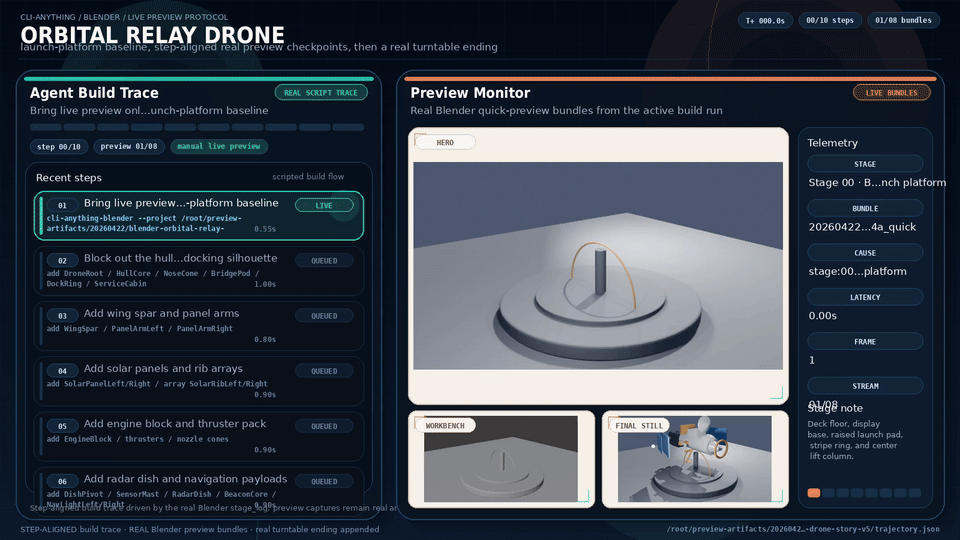
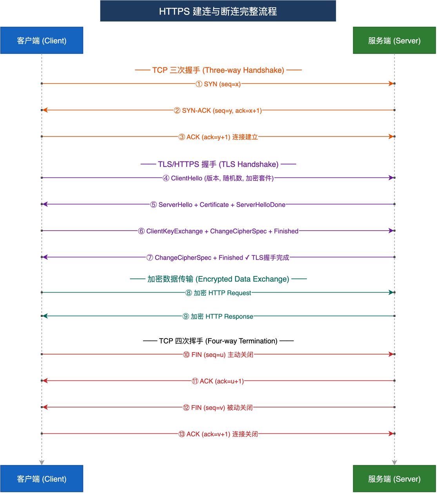
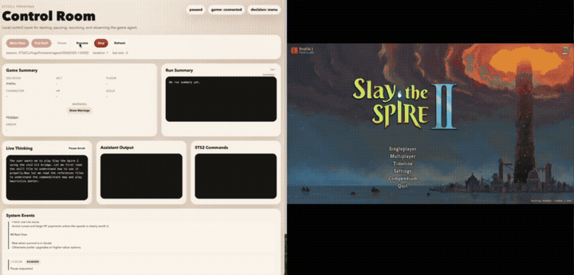

<h1 align="center">&nbsp; CLI-Anything: Biến MỌI phần mềm thành Agent-Native</h1>

<div align="center">
<a href="https://www.star-history.com/hkuds/cli-anything"><picture><source media="(prefers-color-scheme: dark)" srcset="https://api.star-history.com/badge?repo=HKUDS/CLI-Anything&amp;type=trending&amp;theme=dark"><source media="(prefers-color-scheme: light)" srcset="https://api.star-history.com/badge?repo=HKUDS/CLI-Anything&amp;type=trending"></picture></a>&#32;<a href="https://trendshift.io/repositories/22991" target="_blank"></a>&#32;<a href="https://www.star-history.com/hkuds/cli-anything"><picture><source media="(prefers-color-scheme: dark)" srcset="https://api.star-history.com/badge?repo=HKUDS/CLI-Anything&amp;type=rank&amp;theme=dark"><source media="(prefers-color-scheme: light)" srcset="https://api.star-history.com/badge?repo=HKUDS/CLI-Anything&amp;type=rank"></picture></a>
</div>

<p align="center">
  <strong>Phần mềm ngày nay phục vụ con người👨‍💻. Người dùng của ngày mai sẽ là Agent🤖.<br>
CLI-Anything: Thu hẹp khoảng cách giữa AI Agent và phần mềm trên toàn thế giới</strong><br>
</p>

**🌐 [CLI-Hub](https://hkuds.github.io/CLI-Anything/)**: `pip install cli-anything-hub` rồi `cli-hub install <name>` — duyệt, cài đặt và quản lý toàn bộ CLI do cộng đồng xây dựng. Muốn thêm CLI của riêng bạn? [Mở một PR](https://github.com/HKUDS/CLI-Anything/blob/main/CONTRIBUTING.md) — hub sẽ cập nhật ngay lập tức.

**🎬 [Xem Demo](#-real-world-demos)**: Xem AI agent dùng các CLI được sinh ra cùng các vòng lặp preview, live preview và trajectory để tạo ra sản phẩm thật — bản dựng CAD, cảnh 3D, sơ đồ, gameplay, phụ đề và nhiều hơn nữa.

**🙋 [Trở thành Contributor, hoặc yêu cầu một CLI]**: [Tham gia cùng chúng tôi](https://github.com/HKUDS/CLI-Anything/issues/new?template=contributor-signup.yml)! Đăng ký để xây dựng một CLI harness mới — sau khi được review và merge, bạn sẽ trở thành một trong những contributor của cộng đồng! Muốn CLI-Anything hỗ trợ một phần mềm hoặc dịch vụ cụ thể? Hãy gửi [yêu cầu wishlist](https://github.com/HKUDS/CLI-Anything/issues/new?template=cli-wishlist.yml)!

<p align="center">
  <a href="#-quick-start"></a>
  <a href="https://hkuds.github.io/CLI-Anything/"></a>
  <a href="#-demonstrations"></a>
  <a href="#-test-results"></a>
  <a href="https://arxiv.org/abs/2606.03854"></a>
  <a href="LICENSE"></a>
</p>

<p align="center">
  
  
  
  
  
  <a href="https://github.com/HKUDS/.github/blob/main/profile/README.md"></a>
<a href="https://github.com/HKUDS/.github/blob/main/profile/README.md"></a>
</p>

**Một dòng lệnh**: Biến mọi phần mềm thành agent-ready cho Pi, OpenClaw, nanobot, Cursor, Claude Code, v.v.&nbsp;&nbsp;[**English**](README.md) | [**中文文档**](README_CN.md) | [**日本語ドキュメント**](README_JA.md) | [**Deutsch**](README_DE.md)

<p align="center">
  
</p>

<p align="center">
  
</p>

---

## 📰 Tin tức

> Cảm ơn mọi đóng góp quý giá từ cộng đồng! Mỗi ngày đều có thêm cập nhật mới..

- **2026-05-30** 🧭 **Hermes skill** được đề xuất (#320), bổ sung một skill điều phối CLI-Anything cùng các script cài đặt và hướng dẫn fallback HARNESS. 🗺️ **ArcGIS Pro** được đề xuất đưa vào registry công khai (#318) dưới dạng CLI Windows/ArcPy cho bản đồ học, geoprocessing, chỉnh sửa feature và các workflow MCP với Pro đang chạy.

- **2026-05-27** 🔧 Cập nhật ngày trong registry của **CLI-Hub** nay xử lý được lệnh cài đặt `python -m pip` (#312), giúp việc phát hiện ngày phát hành package cho tự động hóa registry chính xác hơn.

- **2026-05-23** 📝 **Obsidian Agent CLI** được đề xuất đưa vào registry công khai (#307), mang đến một CLI tự động hóa Obsidian cài qua PyPI với các workflow bộ nhớ agent bền vững và liên kết skill được ghim phiên bản.

- **2026-05-21** 🔒 Việc xử lý token-file của **Sketch CLI** đã được gia cố trước path traversal và symlink escape (#304).

- **2026-05-20** 📓 **Joplin CLI** được đề xuất (#300) với notebook, ghi chú, to-do, tag, tệp đính kèm, tìm kiếm/đồng bộ, import/export, các helper server/E2EE, tài liệu đầy đủ, tài liệu skill đóng gói sẵn và baseline kiểm thử gồm 134 test.

- **2026-05-20** 🎛️ **Rekordbox CLI** đã được merge (#252) với các đường ghi SQLCipher có bảo vệ, ghi cưỡng bức bắt buộc có backup, smoke test và đồng bộ skill gốc. 📚 **Calibre CLI** đã được merge (#223) với các workflow thư viện/tìm kiếm/metadata/chuyển đổi/export, 41 unit test, bằng chứng E2E với Calibre thật và xác thực skill gốc. 🧊 **3MF CLI** đã được merge (#209) với kiểm tra mesh, đổi kích thước lỗ, sửa chữa, so sánh và giữ nguyên thuộc tính tam giác. 🎙️ **MiniMax CLI** đã được merge (#189) với các workflow chat/TTS, liệt kê model/giọng đọc an toàn với JSON, xử lý dấu nháy trong REPL và smoke/E2E test. 🎮 **UEAtelier** đã gia nhập registry (#297) như một workbench tự mở rộng Unreal Editor MCP với Python CLI proxy.

- **2026-05-19** 🛠️ Các harness hiện có được rà soát lại về chất lượng/bảo mật — **Zoom** tải bản ghi từ URL trực tiếp (#294), tìm kiếm của **Obsidian** nay dùng các content type của vendor trong Local REST API (#289), chuyển đổi headless của **LibreOffice** ổn định hơn trên macOS (#290), và việc parse XML/SVG/ODF/MLT/MusicXML/CSL nay đưa input không đáng tin cậy qua `defusedxml` (#296).

- **2026-05-18** 📈 Làm mới phần trình bày README với badge Trendshift và phần header dự án được căn giữa gọn gàng hơn (#285, #286), giúp phần mở đầu tập trung vào khả năng khám phá và đà phát triển của dự án.

- **2026-05-17** 🌐 Việc xử lý registry của **CLI-Hub** đã được gia cố (#281) — các entry trong registry nay được sao chép trước khi gắn tag `_source`, tránh việc dữ liệu registry được cache hoặc mock bị sửa trực tiếp tại chỗ.

- **2026-05-16** 🔧 **n8n** nhận được bản sửa lỗi crash ở banner REPL, sau đó đã được merge vào main (#280), khôi phục luồng khởi động tương tác khi không có subcommand, kèm regression test.

<details>
<summary>Tin tức trước đó (10–18/04)</summary>

- **2026-04-18** 🧩 **Toàn bộ file SKILL.md đang được hợp nhất vào thư mục `skills/` ở cấp cao nhất** — mọi skill CLI đều có thể cài từ một nguồn chuẩn duy nhất bằng `npx skills add HKUDS/CLI-Anything --skill <skill-name> -g -y`. Chúng tôi cũng bổ sung CI xác thực root-skill, đồng bộ tài liệu đóng góp / PR và gợi ý đường dẫn skill trong REPL theo cấu trúc mới, đồng thời làm mới frontend ưu tiên cài đặt của **CLI-Hub** xoay quanh luồng `npx skills` mới.

- **2026-04-17** 🌐 **CLI-Hub** có thêm một đợt cải thiện trải nghiệm cài đặt — metadata của registry công khai và độ phủ skill được siết chặt hơn, việc đếm lượt truy cập đã được sửa, và web hub được tinh chỉnh thêm. 🧪 Đã sửa thời lượng đầu ra render của **Shotcut** (#92). 📝 Đã sửa đường dẫn đóng góp **SKILL** theo luồng tài liệu mới (#224), và trình sinh skill nay xử lý an toàn phần intro rỗng (#203).

- **2026-04-16** 🗺️ **QGIS CLI** đã được merge (#207) — một harness soạn thảo GIS / bản đồ hoàn chỉnh đã ra mắt. 🧬 **UniMol Tools CLI** đã được merge (#219) cho các workflow mô hình hóa phân tử. 🌐 **CLI-Hub** cũng bổ sung thêm nhiều CLI công khai, trong đó có **py4csr**, làm mới meta-skill được sinh ra, sửa tài liệu đóng góp SKILL, và sửa lỗi trích xuất package `apt-get` trong quá trình sinh skill (#204).

- **2026-04-16** 📈 **Unreal Insights CLI** được mở rộng — thêm điều khiển phiên capture chạy nền (`capture start/status/snapshot/stop`), các luồng xác định/build `UnrealInsights.exe` khớp với engine-root, và làm mới tài liệu/test cho workflow điều phối mới.

- **2026-04-15** 🌐 **CLI-Hub** cập nhật lên **v0.2.0** — package PyPI nay hỗ trợ các CLI công khai từ nhiều nguồn cài đặt (`pip`, `npm`, `brew`, công cụ đi kèm/hệ thống), dựa trên một `public_registry.json` mới. Frontend của Hub được thiết kế lại với hai nhóm **CLI-Anything CLIs** và **Public CLIs** riêng biệt, và các bài kiểm tra end-to-end trực tiếp nay bao phủ toàn bộ luồng cài đặt, cập nhật và gỡ cài đặt thực tế cho cả package pip lẫn npm.

- **2026-04-14** 🧭 **Safari CLI** đã được merge (#212) và thêm vào registry của Hub — tự động hóa trình duyệt qua `safari-mcp`. 🎬 **Kdenlive** cũng nhận được các bản sửa tương thích cho đầu ra project Gen 5 và việc sinh project không hợp lệ.

- **2026-04-13** 📓 **Obsidian CLI** đã được merge (#211) — harness quản lý tri thức qua Local REST API, với 48 unit test và 7 E2E test. ⛓️ **Eth2-Quickstart CLI** đã được merge (#195) — harness quản lý node staking Ethereum. 📚 **Zotero CLI** cập nhật lên v0.4.1 (#201) — nay được phát hành từ repo độc lập, và CLI-Hub đã hỗ trợ các URL `skill_md` từ xa.

- **2026-04-11** 🔗 **n8n CLI** đã được merge (#188) — harness tự động hóa workflow cho các luồng tự động hóa self-hosted. 🔧 Bản sửa **Exa CLI** (#205) thêm header `x-exa-integration` để theo dõi mức sử dụng. 📦 **CLI-Hub** cũng có thêm workflow tự động publish lên PyPI và pipeline làm mới package.

- **2026-04-10** 📦 **Trình quản lý package CLI-Hub** ra mắt — `pip install cli-anything-hub` để duyệt, tìm kiếm, cài đặt, cập nhật và gỡ cài đặt các harness CLI-Anything chỉ bằng một lệnh. Web Hub cũng ra mắt đợt làm mới frontend đầu tiên tập trung vào cài đặt và thẻ toolkit "Empower yourself".

</details>

<details>
<summary>Tin tức trước đó (01–09/04)</summary>

- **2026-04-09** 🧹 Đợt dọn dẹp và chỉnh sửa tài liệu (#200) — sửa tổng phụ của test Openscreen, thêm Openscreen vào README tiếng Trung và cấu trúc dự án, đồng thời làm rõ cú pháp lệnh `/cli-anything` trong tài liệu.

- **2026-04-08** 🎬 **Openscreen CLI** đã được merge (#183) — harness trình chỉnh sửa quay màn hình với 101 test. ☁️ **CloudAnalyzer CLI** đã được merge (#181) — harness phân tích chi phí cloud với 27 lệnh. 🌊 Các harness **SeaClip / PM2 / ChromaDB** đã được merge (#129).

- **2026-04-07** 🔄 **Dify Workflow CLI** đã được merge (#191) — wrapper tự động hóa workflow. 🔧 Sửa lỗi auto-save của **Inkscape** (#193, sửa #182). 🛡️ **Gia cố bảo mật DomShell** (#156) — xác thực URL và làm sạch DOM cho CLI trình duyệt. 🥧 **Extension Pi Coding Agent** đã được merge (#178).

- **2026-04-06** 🔍 **Exa CLI** đã được merge (#172) — harness tìm kiếm web và trả lời bằng AI. 🎮 **Godot CLI** đã được merge (#140) — harness game engine với pipeline E2E demo-game hoàn chỉnh. ☁️ Các bản sửa theo review và cải tiến frontend của **CloudAnalyzer** cũng đã được đưa vào.

- **2026-04-03** 🧪 **WireMock CLI** đã được merge (#170) — harness mock server HTTP cho kiểm thử API. 🥧 Hỗ trợ extension **Pi Coding Agent** cũng đã được đưa vào, và các bản ghi demo CLI đã được thêm vào tài liệu.

- **2026-04-01** ⚔️ **Slay the Spire II CLI** đã được merge (#148) — harness game roguelike xây dựng bộ bài. 🎥 **VideoCaptioner CLI** đã được merge (#166) — harness tạo phụ đề video bằng AI. 🛰️ **IntelWatch** được thêm vào registry cho các workflow OSINT B2B.

</details>

<details>
<summary>Tin tức trước đó (23–30/03)</summary>

- **2026-03-30** 🏗️ **CLI-Anything v0.2.0** — thiết kế lại HARNESS.md theo hướng tiết lộ dần (progressive disclosure). Các hướng dẫn chi tiết được tách vào `guides/` để tải theo nhu cầu. Các Phase 1–7 nay liền mạch. Key Principles và Rules được gộp thành một phần duy nhất mang tính quyết định.

- **2026-03-29** 📐 Cập nhật tài liệu skill Blender — bắt buộc dùng đường dẫn render tuyệt đối và sửa lại các điều kiện tiên quyết.

- **2026-03-28** 🌐 **CLIBrowser** được thêm vào registry của CLI-Hub để tự động hóa trình duyệt mà agent có thể truy cập.

- **2026-03-27** 📚 SKILL.md của Zotero được bổ sung các ràng buộc dành cho agent; sửa lỗi cấu hình REPL và phân giải file thực thi.

- **2026-03-26** 📖 Harness **Zotero CLI** ra mắt cho Zotero desktop (quản lý thư viện, collection, trích dẫn). Sửa lỗi ID tùy chỉnh của Draw.io (#132) và lỗi cú pháp registry.json.

- **2026-03-25** 🎮 **RenderDoc CLI** đã được merge để phân tích frame capture GPU. FreeCAD được cập nhật cho v1.1. Sửa lại tên engine Blender EEVEE. Gia cố quyền token của Zoom.

- **2026-03-24** 🏭 Thêm **FreeCAD CLI** với 258 lệnh trong 17 nhóm. Các harness **iTerm2** và **Teltonika RMS** được thêm vào registry.

- **2026-03-23** 🤖 Ra mắt **meta-skill CLI-Hub** — agent nay có thể tự khám phá và cài đặt CLI. Harness **Krita CLI** đã được merge cho vẽ kỹ thuật số.

</details>

<details>
<summary>Tin tức trước đó (11–22/03)</summary>

- **2026-03-22** 🎵 **MuseScore CLI** đã được merge với các chức năng transpose, export và quản lý nhạc cụ.

- **2026-03-21** 🔧 Cải thiện hạ tầng — tinh chỉnh các test harness và tài liệu trên nhiều CLI. Tăng cường khả năng tương thích Windows cho một số backend.

- **2026-03-20** 🌐 Thêm CLI **Novita AI** để truy cập API tương thích OpenAI. Cải thiện metadata registry để hub dễ khám phá hơn.

- **2026-03-19** 📦 Tinh chỉnh cấu trúc package trên các harness. Cải thiện việc sinh SKILL.md với tài liệu lệnh tốt hơn.

- **2026-03-18** 🧪 Mở rộng độ phủ kiểm thử — bổ sung các kịch bản E2E và kiểm tra trường hợp biên trên nhiều CLI.

- **2026-03-17** 🌐 Ra mắt **[CLI-Hub](https://hkuds.github.io/CLI-Anything/)** — một registry trung tâm nơi bạn có thể duyệt, tìm kiếm và cài đặt bất kỳ CLI nào chỉ với một lệnh `pip`.

- **2026-03-16** 🤖 Thêm tính năng sinh **SKILL.md** (Phase 6.5) — mọi CLI được sinh ra nay đều đi kèm định nghĩa skill mà AI có thể khám phá.

- **2026-03-15** 🐾 Hỗ trợ **OpenClaw** từ cộng đồng! Đã merge guard `cygpath` trên Windows để hỗ trợ đa nền tảng.

- **2026-03-14** 🔒 Sửa lỗ hổng path injection trong GIMP Script-Fu và thêm bản dịch **README tiếng Nhật**.

- **2026-03-13** 🔌 Plugin **Qodercli** chính thức được merge như một đóng góp từ cộng đồng, kèm các script cài đặt riêng.

- **2026-03-12** 📦 Tích hợp **Codex skill** đã được đưa vào, mang CLI-Anything đến thêm một nền tảng AI coding nữa.

- **2026-03-11** 📞 Harness hội nghị truyền hình **Zoom** được thêm vào như ứng dụng được hỗ trợ thứ 11.

</details>

---

## 🤔 Tại sao lại là CLI?

CLI là giao diện phổ quát cho cả con người lẫn AI agent:

• **Có cấu trúc & dễ kết hợp** - Lệnh dạng văn bản khớp với định dạng của LLM và có thể nối chuỗi cho các workflow phức tạp

• **Nhẹ & phổ quát** - Chi phí tối thiểu, chạy trên mọi hệ thống mà không cần phụ thuộc

• **Tự mô tả** - Các cờ --help cung cấp tài liệu tự động để agent có thể khám phá

• **Đã được chứng minh** - Claude Code chạy hàng nghìn workflow thực tế qua CLI mỗi ngày

• **Thiết kế ưu tiên agent** - Đầu ra JSON có cấu trúc loại bỏ độ phức tạp khi parse

• **Xác định & đáng tin cậy** - Kết quả nhất quán giúp agent hoạt động có thể dự đoán được

<a id="-quick-start"></a>
## 🚀 Bắt đầu nhanh

CLI-Anything có hai điểm khởi đầu, đều hữu ích như nhau:

| Mục tiêu | Bắt đầu từ đây |
|------|------------|
| **Dùng ngay hệ sinh thái CLI có sẵn** | Cài `cli-anything-hub`, duyệt registry và cài các CLI làm sẵn. |
| **Xây dựng một CLI agent-native mới** | Cài plugin/skill CLI-Anything cho agent của bạn, rồi chạy trình tạo harness 7 giai đoạn. |

<details open>
<summary><strong>Giai đoạn 1: Tự trang bị cho mình — bộ công cụ CLI của bạn</strong></summary>

Hãy cài trình quản lý gói CLI-Hub trước. Nó cho phép bạn duyệt, tìm kiếm, xem thông tin, cài đặt, cập nhật, gỡ cài đặt và chạy các harness CLI-Anything cùng các CLI công khai của bên thứ ba chỉ bằng một lệnh.

**PIP**

```bash
pip install cli-anything-hub
```

| Lệnh | Chức năng |
|---------|--------------|
| `cli-hub list` | Duyệt registry |
| `cli-hub search <query>` | Tìm theo từ khóa |
| `cli-hub info <name>` | Xem thông tin một CLI |
| `cli-hub install <name>` | Cài từ CLI-Hub |
| `cli-hub update <name>` | Cập nhật bản đã cài |
| `cli-hub uninstall <name>` | Gỡ bản đã cài |
| `cli-hub launch <name> [args...]` | Chạy một CLI đã cài |

```bash
# Duyệt những gì đang có
cli-hub list
cli-hub search image

# Cài và dùng thử một CLI ngay
cli-hub install gimp
cli-hub info gimp
cli-hub launch gimp
```

> Một số CLI bọc phần mềm desktop hoặc backend thật. Nếu CLI bạn chọn cần GIMP, Blender, LibreOffice hoặc một công cụ upstream khác, hãy cài luôn ứng dụng upstream đó.

</details>

<details open>
<summary><strong>Giai đoạn 1.5: Trang bị cho agent của bạn — cài đặt chỉ với một lệnh</strong></summary>

Trao cho các agent tương thích SKILL meta-skill CLI-Hub để chúng tự tìm và cài đúng CLI cho từng tác vụ.

**Cũng có trên:** [ClawHub](https://clawhub.ai/yuh-yang/cli-anything-hub), [SkillHub](https://www.skillhub.club/web/skills/itsyuhao-cli-anything-hub), [SkillHub.cn](https://skillhub.cn/skills/cli-hub-meta-skill)

**NPX SKILLS**

```bash
npx skills add HKUDS/CLI-Anything --skill cli-hub-meta-skill -g -y
```

**Hoạt động với:** OpenClaw, Nanobot, Claude Code, Codex, Reasonix, Antigravity và các agent tương thích SKILL khác.

Sau đó ra lệnh:

```text
Find appropriate CLI software in CLI-Hub and complete the task: ...
```

</details>

<details open>
<summary><strong>Giai đoạn 3: Tạo CLI mới khi registry chưa có</strong></summary>

Dùng trình tạo CLI-Anything khi bạn cần một harness mới cho phần mềm, codebase hoặc công cụ nội bộ chưa có sẵn trên CLI-Hub.

**Yêu cầu trước**

- **Python 3.10+**
- Phần mềm hoặc source repo đích có sẵn ở máy local hoặc trực tuyến
- Một AI coding agent được hỗ trợ: [Claude Code](#-claude-code) | [Cursor](#-cursor) | [Pi](#-pi-coding-agent) | [OpenClaw](#-openclaw) | [OpenCode](#-opencode) | [Codex](#-codex) | [Hermes](#-hermes) | [Reasonix](#-reasonix) | [Qodercli](#-qodercli) | [GitHub Copilot CLI](#-github-copilot-cli) | [Các nền tảng khác](#-more-platforms-coming-soon)

### Chọn nền tảng agent của bạn

<details open>
<summary><h4 id="-claude-code">⚡ Claude Code</h4></summary>

**Bước 1: Thêm Marketplace**

CLI-Anything được phân phối dưới dạng plugin marketplace của Claude Code, đặt trên GitHub.

```bash
# Thêm marketplace CLI-Anything
/plugin marketplace add HKUDS/CLI-Anything
```

**Bước 2: Cài plugin**

```bash
# Cài plugin cli-anything từ marketplace
/plugin install cli-anything
```

Vậy là xong. Plugin giờ đã có trong session Claude Code của bạn.

> **Lưu ý cho người dùng Windows:** Claude Code chạy các lệnh shell qua `bash`. Trên Windows, hãy cài Git for Windows (đã gồm `bash` và
`cygpath`) hoặc dùng WSL; nếu không, lệnh có thể lỗi với thông báo `cygpath: command not found`.

**Bước 3: Tạo CLI chỉ với một lệnh**

```bash
# /cli-anything <software-path-or-repo>
# Tạo một CLI hoàn chỉnh cho GIMP (đủ 7 giai đoạn)
/cli-anything ./gimp
```

Tương thích lệnh giữa các phiên bản Claude Code:
- Dùng `/cli-anything` làm điểm vào chính.
- Trên các bản cũ không nhận ra `/cli-anything` **sau khi đã xác nhận plugin được cài và nạp**, hãy thử dạng cũ `/cli-anything:cli-anything`.
- Các lệnh phụ giữ dạng `:subcommand` (ví dụ `/cli-anything:refine`).

Nếu bạn thấy `Unknown skill: cli-anything`, hãy kiểm tra việc cài/nạp plugin trước (cả hai dạng lệnh đều trỏ tới cùng một skill, nên đổi dạng sẽ không giúp ích):
1. Nạp lại các lệnh plugin: `/reload-plugins`
2. Xác nhận plugin đã được nạp: `/help cli-anything` (phần trợ giúp/lệnh của CLI-Anything phải xuất hiện)
3. Cài lại từ marketplace nếu cần:
   - `/plugin marketplace add HKUDS/CLI-Anything`
   - `/plugin install cli-anything`
4. Sau khi xác nhận plugin đã sẵn sàng, thử lại lệnh vào:
   - Nên dùng: `/cli-anything ./gimp`
   - Chỉ với bản cũ: `/cli-anything:cli-anything ./gimp`

Lệnh này chạy toàn bộ pipeline:
1. 🔍 **Analyze** — Quét source code, ánh xạ các thao tác GUI sang API
2. 📐 **Design** — Thiết kế nhóm lệnh, mô hình state, định dạng output
3. 🔨 **Implement** — Xây dựng CLI Click với REPL, output JSON, undo/redo
4. 📋 **Plan Tests** — Tạo TEST.md với kế hoạch unit test + E2E
5. 🧪 **Write Tests** — Viết bộ test toàn diện
6. 📝 **Document** — Cập nhật TEST.md với kết quả
7. 📦 **Publish** — Tạo `setup.py`, cài vào PATH

**Bước 4 (Tùy chọn): Tinh chỉnh và cải thiện CLI**

Sau lần build đầu tiên, bạn có thể tinh chỉnh CLI theo từng vòng để mở rộng độ phủ và bổ sung các khả năng còn thiếu:

```bash
# Tinh chỉnh diện rộng — agent phân tích khoảng trống trên mọi khả năng
/cli-anything:refine ./gimp

# Tinh chỉnh có trọng tâm — nhắm vào một mảng chức năng cụ thể
/cli-anything:refine ./gimp "I want more CLIs on image batch processing and filters"
```

Lệnh refine phân tích khoảng trống giữa toàn bộ khả năng của phần mềm và độ phủ hiện tại của CLI, sau đó triển khai các lệnh, test và tài liệu mới cho những khoảng trống đã xác định. Bạn có thể chạy nhiều lần để mở rộng độ phủ dần dần — mỗi lần chạy đều mang tính gia tăng và không phá hủy.

<details>
<summary><strong>Cách khác: Cài đặt thủ công</strong></summary>

Nếu bạn không muốn dùng marketplace:

```bash
# Clone repo
git clone https://github.com/HKUDS/CLI-Anything.git

# Copy plugin vào thư mục plugin của Claude Code
cp -r CLI-Anything/cli-anything-plugin ~/.claude/plugins/cli-anything

# Nạp lại plugin
/reload-plugins
```

</details>

</details>

<details>
<summary><h4 id="-pi-coding-agent">⚡ Pi Coding Agent</h4></summary>

**Bước 1: Cài extension**

Extension nằm tại `.pi-extension/cli-anything/` trong repo này. Hãy cài toàn cục để các lệnh `/cli-anything` dùng được trong **mọi** project Pi:

```bash
# Clone repo
git clone https://github.com/HKUDS/CLI-Anything.git
cd CLI-Anything

# Cài toàn cục vào thư mục extensions của Pi
bash .pi-extension/cli-anything/install.sh
```

Để gỡ cài đặt:

```bash
bash .pi-extension/cli-anything/install.sh --uninstall
```

> **Cách hoạt động:** `install.sh` copy các file extension (gồm HARNESS.md, các lệnh, hướng dẫn, script và template từ `cli-anything-plugin/`) vào `~/.pi/agent/extensions/cli-anything/`, thư mục mà Pi tự động phát hiện khi khởi động. Chạy `/reload` trong Pi hoặc khởi động lại Pi để kích hoạt.

**Bước 2: Tạo CLI chỉ với một lệnh**

Khi extension đã được nạp, các lệnh sau sẽ khả dụng:

```bash
# Tạo một CLI hoàn chỉnh cho GIMP (đủ 7 giai đoạn)
/cli-anything ./gimp

# Build từ một repo GitHub
/cli-anything https://github.com/blender/blender
```

**Bước 3 (Tùy chọn): Tinh chỉnh và cải thiện CLI**

```bash
# Tinh chỉnh diện rộng — agent phân tích khoảng trống trên mọi khả năng
/cli-anything:refine ./gimp

# Tinh chỉnh có trọng tâm — nhắm vào một mảng chức năng cụ thể
/cli-anything:refine ./gimp "batch processing and filters"
```

**Các lệnh khả dụng**

| Lệnh | Mô tả |
|---------|-------------|
| `/cli-anything <path-or-repo>` | Build một harness CLI hoàn chỉnh |
| `/cli-anything:refine <path> [focus]` | Tinh chỉnh một harness CLI đã có |
| `/cli-anything:test <path-or-repo>` | Chạy test cho một harness CLI |
| `/cli-anything:validate <path-or-repo>` | Kiểm tra tính hợp lệ của một harness CLI |
| `/cli-anything:list [options]` | Liệt kê tất cả công cụ CLI-Anything |

</details>

<details>
<summary><h4 id="-opencode">⚡ OpenCode (Experimental)</h4></summary>

**Bước 1: Cài các lệnh**

> **Lưu ý:** Hãy nâng cấp lên OpenCode mới nhất. Các phiên bản cũ có thể dùng đường dẫn commands khác.

Copy các lệnh CLI-Anything **và** `HARNESS.md` vào thư mục commands của OpenCode:

```bash
# Clone repo
git clone https://github.com/HKUDS/CLI-Anything.git

# Cài toàn cục (dùng được trong mọi project)
cp CLI-Anything/opencode-commands/*.md ~/.config/opencode/commands/
cp CLI-Anything/cli-anything-plugin/HARNESS.md ~/.config/opencode/commands/

# Hoặc cài ở cấp project
cp CLI-Anything/opencode-commands/*.md .opencode/commands/
cp CLI-Anything/cli-anything-plugin/HARNESS.md .opencode/commands/
```

> **Lưu ý:** Hãy nâng cấp lên OpenCode mới nhất. Các phiên bản cũ dùng `command/` (số ít) thay vì `commands/`. Nếu `commands/` không tồn tại, hãy dùng `command/` cho cả cài đặt toàn cục lẫn cấp project.

> **Lưu ý:** `HARNESS.md` là bản đặc tả phương pháp luận mà mọi lệnh đều tham chiếu. Nó phải nằm cùng thư mục với các lệnh.

Thao tác này thêm 5 slash command: `/cli-anything`, `/cli-anything-refine`, `/cli-anything-test`, `/cli-anything-validate` và `/cli-anything-list`.

**Bước 2: Tạo CLI chỉ với một lệnh**

```bash
# Tạo một CLI hoàn chỉnh cho GIMP (đủ 7 giai đoạn)
/cli-anything ./gimp

# Build từ một repo GitHub
/cli-anything https://github.com/blender/blender
```

Lệnh chạy dưới dạng subtask và theo cùng phương pháp luận 7 giai đoạn như Claude Code.

**Bước 3 (Tùy chọn): Tinh chỉnh và cải thiện CLI**

```bash
# Tinh chỉnh diện rộng — agent phân tích khoảng trống trên mọi khả năng
/cli-anything-refine ./gimp

# Tinh chỉnh có trọng tâm — nhắm vào một mảng chức năng cụ thể
/cli-anything-refine ./gimp "batch processing and filters"
```

</details>

<details>
<summary><h4 id="-goose">⚡ Goose (Desktop / CLI) <sup><code>Experimental</code></sup> <sup><code>Community</code></sup></h4></summary>

**Bước 1: Cài Goose**

Cài Goose (Desktop hoặc CLI) theo hướng dẫn chính thức của Goose cho hệ điều hành của bạn.

**Bước 2: Cấu hình một CLI provider**

Cấu hình Goose để dùng một CLI provider như Claude Code, và đảm bảo CLI đó đã được cài đặt và xác thực.

**Bước 3: Dùng CLI-Anything trong session Goose**

Sau khi Goose được cấu hình, hãy bắt đầu một session và dùng các lệnh CLI-Anything giống như đã mô tả ở trên cho Claude Code, ví dụ:

```bash
/cli-anything ./gimp
/cli-anything:refine ./gimp "batch processing and filters"
```

> Lưu ý: Khi Goose chạy qua một CLI provider, nó dùng khả năng và định dạng lệnh của provider đó.
</details>

<details>

<summary><h4 id="-qodercli">⚡ Qodercli <sup><code>Community</code></sup></h4></summary>

**Bước 1: Đăng ký plugin**

```bash
git clone https://github.com/HKUDS/CLI-Anything.git
bash CLI-Anything/qoder-plugin/setup-qodercli.sh
```

Thao tác này đăng ký plugin cli-anything trong `~/.qoder.json`. Hãy bắt đầu một session Qodercli mới sau khi đăng ký.

**Bước 2: Dùng CLI-Anything từ Qodercli**

```bash
/cli-anything ./gimp
/cli-anything:refine ./gimp "batch processing and filters"
/cli-anything:validate ./gimp
```
</details>

<details>

<summary><h4 id="-openclaw">⚡ OpenClaw <sup><code>Community</code></sup></h4></summary>

**Bước 1: Cài skill**

CLI-Anything cung cấp sẵn file `SKILL.md` native cho OpenClaw. Hãy copy nó vào thư mục skills của OpenClaw:

```bash
# Clone repo
git clone https://github.com/HKUDS/CLI-Anything.git

# Cài vào thư mục skills toàn cục
mkdir -p ~/.openclaw/skills/cli-anything
cp CLI-Anything/openclaw-skill/SKILL.md ~/.openclaw/skills/cli-anything/SKILL.md
```

**Bước 2: Tạo CLI**

Giờ bạn có thể gọi skill ngay trong OpenClaw:

`@cli-anything build a CLI for ./gimp`

Skill này theo cùng phương pháp luận 7 giai đoạn như Claude Code và OpenCode.

</details>

<details>

<summary><h4 id="-cursor">⚡ Cursor</h4></summary>

Cursor hỗ trợ **cả hai** hướng:

| Hướng | Mục đích | Cài đặt |
|-------|---------|---------|
| **Generator** | Tạo harness mới bằng `/cli-anything` (cùng refine/test/validate/list) | Plugin Cursor trong `cursor-plugin/` |
| **Consumer** | Tìm/cài/dùng các CLI đã xuất bản từ CLI-Hub | `npx skills` + `cli-hub` (không đổi) |

**Generator — cài plugin Cursor**

```bash
git clone https://github.com/HKUDS/CLI-Anything.git
bash CLI-Anything/cursor-plugin/scripts/install.sh
```

Windows PowerShell:

```powershell
.\CLI-Anything\cursor-plugin\scripts\install.ps1
```

Nâng cấp bằng `--force` / `-Force`. Đường dẫn cài mặc định là
`~/.cursor/plugins/local/cli-anything` (ghi đè bằng `CURSOR_PLUGINS_HOME` trỏ tới một
thư mục có tên `plugins`). Trình cài đặt vendor các tài nguyên phương pháp luận trong `cli-anything-plugin/`
và ghi `PLUGIN_ROOT.txt` cùng `~/.cursor/cli-anything-generator.root`
để các agent Cursor có thể xác định đường dẫn tuyệt đối tới phương pháp luận.

Nạp lại cửa sổ Cursor (**Developer: Reload Window**), rồi chạy:

```text
/cli-anything ./gimp
/cli-anything-refine ./shotcut "picture-in-picture workflows"
/cli-anything-test ./libreoffice
/cli-anything-validate ./libreoffice
/cli-anything-list
```

**Consumer — Hub / skills (tách biệt với plugin generator)**

```bash
npx skills add HKUDS/CLI-Anything --skill cli-hub-meta-skill -g -y
# hoặc một skill theo từng ứng dụng, ví dụ cli-anything-blender
pip install cli-anything-hub
```

Kiểm tra trình cài đặt plugin ở máy local:

```bash
bash CLI-Anything/cursor-plugin/tests/test_install.sh
```

Xem [`cursor-plugin/README.md`](cursor-plugin/README.md) để khắc phục sự cố khi nạp plugin local.
</details>

<details>

<summary><h4 id="-codex">⚡ Codex <sup><code>Experimental</code></sup> <sup><code>Community</code></sup></h4></summary>

**Bước 1: Cài skill**

Chạy trình cài đặt đi kèm:

```bash
# Clone repo
git clone https://github.com/HKUDS/CLI-Anything.git

# Cài skill
bash CLI-Anything/codex-skill/scripts/install.sh
```

Trên Windows PowerShell, dùng:

```powershell
.\CLI-Anything\codex-skill\scripts\install.ps1
```

Thao tác này cài skill vào `$CODEX_HOME/skills/cli-anything` (hoặc `~/.codex/skills/cli-anything` nếu `CODEX_HOME` chưa được đặt).
Trình cài đặt cũng vendor `HARNESS.md` chuẩn, các đặc tả lệnh,
các hướng dẫn theo yêu cầu, script hỗ trợ có thể tái sử dụng, template skill và giao thức preview
vào các thư mục `references/` và `scripts/` của skill đã cài.
Nhờ vậy skill Codex tự chứa đủ mọi thứ, trong khi `cli-anything-plugin/` vẫn là
nguồn chuẩn (source of truth).

Hãy khởi động lại Codex sau khi cài để nó được phát hiện.

**Bước 2: Dùng CLI-Anything từ Codex**

Mô tả tác vụ bằng ngôn ngữ tự nhiên, ví dụ:

```text
Use CLI-Anything to build a harness for ./gimp
Use CLI-Anything to refine ./shotcut for picture-in-picture workflows
Use CLI-Anything to validate ./libreoffice
Use CLI-Anything to list generated harnesses under the current directory
```

Skill Codex áp dụng cùng phương pháp luận với plugin Claude Code và
các lệnh OpenCode, đồng thời giữ nguyên định dạng harness Python được tạo ra.

Để kiểm tra bản cài Codex tự chứa ở máy local:

```bash
bash CLI-Anything/codex-skill/tests/test_install.sh
```
</details>

<details>

<summary><h4 id="-hermes">⚡ Hermes <sup><code>Experimental</code></sup> <sup><code>Community</code></sup></h4></summary>

**Bước 1: Cài skill**

Chạy trình cài đặt đi kèm:

```bash
# Clone repo
git clone https://github.com/HKUDS/CLI-Anything.git

# Cài skill
bash CLI-Anything/hermes-skill/scripts/install.sh
```

Trên Windows PowerShell, dùng:

```powershell
.\CLI-Anything\hermes-skill\scripts\install.ps1
```

Thao tác này cài skill vào `$HERMES_HOME/skills/cli-anything-hermes` (hoặc `~/.hermes/skills/cli-anything-hermes` nếu `HERMES_HOME` chưa được đặt).

Hãy khởi động lại [Hermes Agent](https://github.com/NousResearch/hermes-agent) sau khi cài để nó được phát hiện.

**Bước 2: Dùng CLI-Anything từ Hermes**

Mô tả tác vụ bằng ngôn ngữ tự nhiên, ví dụ:

```text
Use CLI-Anything to build a harness for ./gimp
Use CLI-Anything to refine ./shotcut for picture-in-picture workflows
Use CLI-Anything to validate ./libreoffice
```

Skill Hermes áp dụng cùng phương pháp luận với plugin Claude Code và
skill Codex, gắn các tool `terminal`, `execute_code`, `delegate_task` và
`read_file` / `write_file` / `patch` của Hermes vào workflow harness 7 giai đoạn, đồng thời
giữ nguyên định dạng harness Python được tạo ra.
</details>

<details>

<summary><h4 id="-reasonix">⚡ Reasonix <sup><code>Experimental</code></sup> <sup><code>Community</code></sup></h4></summary>

**Bước 1: Cài skill**

Chạy trình cài đặt đi kèm:

```bash
# Clone repo
git clone https://github.com/HKUDS/CLI-Anything.git

# Cài skill
bash CLI-Anything/reasonix-skill/scripts/install.sh
```

Trên Windows PowerShell, dùng:

```powershell
.\CLI-Anything\reasonix-skill\scripts\install.ps1
```

Thao tác này cài skill vào thư mục skill toàn cục của Reasonix tại `~/.reasonix/skills/cli-anything`.

Hãy khởi động lại Reasonix sau khi cài để nó được phát hiện.

**Bước 2: Dùng CLI-Anything từ Reasonix**

Mô tả tác vụ bằng ngôn ngữ tự nhiên, ví dụ:

```text
Use CLI-Anything to build a harness for ./gimp
Use CLI-Anything to refine ./shotcut for picture-in-picture workflows
Use CLI-Anything to validate ./libreoffice
```

Skill Reasonix áp dụng cùng phương pháp luận với plugin Claude Code và
các skill Codex/Hermes, gắn các tool `bash`, `write_file`, `edit_file`,
`multi_edit`, `grep`, `glob` cùng các tool tùy chọn `mcp__codegraph__search` / `mcp__codegraph__context` vào
workflow harness 7 giai đoạn, đồng thời giữ nguyên định dạng harness Python được tạo ra.
</details>

<details>

<summary><h4 id="-github-copilot-cli">⚡ GitHub Copilot CLI <sup><code>Community</code></sup></h4></summary>

**Bước 1: Cài plugin**

```bash
git clone https://github.com/HKUDS/CLI-Anything.git
cd CLI-Anything
copilot plugin install ./cli-anything-plugin
```

Thao tác này cài plugin CLI-Anything vào GitHub Copilot CLI. Plugin giờ đã có trong session GitHub Copilot CLI của bạn.

**Bước 2: Dùng CLI-Anything từ GitHub Copilot CLI**

```bash
/cli-anything ./gimp
/cli-anything:refine ./gimp "batch processing and filters"
/cli-anything:validate ./gimp
```

</details>

<details>
<summary><h4 id="-more-platforms-coming-soon">🔮 Các nền tảng khác (Sắp ra mắt)</h4></summary>

CLI-Anything được thiết kế để không phụ thuộc nền tảng. Dự kiến hỗ trợ thêm nhiều AI coding agent khác:

- **Cursor** — khả dụng qua plugin Cursor trong `cursor-plugin/` (generator) cùng Hub/skills (consumer)
- **Codex** — khả dụng qua skill đi kèm trong `codex-skill/`
- **Windsurf** — sắp ra mắt
- **Công cụ yêu thích của bạn** — hoan nghênh đóng góp! Xem thư mục `opencode-commands/` để tham khảo một bản triển khai mẫu.

</details>

### Dùng CLI đã tạo

Dù bạn build bằng nền tảng nào, CLI được tạo ra đều hoạt động theo cùng một cách:

```bash
# Cài vào PATH
cd gimp/agent-harness && pip install -e .

# Dùng ở bất cứ đâu
cli-anything-gimp --help
cli-anything-gimp project new --width 1920 --height 1080 -o poster.json
cli-anything-gimp --json layer add -n "Background" --type solid --color "#1a1a2e"

# Vào REPL tương tác
cli-anything-gimp
```

Mỗi harness trong repo giờ đều có một file [`SKILL.md`](#-skillmd-generation) chuẩn tại `skills/cli-anything-<software>/SKILL.md`, giúp monorepo có thể được phát hiện trực tiếp qua `npx skills add HKUDS/CLI-Anything --list`. Các gói harness đã cài vẫn kèm một bản sao tương thích tại `cli_anything/<software>/skills/SKILL.md`, và banner REPL ưu tiên file chuẩn ở root repo khi có, nếu không thì quay về dùng bản đóng gói.

</details>

---

## 🤖 Trao sức mạnh cho Agent của bạn với CLI-Hub

CLI-Hub cho phép agent tự động tìm, cài đặt và sử dụng các CLI mà chúng cần.

```bash
npx skills add HKUDS/CLI-Anything --skill cli-hub-meta-skill -g -y
```

**Cũng có trên:** [ClawHub](https://clawhub.ai/yuh-yang/cli-anything-hub), [SkillHub](https://www.skillhub.club/web/skills/itsyuhao-cli-anything-hub), [SkillHub.cn](https://skillhub.cn/skills/cli-hub-meta-skill)

Sau đó nhập prompt:

```text
Find appropriate CLI software in CLI-Hub and complete the task: ...
```

Meta-skill này dẫn agent đến danh mục CLI-Hub trực tuyến, nơi chúng có thể chọn một CLI, cài đặt và đọc `SKILL.md` của chính CLI đó để biết cách dùng cho từng tác vụ cụ thể.

---

## 💡 Tầm nhìn của CLI-Anything: Xây dựng phần mềm agent-native

• 🌐 **Truy cập phổ quát** - Mọi phần mềm đều có thể được agent điều khiển ngay lập tức thông qua CLI có cấu trúc.

• 🔗 **Tích hợp liền mạch** - Agent điều khiển bất kỳ ứng dụng nào mà không cần API, GUI, viết lại hay các lớp wrapper phức tạp.

• 🚀 **Hệ sinh thái sẵn sàng cho tương lai** - Biến phần mềm do con người thiết kế thành công cụ agent-native chỉ với một lệnh.

---

## 🔧 Khi nào nên dùng CLI-Anything

| Nhóm | Cách trở thành agent-native | Ví dụ nổi bật |
|----------|----------------------|----------|
| **📂 GitHub Repositories** | Biến mọi dự án mã nguồn mở thành công cụ agent có thể điều khiển nhờ tự động sinh CLI | VSCodium, WordPress, Calibre, Zotero, Joplin, Logseq, Penpot, Super Productivity |
| **🤖 AI/ML Platforms** | Tự động hóa huấn luyện mô hình, pipeline suy luận và tinh chỉnh siêu tham số thông qua các lệnh có cấu trúc | Stable Diffusion WebUI, ComfyUI, Ollama, InvokeAI, Text-generation-webui, Open WebUI, Fooocus, Kohya_ss, AnythingLLM, SillyTavern |
| **📊 Data & Analytics** | Cho phép xử lý dữ liệu, trực quan hóa và phân tích thống kê theo workflow lập trình được | JupyterLab, Apache Superset, Metabase, Redash, DBeaver, KNIME, Orange, OpenSearch Dashboards, Lightdash |
| **💻 Development Tools** | Tinh gọn việc chỉnh sửa code, build, kiểm thử và triển khai qua giao diện dòng lệnh | Jenkins, Gitea, Hoppscotch, Portainer, pgAdmin, SonarQube, ArgoCD, OpenLens, Insomnia, Beekeeper Studio, **[iTerm2](https://iterm2.com)** |
| **🎨 Creative & Media** | Điều khiển workflow tạo nội dung, chỉnh sửa và render bằng lập trình | Blender, GIMP, OBS Studio, Audacity, WaveTone, Krita, Kdenlive, Shotcut, Inkscape, Darktable, LMMS, Ardour |
| **🎮 Game Development** | Quản lý dự án game, scene, export và scripting thông qua giao diện engine headless | **[Godot Engine](https://godotengine.org)**, **[s&box](https://sbox.game)** |
| **🔬 Scientific Computing** | Tự động hóa workflow nghiên cứu, mô phỏng và các phép tính phức tạp | ImageJ, FreeCAD, QGIS, ParaView, Gephi, LibreCAD, Stellarium, KiCad, JASP, Jamovi |
| **🏢 Enterprise & Office** | Chuyển các ứng dụng doanh nghiệp và công cụ năng suất thành hệ thống agent có thể truy cập | NextCloud, GitLab, Grafana, Mattermost, LibreOffice, AppFlowy, NocoDB, Odoo (Community), Plane, ERPNext |
| **📞 Communication & Collaboration** | Tự động hóa lên lịch họp, quản lý người tham dự, lấy bản ghi và báo cáo thông qua CLI có cấu trúc | Zoom, Jitsi Meet, BigBlueButton, Mattermost |
| **📐 Diagramming & Visualization** | Tạo và chỉnh sửa sơ đồ, flowchart, sơ đồ kiến trúc và tài liệu trực quan bằng lập trình | Draw.io (diagrams.net), Mermaid, PlantUML, Excalidraw, yEd |
| **🌐 Network & Infrastructure** | Quản lý dịch vụ mạng, DNS, chặn quảng cáo và hạ tầng thông qua các lệnh CLI có cấu trúc | AdGuardHome |
| **🧪 Testing & Mocking** | Điều khiển HTTP mock server, quản lý test stub, ghi và phát lại lưu lượng API cho integration test | **[WireMock](https://wiremock.org)** |
| **🔬 Graphics & GPU Debugging** | Phân tích GPU frame capture, kiểm tra trạng thái pipeline, export shader và so sánh trạng thái render | RenderDoc |
| **⚙️ Fabrication & Machine Control** | Điều khiển phần cứng thật từ file thiết kế đến sản phẩm vật lý — các lệnh detect, preflight, jog và framing có cơ chế an toàn, kèm machine profile, chạy trên backend thật của phần mềm | MeerK40t (laser), Ink/Stitch (thêu) |
| **🎬 Video & Subtitles** | Chuyển giọng nói thành văn bản, dịch phụ đề, ghi phụ đề có định dạng vào video — pipeline tạo phụ đề hoàn chỉnh | VideoCaptioner |
| **🔍 AI-Native Search** | Tìm kiếm web neural và chuyên sâu, truy xuất nội dung có cấu trúc qua các API dựa trên embedding | [Exa](https://exa.ai) |
| **✨ AI Content Generation** | Tạo sản phẩm chuyên nghiệp (slide, tài liệu, sơ đồ, website, báo cáo nghiên cứu) thông qua các API đám mây chạy bằng AI | [AnyGen](https://www.anygen.io), Gamma, Beautiful.ai, Tome |

---

## Các tính năng chính của CLI-Anything

### Khoảng cách giữa Agent và phần mềm
AI agent suy luận rất giỏi nhưng lại dùng phần mềm chuyên nghiệp thực tế rất kém. Các giải pháp hiện nay hoặc là tự động hóa UI mong manh, API hạn chế, hoặc là bản viết lại đơn giản hóa bỏ sót 90% chức năng.

**Giải pháp của CLI-Anything**: Biến mọi phần mềm chuyên nghiệp thành công cụ agent-native mà không mất đi tính năng nào.

| **Vấn đề hiện tại** | **Cách CLI-Anything giải quyết** |
|----------|----------------------|
| 🤖 "AI không dùng được công cụ thật" | Tích hợp trực tiếp với backend của phần mềm thật (Blender, LibreOffice, FFmpeg) — đầy đủ khả năng chuyên nghiệp, không đánh đổi gì |
| 💸 "Tự động hóa UI hỏng liên tục" | Không ảnh chụp màn hình, không click chuột, không RPA mong manh. Độ ổn định thuần dòng lệnh với giao diện có cấu trúc |
| 📊 "Agent cần dữ liệu có cấu trúc" | Tích hợp sẵn đầu ra JSON để agent xử lý liền mạch, kèm định dạng dễ đọc cho con người khi debug |
| 🔧 "Tích hợp tùy chỉnh rất tốn kém" | Một Claude plugin tự động sinh CLI cho BẤT KỲ codebase nào qua pipeline 7 giai đoạn đã được kiểm chứng |
| ⚡ "Khoảng cách giữa prototype và production" | 2,280+ test với kiểm chứng trên phần mềm thật. Đã được thử thách thực tế trên 18 ứng dụng lớn |

---

## 🎯 Bạn có thể làm gì với CLI-Anything?

<table>
<tr>
<td width="33%">

### 🛠️ Để Agent đảm nhận workflow của bạn

Chuyên nghiệp hay đời thường — cứ ném codebase vào `/cli-anything`. GIMP, Blender, Shotcut cho công việc sáng tạo. LibreOffice, OBS Studio cho tác vụ hằng ngày. Không có mã nguồn? Tìm một phần mềm mã nguồn mở thay thế và ném *nó* vào. Bạn sẽ có ngay một CLI đầy đủ cho agent sử dụng.

</td>
<td width="33%">

### 🔗 Gộp các API rời rạc thành một CLI

Mệt mỏi vì phải xoay xở với đủ loại API web service rời rạc? Đưa tài liệu hoặc bản thảo SDK cho `/cli-anything`, agent của bạn sẽ có một **CLI mạnh mẽ, có trạng thái**, gói từng endpoint riêng lẻ thành các nhóm lệnh mạch lạc. Một công cụ thay cho hàng chục lệnh gọi API thô — khả năng mạnh hơn mà còn tiết kiệm token.

</td>
<td width="33%">

### 🚀 Thay thế hoặc tăng sức mạnh cho GUI Agent

CLI-Anything có thể **thay thế hoàn toàn các cách tiếp cận agent dựa trên GUI** — không còn ảnh chụp màn hình, không còn click pixel mong manh. Nhưng điều thú vị là: một khi đã `/cli-anything` một phần mềm GUI, bạn có thể **tổng hợp tác vụ agent, evaluator và benchmark** hoàn toàn bằng code và terminal — tự động hóa toàn bộ, tinh chỉnh lặp lại được, hiệu quả hơn rất nhiều.

</td>
</tr>
</table>

---

## ✨ ⚙️ CLI-Anything hoạt động như thế nào

<table>
<tr>
<td width="50%">

### 🏗️ Pipeline 7 giai đoạn hoàn toàn tự động
Từ phân tích codebase đến xuất bản lên PyPI — plugin tự động xử lý toàn bộ thiết kế kiến trúc, triển khai, lập kế hoạch kiểm thử, viết test và tài liệu.

</td>
<td width="50%">

### 🎯 Tích hợp phần mềm thực sự
Gọi trực tiếp các ứng dụng thật để render thật. LibreOffice xuất PDF, Blender render cảnh 3D, Audacity xử lý âm thanh qua sox. **Không đánh đổi**, **không có bản triển khai đồ chơi**.

</td>
</tr>
<tr>
<td width="50%">

### 🔁 Quản lý session thông minh
Trạng thái dự án được lưu bền vững với khả năng undo/redo, cùng giao diện REPL thống nhất (ReplSkin) mang lại trải nghiệm tương tác nhất quán trên mọi CLI.

</td>
<td width="50%">

### 📦 Cài đặt không cần cấu hình
Chỉ cần pip install -e . là cli-anything-<software> nằm ngay trên PATH. Agent tìm công cụ qua lệnh which tiêu chuẩn. Không cần thiết lập, không cần wrapper.

</td>
</tr>
<tr>
<td width="50%">

### 🧪 Kiểm thử chuẩn production
Kiểm chứng nhiều tầng: unit test với dữ liệu giả lập, test end-to-end với file và phần mềm thật, cộng với xác minh CLI subprocess cho các lệnh đã cài đặt.

</td>
<td width="50%">

### 🐍 Kiến trúc package gọn gàng
Mọi CLI được tổ chức dưới namespace cli_anything.* — không xung đột, cài được bằng pip, với cách đặt tên nhất quán: cli-anything-gimp, cli-anything-blender, v.v.

</td>
</tr>
</table>

<a id="-skillmd-generation"></a>
### 🤖 Tạo SKILL.md

Mỗi CLI được sinh ra giờ đều có một `SKILL.md` chuẩn tại `skills/cli-anything-<software>/SKILL.md`. Nhờ vậy monorepo hiện tại có thể được `npx skills` sử dụng trực tiếp, trong khi một bản sao tương thích đi kèm package tại `cli_anything/<software>/skills/SKILL.md` giữ nguyên hành vi của harness đã cài đặt.

**SKILL.md cung cấp những gì:**
- **YAML frontmatter** với name và description để agent tìm skill
- **Nhóm lệnh** kèm tài liệu về tất cả subcommand có sẵn
- **Ví dụ sử dụng** cho các workflow phổ biến
- **Hướng dẫn riêng cho agent** về đầu ra JSON, xử lý lỗi và sử dụng bằng lập trình

Các file SKILL.md được tự động sinh ở Phase 6.5 của pipeline bằng `skill_generator.py`, công cụ này trích xuất metadata trực tiếp từ các decorator Click, setup.py và README của CLI. Generator hiện ghi file skill chuẩn ở root của repo và làm mới bản sao tương thích nằm trong package mà các harness đã cài đặt sử dụng. Bên trong repo này, banner REPL trỏ agent đến đường dẫn skill chuẩn ở root; sau khi `pip install`, nó sẽ chuyển sang dùng bản sao trong package.

---

<a id="-real-world-demos"></a>
## 🎬 Demo thực tế

AI agent dùng các CLI được sinh ra để tạo ra những sản phẩm hoàn chỉnh, hữu ích — không cần GUI.

### FreeCAD &mdash; Xe thám hiểm Curiosity qua Preview, Live Preview và Trajectory

> **Harness:** `cli-anything-freecad` | **Preview Stack:** `preview` + `preview live` + `trajectory.json` | **Sản phẩm:** Xe thám hiểm kiểu Curiosity do agent dựng

Một agent lần lượt lắp ráp xe thám hiểm lấy cảm hứng từ Curiosity, đồng thời xuất các preview bundle FreeCAD thật, làm mới một session live preview và ghi lại lịch sử từ lệnh đến preview để phát lại sau. Bản demo cho thấy sản phẩm hình thành từng bước trước khi đến phần trình diễn cuối.

<p align="center">
  
</p>

<p align="center">
  <sub>GIF trong README được tạo từ video demo cục bộ đầy đủ, với workflow ffmpeg palette chất lượng cao và đã điều chỉnh tốc độ.</sub>
</p>

### Blender &mdash; Drone chuyển tiếp quỹ đạo qua Preview, Live Preview và Trajectory

> **Harness:** `cli-anything-blender` | **Preview Stack:** `preview` + `preview live` + `trajectory.json` | **Sản phẩm:** Drone chuyển tiếp quỹ đạo do agent dựng

Một agent dùng Blender harness để dựng dần một drone chuyển tiếp quỹ đạo kiểu hard-surface trong vòng lặp preview thật: mỗi giai đoạn đẩy ra các bundle mới dựa trên render, session live theo dõi phiên bản mới nhất, và trajectory gắn mỗi lệnh với trạng thái hình ảnh tương ứng. Bản demo kết thúc với cảnh hoàn chỉnh, sẵn sàng cho một turntable chỉn chu.

<p align="center">
  
</p>

<p align="center">
  <sub>GIF trong README được tạo từ video demo cục bộ đầy đủ, với workflow ffmpeg palette chất lượng cao và đã điều chỉnh tốc độ.</sub>
</p>

### Draw.io &mdash; Sơ đồ HTTPS Handshake

> **Harness:** `cli-anything-drawio` | **Thời gian:** ~4 phút | **Sản phẩm:** `.drawio` + `.png`

Một agent tạo từ đầu sơ đồ vòng đời kết nối HTTPS đầy đủ — TCP three-way handshake, thương lượng TLS, trao đổi dữ liệu mã hóa và TCP four-way termination — hoàn toàn bằng các lệnh CLI.

<p align="center">
  
</p>

<details>
<summary>Sản phẩm cuối cùng</summary>
<p align="center">
  
</p>
</details>

*Đóng góp bởi [@zhangxilong-43](https://github.com/zhangxilong-43)*

### Slay the Spire II &mdash; Tự động hóa game

> **Harness:** `cli-anything-slay-the-spire-ii` | **Sản phẩm:** Phiên chơi game tự động

Một agent chơi hết một lượt Slay the Spire II bằng CLI harness — đọc trạng thái game, chọn thẻ bài, chọn đường đi và đưa ra quyết định chiến lược theo thời gian thực.

<p align="center">
  
</p>

*Đóng góp bởi [@TianyuFan0504](https://github.com/TianyuFan0504)*

### VideoCaptioner &mdash; Tự động tạo phụ đề

> **Harness:** `cli-anything-videocaptioner` | **Sản phẩm:** Các khung hình video đã gắn phụ đề

Một agent dùng CLI của VideoCaptioner để tự động tạo và chèn phụ đề có định dạng vào video, với hiển thị văn bản song ngữ và định dạng tùy chỉnh.

<table align="center">
<tr>
<td align="center"><strong>Sub A</strong></td>
<td align="center"><strong>Sub B</strong></td>
</tr>
<tr>
<td></td>
<td></td>
</tr>
</table>

*Đóng góp bởi [@WEIFENG2333](https://github.com/WEIFENG2333)*

### ArcGIS Pro &mdash; Bản đồ học trực tiếp bằng Agent qua MCP Bridge

> **Harness:** [`arcgis-pro`](https://github.com/Jasper0122/CLI-Anything-Arcgis-Pro) (đã đăng ký trong [`public_registry.json`](public_registry.json)) | **Chế độ:** live-Pro MCP bridge | **Sản phẩm:** Điều hướng bản đồ do agent điều khiển trong một session ArcGIS Pro đang chạy

Một agent điều khiển một **session ArcGIS Pro đang mở và chạy trực tiếp** thông qua MCP bridge — đọc project, zoom bản đồ đến các feature layer, chạy geoprocessing và export layout — trong khi từng bước được thực thi ngay bên trong Pro cho bạn quan sát. ArcGIS Pro là phần mềm GIS desktop thương mại của Esri (chỉ chạy trên Windows, cần giấy phép), nên harness này bọc **ArcPy / ArcGIS Pro SDK** chính thức thay vì được sinh ra từ mã nguồn — đây là bản đối ứng ArcGIS Pro của QGIS harness.

<p align="center">
  
</p>

<p align="center">
  <sub>GIF trong README được tạo từ video demo cục bộ đầy đủ, với workflow ffmpeg palette chất lượng cao.</sub>
</p>

*Đóng góp bởi [@Jasper0122](https://github.com/Jasper0122)*

*Thêm nhiều demo CLI sắp ra mắt.*

---

<a id="-demonstrations"></a>
## 🎬 Minh họa

### 🎯 Đa dụng
CLI-Anything hoạt động với mọi phần mềm có codebase — không giới hạn lĩnh vực hay kiến trúc.

### 🏭 Kiểm thử cấp chuyên nghiệp
Đã được kiểm thử trên 18 ứng dụng đa dạng, phức tạp, trải rộng các lĩnh vực sáng tạo, năng suất, giao tiếp, vẽ sơ đồ, tạo ảnh bằng AI, tạo nội dung bằng AI, chặn quảng cáo toàn mạng, chạy LLM cục bộ, debug native và profiling đồ họa — những lĩnh vực mà trước đây AI agent không thể tiếp cận.

### 🎨 Phủ nhiều lĩnh vực
Từ workflow sáng tạo (chỉnh sửa ảnh, dựng mô hình 3D, đồ họa vector) đến công cụ sản xuất (âm thanh, văn phòng, live streaming, dựng video).

### ✅ Sinh CLI đầy đủ
Mỗi ứng dụng đều có giao diện CLI hoàn chỉnh, sẵn sàng cho production — không chỉ là demo, mà là quyền truy cập công cụ toàn diện, giữ nguyên đầy đủ khả năng.

<table>
<tr>
<th align="center">Phần mềm</th>
<th align="center">Lĩnh vực</th>
<th align="center">Lệnh CLI</th>
<th align="center">Backend</th>
<th align="center">Kiểm thử</th>
</tr>
<tr>
<td align="center"><strong>🎨 GIMP</strong></td>
<td>Chỉnh sửa ảnh</td>
<td><code>cli-anything-gimp</code></td>
<td>Pillow + GEGL/Script-Fu</td>
<td align="center">✅ 107</td>
</tr>
<tr>
<td align="center"><strong>🧊 Blender</strong></td>
<td>Dựng mô hình 3D &amp; Render</td>
<td><code>cli-anything-blender</code></td>
<td>bpy (Python scripting)</td>
<td align="center">✅ 208</td>
</tr>
<tr>
<td align="center"><strong>✏️ Inkscape</strong></td>
<td>Đồ họa vector</td>
<td><code>cli-anything-inkscape</code></td>
<td>Thao tác trực tiếp SVG/XML</td>
<td align="center">✅ 202</td>
</tr>
<tr>
<td align="center"><strong>🎵 Audacity</strong></td>
<td>Sản xuất âm thanh</td>
<td><code>cli-anything-audacity</code></td>
<td>Python wave + sox</td>
<td align="center">✅ 161</td>
</tr>
<tr>
<td align="center"><strong>WaveTone</strong></td>
<td>Chuyển âm thanh thành bản nhạc</td>
<td><code>cli-anything-wavetone</code></td>
<td>JSON manifest + khởi chạy WaveTone thật</td>
<td align="center"><a href="wavetone/agent-harness/">New</a></td>
</tr>
<tr>
<td align="center"><strong>🌐 Browser</strong></td>
<td>Tự động hóa trình duyệt</td>
<td><code>cli-anything-browser</code></td>
<td>DOMShell MCP + Accessibility Tree</td>
<td align="center">✅ <a href="browser/agent-harness/">New</a></td>
</tr>
<tr>
<td align="center"><strong><a href="web-yu-pri/agent-harness/">Web Yu-pri</a></strong></td>
<td>Nhãn vận chuyển Japan Post</td>
<td><code>cli-anything-web-yu-pri</code></td>
<td>Playwright + form Web Yu-pri</td>
<td align="center">✅ <a href="web-yu-pri/agent-harness/">New</a></td>
</tr>
<tr>
<td align="center"><strong>📄 LibreOffice</strong></td>
<td>Bộ ứng dụng văn phòng (Writer, Calc, Impress)</td>
<td><code>cli-anything-libreoffice</code></td>
<td>Sinh ODF + LO headless</td>
<td align="center">✅ 158</td>
</tr>
<tr>
<td align="center"><strong><a href="openrefine/agent-harness/">OpenRefine</a></strong></td>
<td>Làm sạch dữ liệu</td>
<td><code>cli-anything-openrefine</code></td>
<td>HTTP API cục bộ của OpenRefine</td>
<td align="center">✅ 76</td>
</tr>
<tr>
<td align="center"><strong>⚡ <a href="n8n/agent-harness/">n8n</a></strong></td>
<td>Tự động hóa workflow</td>
<td><code>cli-anything-n8n</code></td>
<td>n8n REST API v1.1.1</td>
<td align="center">✅ <a href="n8n/agent-harness/">55+ cmds</a></td>
</tr>
<tr>
<td align="center"><strong>📧 <a href="mailchimp/agent-harness/">Mailchimp</a></strong></td>
<td>Email marketing &amp; tự động hóa</td>
<td><code>cli-anything-mailchimp</code></td>
<td>Mailchimp Marketing API v3.0</td>
<td align="center">✅ <a href="mailchimp/agent-harness/">303 cmds</a></td>
</tr>
<tr>
<td align="center"><strong>📚 <a href="zotero/agent-harness/">Zotero</a></strong></td>
<td>Quản lý tài liệu tham khảo</td>
<td><code>cli-anything-zotero</code></td>
<td>SQLite cục bộ + connector + Local API</td>
<td align="center">✅ <a href="zotero/agent-harness/">New</a></td>
</tr>
<tr>
<td align="center"><strong>📖 <a href="calibre/agent-harness/">Calibre</a></strong></td>
<td>Quản lý thư viện e-book</td>
<td><code>cli-anything-calibre</code></td>
<td>calibredb + ebook-convert + ebook-meta</td>
<td align="center">✅ <a href="calibre/agent-harness/">58</a></td>
</tr>
<tr>
<td align="center"><strong>📓 <a href="joplin/agent-harness/">Joplin</a></strong></td>
<td>Ghi chú &amp; việc cần làm</td>
<td><code>cli-anything-joplin</code></td>
<td>Subprocess CLI terminal của Joplin</td>
<td align="center">✅ 134</td>
</tr>
<tr>
<td align="center"><strong>📝 <a href="mubu/agent-harness/">Mubu</a></strong></td>
<td>Quản lý tri thức &amp; lập dàn ý</td>
<td><code>cli-anything-mubu</code></td>
<td>Dữ liệu Mubu cục bộ + log đồng bộ</td>
<td align="center">✅ 96</td>
</tr>
<tr>
<td align="center"><strong>📹 OBS Studio</strong></td>
<td>Live streaming &amp; quay video</td>
<td><code>cli-anything-obs-studio</code></td>
<td>JSON scene + obs-websocket</td>
<td align="center">✅ 153</td>
</tr>
<tr>
<td align="center"><strong>📱 <a href="nslogger/agent-harness/">NSLogger</a></strong></td>
<td>Thu log iOS/macOS</td>
<td><code>cli-anything-nslogger</code></td>
<td>Giao thức wire của NSLogger + Bonjour native trên macOS</td>
<td align="center">✅ 139</td>
</tr>
<tr>
<td align="center"><strong>🎞️ Kdenlive</strong></td>
<td>Dựng video</td>
<td><code>cli-anything-kdenlive</code></td>
<td>MLT XML + trình render melt</td>
<td align="center">✅ 155</td>
</tr>
<tr>
<td align="center"><strong>🎬 Shotcut</strong></td>
<td>Dựng video</td>
<td><code>cli-anything-shotcut</code></td>
<td>MLT XML trực tiếp + melt</td>
<td align="center">✅ 154</td>
</tr>
<tr>
<td align="center"><strong>🎬 <a href="openscreen/agent-harness/">Openscreen</a></strong></td>
<td>Trình chỉnh sửa quay màn hình</td>
<td><code>cli-anything-openscreen</code></td>
<td>backend ffmpeg</td>
<td align="center">✅ 101</td>
</tr>
<tr>
<td align="center"><strong>📞 Zoom</strong></td>
<td>Họp video</td>
<td><code>cli-anything-zoom</code></td>
<td>Zoom REST API (OAuth2)</td>
<td align="center">✅ 22</td>
</tr>
<tr>
<td align="center"><strong>🎵 MuseScore</strong></td>
<td>Ký âm nhạc</td>
<td><code>cli-anything-musescore</code></td>
<td>mscore CLI (MSCX/MusicXML)</td>
<td align="center">✅ 56</td>
</tr>
<tr>
<td align="center"><strong>📐 Draw.io</strong></td>
<td>Vẽ sơ đồ</td>
<td><code>cli-anything-drawio</code></td>
<td>mxGraph XML + draw.io CLI</td>
<td align="center">✅ 138</td>
</tr>
<tr>
<td align="center"><strong><a href="eez-studio/agent-harness/">EEZ Studio</a></strong></td>
<td>UI nhúng / Tự động hóa thiết bị đo</td>
<td><code>cli-anything-eez-studio</code></td>
<td>JSON .eez-project + backend Node của EEZ Studio</td>
<td align="center">✅ <a href="eez-studio/agent-harness/">New</a></td>
</tr>
<tr>
<td align="center"><strong>⛓️ ETH2 QuickStart</strong></td>
<td>DevOps / Ethereum</td>
<td><code>cli-anything-eth2-quickstart</code></td>
<td>Tự động hóa shell eth2-quickstart + kiểm tra sức khỏe bằng JSON</td>
<td align="center">✅ 18</td>
</tr>
<tr>
<td align="center"><strong>🧜 Mermaid Live Editor</strong></td>
<td>Vẽ sơ đồ</td>
<td><code>cli-anything-mermaid</code></td>
<td>State Mermaid + trình render mermaid.ink</td>
<td align="center">✅ 10</td>
</tr>
<tr>
<td align="center"><strong>✨ AnyGen</strong></td>
<td>Tạo nội dung bằng AI</td>
<td><code>cli-anything-anygen</code></td>
<td>AnyGen REST API (anygen.io)</td>
<td align="center">✅ 50</td>
</tr>
<tr>
<td align="center"><strong>🧠 NotebookLM</strong></td>
<td>Trợ lý nghiên cứu AI</td>
<td><code>cli-anything-notebooklm</code></td>
<td>Wrapper CLI NotebookLM (thử nghiệm)</td>
<td align="center">✅ 21</td>
</tr>
<tr>
<td align="center"><strong>🧩 <a href="dify-workflow/agent-harness/">Dify Workflow</a></strong></td>
<td>Chỉnh sửa Dify DSL</td>
<td><code>cli-anything-dify-workflow</code></td>
<td>Wrapper quanh CLI mã nguồn mở dify-workflow</td>
<td align="center">✅ 11</td>
</tr>
<tr>
<td align="center"><strong>🖼️ ComfyUI</strong></td>
<td>Tạo ảnh bằng AI</td>
<td><code>cli-anything-comfyui</code></td>
<td>ComfyUI REST API</td>
<td align="center">✅ 70</td>
</tr>
<tr>
<td align="center"><strong>🛡️ AdGuard Home</strong></td>
<td>Chặn quảng cáo toàn mạng</td>
<td><code>cli-anything-adguardhome</code></td>
<td>AdGuard Home REST API</td>
<td align="center">✅ 36</td>
</tr>
<tr>
<td align="center"><strong>🦙 Ollama</strong></td>
<td>Chạy LLM cục bộ</td>
<td><code>cli-anything-ollama</code></td>
<td>Ollama REST API</td>
<td align="center">✅ 98</td>
</tr>
<tr>
<td align="center"><strong>🧬 <a href="unimol_tools/agent-harness/">Uni-Mol Tools</a></strong></td>
<td>Dự đoán tính chất phân tử (AI4S)</td>
<td><code>cli-anything-unimol-tools</code></td>
<td>Backend ML phân tử Uni-Mol</td>
<td align="center">✅ 67</td>
</tr>
<tr>
<td align="center"><strong>🎬 <a href="videocaptioner/agent-harness/">VideoCaptioner</a></strong></td>
<td>Tạo phụ đề video bằng AI</td>
<td><code>cli-anything-videocaptioner</code></td>
<td>videocaptioner CLI (PyPI)</td>
<td align="center">✅ 26</td>
</tr>
<tr>
<td align="center"><strong>🎨 Sketch</strong></td>
<td>Thiết kế UI</td>
<td><code>sketch-cli</code></td>
<td>sketch-constructor (Node.js)</td>
<td align="center">✅ 19</td>
</tr>
<tr>
<td align="center"><strong>🎮 Godot Engine</strong></td>
<td>Phát triển game</td>
<td><code>cli-anything-godot</code></td>
<td>Subprocess headless Godot 4.x</td>
<td align="center">✅ 24</td>
</tr>
<tr>
<td align="center"><strong>📦 <a href="sbox/agent-harness/">s&amp;box</a></strong></td>
<td>Phát triển game</td>
<td><code>cli-anything-sbox</code></td>
<td>Game engine Source 2 - I/O file trực tiếp trên JSON .scene/.prefab/.vmat/.vsnd</td>
<td align="center">✅ 244</td>
</tr>
<tr>
<td align="center"><strong>🐞 <a href="lldb/agent-harness/">LLDB</a></strong></td>
<td>Debug native</td>
<td><code>cli-anything-lldb</code></td>
<td>LLDB Python API</td>
<td align="center">✅ 27</td>
</tr>
<tr>
<td align="center"><strong>🟩 <a href="nsight-graphics/agent-harness/">Nsight Graphics CLI</a></strong></td>
<td>Debug &amp; profiling GPU</td>
<td><code>cli-anything-nsight-graphics</code></td>
<td>Điều phối ngfx / ngfx-capture chính thức + tóm tắt GPU Trace + phân tích replay</td>
<td align="center">✅ 51</td>
</tr>
<tr>
<td align="center"><strong>🔍 <a href="exa/agent-harness/">Exa</a></strong></td>
<td>Tìm kiếm web AI-native</td>
<td><code>cli-anything-exa</code></td>
<td>exa-py SDK</td>
<td align="center">✅ 40</td>
</tr>
<tr>
<td align="center"><strong>📈 <a href="unrealinsights/agent-harness/">Unreal Insights</a></strong></td>
<td>Profiling hiệu năng</td>
<td><code>cli-anything-unrealinsights</code></td>
<td>Session trace chạy nền + bản build UnrealInsights khớp engine + xuất headless</td>
<td align="center">✅ 50</td>
</tr>
<tr>
<td align="center"><strong>☁️ <a href="cloudanalyzer/agent-harness/">CloudAnalyzer</a></strong></td>
<td>QA point cloud / quỹ đạo</td>
<td><code>cli-anything-cloudanalyzer</code></td>
<td>CloudAnalyzer (Python API)</td>
<td align="center">✅ 14</td>
</tr>
<tr>
<td align="center"><strong>🗺️ <a href="QGIS/agent-harness/">QGIS</a></strong></td>
<td>Phân tích địa không gian &amp; bản đồ</td>
<td><code>cli-anything-qgis</code></td>
<td>PyQGIS + qgis_process</td>
<td align="center">✅ 22</td>
</tr>
<tr>
<td align="center"><strong>🔩 <a href="3MF/agent-harness/">3MF</a></strong></td>
<td>Trình chỉnh sửa hình học mesh cho in 3D</td>
<td><code>cli-anything-3mf</code></td>
<td>numpy, scipy, trimesh</td>
<td align="center">✅ 50</td>
</tr>
<tr>
<td align="center"><strong>🗄️ <a href="tigris/agent-harness/">Tigris</a></strong></td>
<td>Object Storage (tương thích S3, toàn cầu, không phí egress) — bucket, object, snapshot, IAM, access key</td>
<td><code>cli-anything-tigris</code></td>
<td>subprocess bọc CLI <code>tigris</code> chính thức</td>
<td align="center">✅ <a href="tigris/agent-harness/">New</a></td>
</tr>
<tr>
<td align="center" colspan="4"><strong>Tổng</strong></td>
<td align="center"><strong>✅ 2,461</strong></td>
</tr>
</table>

> **Tỷ lệ pass 100%** trên toàn bộ 2,461 test — 1,732 unit test + 579 test end-to-end + 19 test Node.js.

---

<a id="-test-results"></a>
## 📊 Kết quả kiểm thử

Mỗi CLI harness đều trải qua kiểm thử nhiều lớp nghiêm ngặt để đảm bảo độ tin cậy khi chạy production:

| Lớp | Kiểm thử gì | Ví dụ |
|-------|---------------|---------|
| **Unit test** | Từng hàm lõi được kiểm tra riêng biệt với dữ liệu giả lập | `test_core.py` — tạo project, thao tác layer, tham số filter |
| **E2E test (native)** | Pipeline sinh file project | Cấu trúc ODF ZIP hợp lệ, MLT XML đúng, SVG well-formed |
| **E2E test (true backend)** | Gọi phần mềm thật + kiểm tra output | LibreOffice → PDF có magic bytes `%PDF-`, Blender → file PNG đã render |
| **CLI subprocess test** | Chạy lệnh đã cài đặt qua `subprocess.run` | `cli-anything-gimp --json project new` → output JSON hợp lệ |

```
================================ Test Summary ================================
gimp          107 passed  ✅   (64 unit + 43 e2e)
blender       208 passed  ✅   (150 unit + 58 e2e)
inkscape      202 passed  ✅   (148 unit + 54 e2e)
audacity      161 passed  ✅   (107 unit + 54 e2e)
wavetone       30 passed  ✅   (24 unit + 6 default e2e, 2 backend-gated e2e skipped; 32 passed opt-in)
libreoffice   158 passed  ✅   (89 unit + 69 e2e)
mubu           96 passed  ✅   (85 unit + 11 e2e)
obs-studio    153 passed  ✅   (116 unit + 37 e2e)
nslogger      139 passed  ✅   (97 unit + 42 e2e)
kdenlive      155 passed  ✅   (111 unit + 44 e2e)
shotcut       154 passed  ✅   (110 unit + 44 e2e)
zoom           22 passed  ✅   (22 unit + 0 e2e)
drawio        138 passed  ✅   (116 unit + 22 e2e)
eth2-quickstart 18 passed ✅   (18 unit + 3 e2e skipped)
mermaid        10 passed  ✅   (5 unit + 5 e2e)
anygen         50 passed  ✅   (40 unit + 10 e2e)
notebooklm     21 passed  ✅   (21 unit + 0 e2e)
comfyui        73 passed  ✅   (63 unit + 10 e2e)
adguardhome    36 passed  ✅   (24 unit + 12 e2e)
ollama         98 passed  ✅   (87 unit + 11 e2e)
sketch         19 passed  ✅   (19 jest, Node.js)
renderdoc      59 passed  ✅   (45 unit + 14 e2e)
cloudcompare   88 passed  ✅   (49 unit + 39 e2e)
openscreen    101 passed  ✅   (78 unit + 23 e2e)
lldb           27 passed  ✅   (23 unit + 4 e2e)
nsight-graphics 51 passed ✅   (46 unit/CLI + 5 local e2e)
unrealinsights 50 passed  ✅   (49 unit + 1 e2e, 9 backend-gated e2e skipped)
cloudanalyzer  14 passed  ✅   (7 unit + 7 e2e)
3mf            50 passed  ✅   (50 unit)
joplin        134 passed  ✅   (107 unit + 27 e2e, 1 skipped on Windows)
──────────────────────────────────────────────────────────────────────────────
TOTAL        2,464 passed  ✅   100% pass rate
```

---

## 🏗️ Kiến trúc của CLI-Anything

<p align="center">
  
</p>

### 🎯 Nguyên tắc thiết kế cốt lõi

1. **Tích hợp phần mềm thực sự** — CLI sinh ra các file project hợp lệ (ODF, MLT XML, SVG) và giao việc render cho ứng dụng thật. **Chúng tôi xây dựng giao diện có cấu trúc CHO phần mềm, không phải thay thế phần mềm**.

2. **Mô hình tương tác linh hoạt** — Mỗi CLI hoạt động ở hai chế độ: REPL có trạng thái cho các session agent tương tác + giao diện subcommand cho scripting/pipeline. **Chạy lệnh trần → vào chế độ REPL**.

3. **Trải nghiệm nhất quán** — Mọi CLI được sinh ra đều dùng chung một giao diện REPL (repl_skin.py) với banner thương hiệu, prompt có style, lịch sử lệnh, chỉ báo tiến trình và định dạng chuẩn hóa.

4. **Thiết kế agent-native** — Cờ --json có sẵn ở mọi lệnh trả về dữ liệu có cấu trúc cho máy đọc, trong khi bảng dễ đọc dành cho người dùng tương tác. **Agent khám phá khả năng qua các lệnh chuẩn --help và which**.

5. **Không nhân nhượng về dependency** — Phần mềm thật là yêu cầu bắt buộc — không fallback, không degrade nhẹ nhàng. **Test sẽ fail (không skip) khi thiếu backend, đảm bảo chức năng là thật**.

---

## 📂 Cấu trúc dự án

```
cli-anything/
├── 📄 README.md                          # Bạn đang ở đây
├── 📁 assets/                            # Hình ảnh và media
│   ├── icon.png                          # Icon của dự án
│   └── teaser.png                        # Hình teaser
│
├── 🔌 cli-anything-plugin/               # Plugin Claude Code
│   ├── HARNESS.md                        # SOP phương pháp luận (nguồn chuẩn)
│   ├── README.md                         # Tài liệu plugin
│   ├── QUICKSTART.md                     # Bắt đầu trong 5 phút
│   ├── PUBLISHING.md                     # Hướng dẫn phân phối
│   ├── repl_skin.py                      # Giao diện REPL thống nhất
│   ├── commands/                         # Định nghĩa các lệnh của plugin
│   │   ├── cli-anything.md               # Lệnh build chính
│   │   ├── refine.md                     # Mở rộng độ phủ của harness hiện có
│   │   ├── test.md                       # Trình chạy test
│   │   └── validate.md                   # Kiểm tra tuân thủ chuẩn
│   └── scripts/
│       └── setup-cli-anything.sh         # Script cài đặt
│
├── 🖱️ cursor-plugin/                     # Plugin generator cho Cursor Desktop
│   ├── .cursor-plugin/plugin.json        # Manifest của plugin Cursor
│   ├── commands/                         # Các slash command /cli-anything
│   ├── skills/                           # Skill generator hỗ trợ
│   ├── rules/                            # Hướng dẫn phase-gate
│   ├── scripts/                          # Trình cài đặt Bash/PowerShell + helper vendored
│   └── tests/                            # Regression test đồng bộ resource của trình cài đặt
├── 🤖 codex-skill/                      # Trình cài đặt skill Codex độc lập
│   ├── SKILL.md                         # Điểm vào workflow của Codex
│   ├── agents/                          # Metadata UI của Codex
│   ├── scripts/                         # Trình cài đặt Bash và PowerShell
│   └── tests/                           # Regression test đồng bộ resource của trình cài đặt
├── 🧭 hermes-skill/                     # Điểm vào skill Hermes Agent
├── 🧠 reasonix-skill/                   # Điểm vào skill Reasonix
├── 🎨 gimp/agent-harness/               # GIMP CLI (107 test)
├── 🧊 blender/agent-harness/            # Blender CLI (208 test)
├── ✏️ inkscape/agent-harness/            # Inkscape CLI (202 test)
├── 🎵 audacity/agent-harness/           # Audacity CLI (161 test)
├── wavetone/agent-harness/              # WaveTone CLI (32 test: 30 mặc định + 2 e2e cần backend)
├── 🌐 browser/agent-harness/            # Browser CLI (DOMShell MCP, mới)
├── 🌐 web-yu-pri/agent-harness/         # Japan Post Web Yu-pri CLI (mới)
├── 📄 libreoffice/agent-harness/        # LibreOffice CLI (158 test)
├── 🧹 openrefine/agent-harness/         # OpenRefine CLI (76 test: 64 unit + 12 e2e backend thật)
├── 📧 mailchimp/agent-harness/          # Mailchimp Marketing API CLI (303 lệnh, 36 unit test)
├── 📚 zotero/agent-harness/             # Zotero CLI (mới, hỗ trợ ghi import)
├── 📖 calibre/agent-harness/            # Calibre CLI (58 test: 38 unit + 20 E2E)
├── 📓 joplin/agent-harness/             # Joplin CLI (134 test: 107 unit + 27 e2e)
├── 📝 mubu/agent-harness/               # Mubu CLI (96 test)
├── 📹 obs-studio/agent-harness/         # OBS Studio CLI (153 test)
├── 📱 nslogger/agent-harness/           # NSLogger CLI (139 test)
├── 🎞️ kdenlive/agent-harness/           # Kdenlive CLI (155 test)
├── 🎬 shotcut/agent-harness/            # Shotcut CLI (154 test)
├── 📞 zoom/agent-harness/               # Zoom CLI (22 test)
├── 🎵 musescore/agent-harness/          # MuseScore CLI (56 test)
├── 📐 drawio/agent-harness/             # Draw.io CLI (138 test)
├── 🧪 eez-studio/agent-harness/         # EEZ Studio CLI (tự động hóa project, LVGL, SCPI)
├── ⛓️ eth2-quickstart/agent-harness/    # ETH2 QuickStart CLI (18 unit, 3 e2e bị skip)
├── 🧜 mermaid/agent-harness/            # Mermaid Live Editor CLI (10 test)
├── ✨ anygen/agent-harness/             # AnyGen CLI (50 test)
├── 🖼️ comfyui/agent-harness/            # ComfyUI CLI (73 test)
├── 🧠 notebooklm/agent-harness/         # NotebookLM CLI (experimental, 21 test)
├── 🧩 dify-workflow/agent-harness/      # Wrapper CLI cho Dify Workflow (11 test)
├── 🛡️ adguardhome/agent-harness/       # AdGuard Home CLI (36 test)
├── 🦙 ollama/agent-harness/             # Ollama CLI (98 test)
├── 🎮 godot/agent-harness/              # Godot Engine CLI (24 test)
├── 📦 sbox/agent-harness/               # s&box CLI (244 test: 157 unit + 17 orchestrator + 50 e2e + 20 exit-code)
├── 🎨 sketch/agent-harness/             # Sketch CLI (19 test, Node.js)
├── 🔬 renderdoc/agent-harness/          # RenderDoc CLI (59 test)
├── 🟩 nsight-graphics/agent-harness/    # Nsight Graphics CLI (51 test)
├── 🐞 lldb/agent-harness/               # LLDB CLI (27 test)
├── 📈 unrealinsights/agent-harness/     # Unreal Insights CLI (50 test)
├── 🎬 videocaptioner/agent-harness/     # VideoCaptioner CLI (26 test)
├── 🎬 openscreen/agent-harness/         # Openscreen CLI — trình chỉnh sửa quay màn hình (101 test)
├── ☁️ cloudcompare/agent-harness/       # CloudCompare CLI (88 test)
├── 🔍 exa/agent-harness/               # Exa CLI (40 test)
└── ⛅ cloudanalyzer/agent-harness/      # CloudAnalyzer CLI (14 test)
└── 🔩 3MF/agent-harness/               # 3MF Mesh Editor CLI (50+ test)
```

Mỗi thư mục `agent-harness/` chứa một package Python có thể cài đặt dưới `cli_anything.<software>/`, gồm Click CLI, các module core, utils (bao gồm `repl_skin.py` và backend wrapper) và bộ test đầy đủ.

---

## 🎯 Các lệnh của plugin

| Lệnh | Mô tả |
|---------|-------------|
| `/cli-anything <software-path-or-repo>` | Build CLI harness hoàn chỉnh — cả 7 phase |
| `/cli-anything:refine <software-path> [focus]` | Tinh chỉnh harness hiện có — mở rộng độ phủ bằng gap analysis |
| `/cli-anything:test <software-path-or-repo>` | Chạy test và cập nhật TEST.md với kết quả |
| `/cli-anything:validate <software-path-or-repo>` | Kiểm tra theo chuẩn HARNESS.md |

### Ví dụ

```bash
# Build CLI hoàn chỉnh cho GIMP từ source cục bộ
/cli-anything /home/user/gimp

# Build từ repo GitHub
/cli-anything https://github.com/blender/blender

# Tinh chỉnh harness hiện có — gap analysis diện rộng
/cli-anything:refine /home/user/gimp

# Tinh chỉnh theo một lĩnh vực cụ thể
/cli-anything:refine /home/user/shotcut "vid-in-vid and picture-in-picture compositing"

# Chạy test và cập nhật TEST.md
/cli-anything:test /home/user/inkscape

# Kiểm tra theo chuẩn HARNESS.md
/cli-anything:validate /home/user/audacity
```

---

## 🎮 Demo: Dùng CLI đã được sinh ra

Đây là những gì một agent có thể làm với `cli-anything-libreoffice`:

```bash
# Tạo tài liệu Writer mới
$ cli-anything-libreoffice document new -o report.json --type writer
✓ Created Writer document: report.json

# Thêm nội dung
$ cli-anything-libreoffice --project report.json writer add-heading -t "Q1 Report" --level 1
✓ Added heading: "Q1 Report"

$ cli-anything-libreoffice --project report.json writer add-table --rows 4 --cols 3
✓ Added 4×3 table

# Export ra PDF thật qua LibreOffice headless
$ cli-anything-libreoffice --project report.json export render output.pdf -p pdf --overwrite
✓ Exported: output.pdf (42,831 bytes) via libreoffice-headless

# Chế độ JSON cho agent sử dụng
$ cli-anything-libreoffice --json document info --project report.json
{
  "name": "Q1 Report",
  "type": "writer",
  "pages": 1,
  "elements": 2,
  "modified": true
}
```

### Chế độ REPL

```
$ cli-anything-blender
╔══════════════════════════════════════════╗
║       cli-anything-blender v1.0.0       ║
║     Blender CLI for AI Agents           ║
╚══════════════════════════════════════════╝

blender> scene new --name ProductShot
✓ Created scene: ProductShot

blender[ProductShot]> object add-mesh --type cube --location 0 0 1
✓ Added mesh: Cube at (0, 0, 1)

blender[ProductShot]*> render execute --output render.png --engine CYCLES
✓ Rendered: render.png (1920×1080, 2.3 MB) via blender --background

blender[ProductShot]> exit
Goodbye! 👋
```

---

## 📖 Playbook chuẩn: HARNESS.md

HARNESS.md là SOP chính thức của chúng tôi để biến bất kỳ phần mềm nào thành agent-accessible thông qua việc sinh CLI tự động.

Nó mã hóa các pattern và phương pháp đã được kiểm chứng, được tinh chỉnh qua các quy trình sinh tự động.

Playbook này chắt lọc những insight chính từ việc xây dựng thành công cả 18 harness đa dạng, sẵn sàng cho production.

### Bài học quan trọng

| Bài học | Mô tả |
|--------|-------------|
| **Dùng phần mềm thật** | CLI PHẢI gọi ứng dụng thật để render. Không dùng Pillow thay GIMP, không tự viết renderer cho Blender. Sinh file project hợp lệ → gọi backend thật. |
| **Rendering Gap** | Ứng dụng GUI áp dụng hiệu ứng ở thời điểm render. Nếu CLI của bạn thao tác trên file project nhưng dùng công cụ export ngây thơ, hiệu ứng sẽ bị bỏ mất mà không báo lỗi. Giải pháp: native renderer → dịch filter → render script. |
| **Dịch filter** | Khi ánh xạ hiệu ứng giữa các định dạng (MLT → ffmpeg), hãy chú ý việc gộp filter trùng lặp, thứ tự stream xen kẽ, khác biệt về không gian tham số và các hiệu ứng không thể ánh xạ. |
| **Độ chính xác timecode** | Frame rate không nguyên (29.97fps) gây sai số làm tròn cộng dồn. Dùng `round()` thay vì `int()`, dùng số học số nguyên khi hiển thị, và cho phép dung sai ±1 frame trong test. |
| **Kiểm tra output** | Đừng tin rằng export đã chạy đúng chỉ vì nó thoát với mã 0. Hãy kiểm tra: magic bytes, cấu trúc ZIP/OOXML, phân tích pixel, mức RMS của audio, kiểm tra thời lượng. |

> Xem phương pháp luận đầy đủ: [`cli-anything-plugin/HARNESS.md`](cli-anything-plugin/HARNESS.md)

---

## 📦 Cài đặt & Sử dụng

### Dành cho người dùng CLI-Hub

```bash
# Cài đặt package manager
pip install cli-anything-hub

# Duyệt, tìm kiếm, xem chi tiết và cài đặt CLI
cli-hub list
cli-hub search <query>
cli-hub info <name>
cli-hub install <name>

# Quản lý các CLI đã cài
cli-hub update <name>
cli-hub uninstall <name>
cli-hub launch <name> [args...]
```

### Dành cho người dùng Plugin (Claude Code)

```bash
# Thêm marketplace & cài đặt (khuyến nghị)
/plugin marketplace add HKUDS/CLI-Anything
/plugin install cli-anything

# Tạo CLI cho bất kỳ phần mềm nào có codebase
/cli-anything <software-name>
```

### Dành cho các CLI được tạo ra

```bash
# Cài đặt bất kỳ CLI nào đã được tạo
cd <software>/agent-harness
pip install -e .

# Kiểm tra
which cli-anything-<software>

# Sử dụng
cli-anything-<software> --help
cli-anything-<software>                    # vào REPL
cli-anything-<software> --json <command>   # output JSON cho agent
```

### Chạy kiểm thử

```bash
# Chạy test cho một CLI cụ thể
cd <software>/agent-harness
python3 -m pytest cli_anything/<software>/tests/ -v

# Chế độ force-installed (khuyến nghị khi validate)
CLI_ANYTHING_FORCE_INSTALLED=1 python3 -m pytest cli_anything/<software>/tests/ -v -s
```

---

## 🤝 Đóng góp

Chúng tôi hoan nghênh mọi đóng góp! CLI-Anything được thiết kế để dễ mở rộng:

- **Phần mềm mục tiêu mới** — Dùng plugin để tạo CLI cho bất kỳ phần mềm nào có codebase, rồi gửi harness của bạn theo hướng dẫn trong [`cli-anything-plugin/PUBLISHING.md`](cli-anything-plugin/PUBLISHING.md).
- **Cải thiện phương pháp luận** — PR vào `HARNESS.md` để đúc kết những bài học mới
- **Nâng cấp plugin** — Command mới, cải tiến các phase, validation tốt hơn
- **Độ phủ kiểm thử** — Thêm kịch bản E2E, edge case, workflow test

### Hạn chế

- **Cần foundation model mạnh** — CLI-Anything dựa vào các model thuộc hàng frontier (ví dụ: Claude Opus 4.6, Claude Sonnet 4.6, GPT-5.4) để tạo harness đáng tin cậy. Các model yếu hơn hoặc nhỏ hơn có thể tạo ra CLI chưa đầy đủ hoặc sai, và phải sửa tay khá nhiều.
- **Phụ thuộc vào source code có sẵn** — Pipeline 7 phase phân tích và tạo harness từ source code. Nếu phần mềm đích chỉ cung cấp binary đã biên dịch và phải decompile, chất lượng và độ phủ của harness sẽ giảm đáng kể.
- **Có thể cần tinh chỉnh lặp lại** — Một lần chạy `/cli-anything` có thể chưa bao phủ hết mọi khả năng. Thường phải chạy `/refine` một hoặc nhiều lần để đưa hiệu năng và độ phủ của CLI lên mức production.

### Lộ trình

- [ ] Hỗ trợ thêm nhiều nhóm ứng dụng (CAD, DAW, IDE, EDA, công cụ khoa học)
- [ ] Bộ benchmark đo tỷ lệ hoàn thành tác vụ của agent
- [ ] Community đóng góp CLI harness cho phần mềm nội bộ/tùy chỉnh
- [ ] Tích hợp thêm các agent framework ngoài Claude Code
- [ ] Hỗ trợ đóng gói API của phần mềm closed-source và web service thành CLI
- [x] Tạo SKILL.md cùng với CLI để agent khám phá và điều phối skill

---

## 📖 Tài liệu

| Tài liệu | Mô tả |
|----------|-------------|
| [`cli-anything-plugin/HARNESS.md`](cli-anything-plugin/HARNESS.md) | SOP phương pháp luận — nguồn tham chiếu duy nhất |
| [`cli-anything-plugin/README.md`](cli-anything-plugin/README.md) | Tài liệu plugin — command, tùy chọn, các phase |
| [`cli-anything-plugin/QUICKSTART.md`](cli-anything-plugin/QUICKSTART.md) | Hướng dẫn bắt đầu trong 5 phút |
| [`cli-anything-plugin/PUBLISHING.md`](cli-anything-plugin/PUBLISHING.md) | Hướng dẫn phân phối và xuất bản |

Mỗi harness được tạo ra còn có:
- `<SOFTWARE>.md` — SOP kiến trúc dành riêng cho ứng dụng đó
- `tests/TEST.md` — Kế hoạch kiểm thử và tài liệu kết quả

---

## ⭐ Star History

Nếu CLI-Anything giúp phần mềm của bạn trở nên Agent-native, hãy tặng chúng tôi một star! ⭐

<div align="center">
  <a href="https://star-history.com/#HKUDS/CLI-Anything&Date">
    <picture>
      <source media="(prefers-color-scheme: dark)" srcset="https://api.star-history.com/svg?repos=HKUDS/CLI-Anything&type=Date&theme=dark" />
      <source media="(prefers-color-scheme: light)" srcset="https://api.star-history.com/svg?repos=HKUDS/CLI-Anything&type=Date" />
      
    </picture>
  </a>
</div>

---

## 📚 Trích dẫn

Nếu bạn thấy CLI-Anything hữu ích, vui lòng trích dẫn technical report của chúng tôi:

```bibtex
@misc{yang2026clianythingagentnativecomputeruse,
      title={CLI-Anything: Towards Agent-Native Computer Use}, 
      author={Yuhao Yang and Tianyu Fan and Chao Huang},
      year={2026},
      eprint={2606.03854},
      archivePrefix={arXiv},
      primaryClass={cs.HC},
      url={https://arxiv.org/abs/2606.03854}, 
}
```

---

## 📄 Giấy phép

Apache License 2.0 — tự do sử dụng, chỉnh sửa và phân phối.

---

<div align="center">

**CLI-Anything** — *Biến mọi phần mềm có codebase thành Agent-native.*

<sub>Một phương pháp luận cho kỷ nguyên AI agent | 18 demo phần mềm chuyên nghiệp | 2,280 test đạt</sub>

<br>


</div>

<p align="center">
  <em> Cảm ơn bạn đã ghé thăm ✨ CLI-Anything!</em><br><br>
  
</p>
